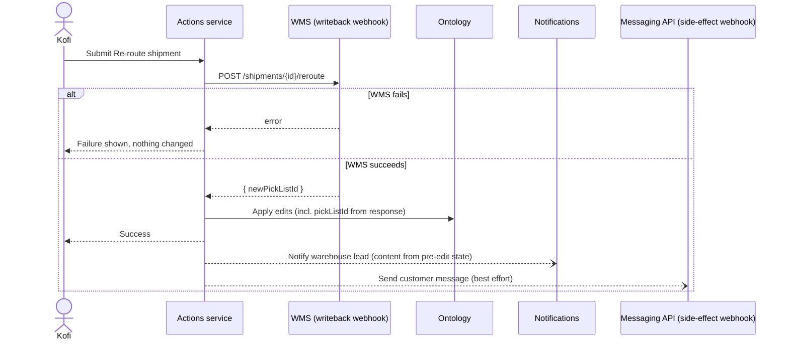

# 05 — Side effects

*Sources: [Side effects overview](https://www.palantir.com/docs/foundry/action-types/side-effects-overview/) · [Notifications](https://www.palantir.com/docs/foundry/action-types/notifications/) · [Webhooks](https://www.palantir.com/docs/foundry/action-types/webhooks/) · [Trigger schedule build](https://www.palantir.com/docs/foundry/action-types/trigger-schedule-build/) · [Scale and property limits](https://www.palantir.com/docs/foundry/action-types/scale-property-limits/) · [Set up a notification](https://www.palantir.com/docs/foundry/action-types/set-up-notification/) · [Set up a webhook](https://www.palantir.com/docs/foundry/action-types/set-up-webhook/) · checked October 2, 2026 · Ready for Review*

**[Docs]** Side effects "send data out of Foundry to integrate with existing organizational processes". There are two kinds: **notifications** to Foundry users, and **webhooks** to outside systems. The docs call the second pattern *decision orchestration*. A **schedule** rule (start a build) behaves like a side effect too, so it is included here.

The detail that matters most is *when* each one runs relative to the Ontology edit.

## One action, followed through time

Kofi's *Re-route shipment* ([02](02-rules-and-parameters.md)) now has to do three things:

- tell the **WMS**, which is still the system that actually prints pick lists;
- notify the new warehouse's lead;
- send the customer a "your parcel is coming from a different warehouse" message through Kestrel's messaging service.

## Writeback webhook vs side-effect webhook

**[Docs]** A webhook is a Data Connection resource, and it has to exist there before an action can use it.

| | **Writeback** webhook | **Side-effect** webhook |
|---|---|---|
| Runs | **Before** any other rule | **After** the edits |
| If it fails | No edits; the user **sees the error** | Edits stand; failure **not shown** to the user |
| How many | **One** per action | Several, in **no particular order** |
| Output usable later | **Yes**: "Writeback response" in later rules | No |
| Docs' guidance | Use it when Foundry mustn't change before the external system | "best-effort notifications or write back to multiple external systems" |

**[Docs] It isn't a distributed transaction.** A writeback webhook guarantees that a failed external call leaves the Ontology unchanged. "It is still possible that the external request may succeed but Ontology changes could fail."

**[Explanation]** For the WMS, that means a re-route can land in the WMS and not in Foundry, for example if the edit hits the 10,000-object limit or a stale-object conflict ([07](07-consistency-reverts-and-logs.md)). Two consequences for Kestrel:

1. The WMS endpoint is **idempotent**, keyed on `shipmentId` plus a request ID, so retrying is safe.
2. The nightly WMS sync reconciles any drift.

Design for that gap. Don't assume it can't happen.

**Inputs.** **[Docs]** Each required webhook input is mapped to one of:

- an action parameter;
- a static value;
- a property of an object parameter;
- the output of a **function** that returns a type that "strongly matches" the webhook's inputs. A mismatch raises `ActionWebhookInputsDoNotHaveExpectedType`.

A function that returns a **list** of payloads calls a side-effect webhook once per payload, in no guaranteed order.

**Authentication.** **[Docs]** On REST sources that use an OAuth 2.0 outbound application, Foundry handles tokens for you.

**Setting one up.** **[Docs]** *Logic → Add new rule → Webhook*. A new webhook rule is a **side effect** by default (it runs after the edits); choose **Writeback** to run it before them. Each webhook input maps to an action parameter; new parameters are generated for unmatched inputs, so delete the unused ones afterwards. Creating the webhook itself may need an administrator who can connect to the source system.

## Notifications

**[Docs]** Notifications go to **Foundry users and groups**, never directly to email addresses. Recipients can be:

- **static** users or groups;
- **from a parameter** (a user or group ID);
- **from a property** of an object parameter, including lists of IDs;
- **from a function**, for anything else, such as "EMEA tasks go to these people".

Each user's preferences decide the channel: in-platform, email or both. Someone who turned action notifications off still finds them in Workspace notifications.

**[Docs]** Content comes from a **template** or a **function**:

- templates have a subject, a body and a link button, with `{{{param}}}` handlebars;
- an optional HTML email body can be added;
- a function is needed for per-recipient content, different email and in-app subjects, external URLs, or Search Arounds and aggregations while rendering.

The **gotchas**, all documented:

- **Content reflects the state *before* the edit.** "Moved from {{{previousWarehouse}}}" works. Reading the shipment's warehouse would show the *old* one. This is another reason for the hidden `previousWarehouseId` parameter in [02](02-rules-and-parameters.md#step-2--the-parameters).
- **Links to new objects use the primary key.** No RID exists yet at render time. This only works for objects made by a *Create object* rule, not by a function.
- **Limits:**
  - 500 recipients with a template, 50 with function content; above that, the action **fails**;
  - subject 250 characters;
  - body 1,000 characters, or 51,200 for HTML email;
  - dynamic content that runs over is truncated with `...`.
- **Permissions are checked per recipient.** Groups are expanded to users. Every recipient must be able to see the data in the content. There is a setting at the bottom of **Security & Submission Criteria** that decides what happens when someone can't:
  - **Require all users to have permissions** (the default): the action **fails**, with no edits and no notifications;
  - **Require any user to have permissions**: the action succeeds, and only the permitted users are notified.
- **Redaction.** With *Strict* or *Group Redaction* on for outbound email, recipients get a generic "View in Foundry" email instead. An action type can override this if the organisation allows it.

**[Docs] The pages disagree.** The *Permissions* page says that recipients without access are simply skipped, and that "edits may still succeed". That matches the *any user* setting, not the default. The disagreement is logged in [SOURCES](../SOURCES.md#open-research-questions) (RQ-21).

**[Explanation]** For Kestrel this is a real risk. Under the default, if the Kumasi warehouse lead can't see Accra data, then a re-route from Accra to Kumasi that names Accra details in the notification will **fail the whole action**. There are two ways out: keep notification content within what every recipient can see, or deliberately choose *any user*. Test with the recipient's access, not yours.

**Setting one up.** **[Docs]** The tutorial's steps: *Rules → Add new rule → Notification*; choose recipients (for example *Recipient(s) from property of object parameter*); write the content as a **template**, inserting parameters, *Recipient* and *Current User* with `/`; and add an **Object View** link button. The property must hold **Foundry user IDs**. "If this property contains something else such as string email addresses, no notifications will be sent." **[Recommendation]** Test with a hard-coded recipient first, as the docs suggest, then switch to the property. If a test email doesn't arrive, check *User Settings → Notifications*.

## Schedule rules

**[Docs]** A **Schedule** rule starts a build of a **project-scoped** schedule, passing parameters to parameterized transforms. The edits are applied **after the build begins**: they don't wait for it to finish.

**[Docs]** Two more details:

- The rule can write the **schedule run RID** into a string property. With resource-RID formatting, the property shows live build status: *Running*, *Ignored*, *Failed* or *Succeeded*.
- **Permissions move.** Users who pass the submission criteria can trigger the schedule "without any direct permissions on the schedule". Whoever manages the action type now controls who can build.

**[Explanation]** Kestrel uses this for *Recompute delivery risk for region*, Kofi's on-demand refresh. The action's submission criteria become the access control for an expensive build, so write them as carefully as a schedule permission.

## In test runs

**[Docs]** A test run ([03](03-submission-criteria.md#test-cases-run-before-go-live)) **skips** side-effect webhooks, notifications and schedule builds, and shows a preview of the notification. It **executes** writeback webhooks and the functions needed to compute the result, after you confirm. A test of *Re-route shipment* really calls the WMS, so point it at the WMS sandbox.

---
[Module index](README.md) · Previous: [04 — Function-backed actions](04-function-backed-actions.md) · Next: [06 — Action permissions](06-action-permissions.md)
