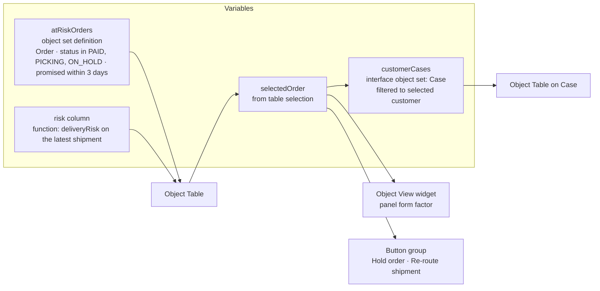

# 03 — Workshop and Slate on the Ontology

*Sources: [Workshop overview](https://www.palantir.com/docs/foundry/workshop/overview/) · [Variables](https://www.palantir.com/docs/foundry/workshop/concepts-variables/) · [Interfaces in Workshop](https://www.palantir.com/docs/foundry/workshop/ontology-interfaces/) · [Workshop permissions](https://www.palantir.com/docs/foundry/workshop/concepts-permissions/) · [Functions in Workshop](https://www.palantir.com/docs/foundry/workshop/functions-overview/) · [Derived properties in Workshop](https://www.palantir.com/docs/foundry/workshop/derived-properties/) · [Unsupported property types](https://www.palantir.com/docs/foundry/workshop/unsupported-object-properties/) · [Slate overview](https://www.palantir.com/docs/foundry/slate/overview/) · [Slate: read and write data](https://www.palantir.com/docs/foundry/slate/read-write-overview/) · [Slate object sets](https://www.palantir.com/docs/foundry/slate/concepts-object-sets/) · [OSDK in Slate](https://www.palantir.com/docs/foundry/slate/concepts-osdk/) · [Slate writeback](https://www.palantir.com/docs/foundry/slate/applications-writeback/) · checked October 2, 2026 · Ready for Review*

This note isn't a Workshop tutorial; the course notes listed in this module's README cover the clicks. It traces **which Ontology features an app builder touches**, using one app, the **Delivery Desk queue**, built first in Workshop and then sketched in Slate for comparison.

**The app.** Ama's team sees open orders at risk of missing their promised date. Each row has the customer's tier, the delivery-risk score and the latest shipment status. Selecting a row shows the order's panel Object View. Buttons run *Hold order* and *Re-route shipment*. A side tab shows **all open cases**, of every kind, for that customer.

## Built in Workshop

**[Docs]** Workshop's principle is that "all data in a Workshop Application is read from the Object Data Layer". Writeback goes through **actions**, logic through **functions**, and runtime calculations through **derived properties**.

The Ontology feature behind each piece:

| Piece | Ontology feature | Docs detail that matters |
|---|---|---|
| `atRiskOrders` | **Object set variable**, *object set definition* | Built from an object type, an **interface** or another set, then filtered, or pivoted through a Search Around. It can also pivot "through shared property types or object-backed link types". |
| Tier column | **Workshop derived property**, linked property from a 1:1 link | Defined **per module and per object type**. It is a *third* kind of derived property, separate from the two in [05-05](../05-properties/05-derived-properties.md). |
| Risk score column | **Function-backed column** ([09-03](../09-functions/03-function-lifecycle.md)) | Users can sort it for tables of up to **10,000** objects |
| Panel | **Object View widget** using the *panel* form factor ([02](02-object-views-and-object-explorer.md)) | |
| Buttons | **Action types** with defaults from variables ([08-08](../08-actions/08-using-actions-in-the-platform.md#workshop)) | Local defaults override the action's own |
| Cases tab | **Interface-based object set** on `Case` ([07](../07-interfaces/01-interfaces.md)) | Supported widgets include Object List, Object Table, Filter List, Metric Card, Object Dropdown and Property List |

**Workshop derived properties.** **[Docs]** There are two kinds:

- **Linked property / aggregation**: from a 1:1 link, or an aggregation across a link, optionally with **statically defined filters** on the linked type;
- **Column math**: arithmetic across properties of one type.

The limits:

- only **one link traversal**;
- sorting is capped at **200 rows**;
- support covers a subset of widgets, including Object Table, Pivot Table and Waterfall;
- saved states can't reference them;
- they're computed live, so they cost load time.

**[Explanation]** Workshop's static filters partly answer [RQ-19](../SOURCES.md#open-research-questions). *Count of late shipments* (a fixed filter, `isLate = true`) can be a Workshop derived property. *Late shipments **this week*** can't be: "this week" is a relative date, and the docs only allow **statically defined** filters. That still needs a function or a pipeline aggregate. Whether the Ontology Manager version supports filters at all is still open.

**Interface casting.** **[Docs]** A set can be **cast** to an interface, or from an interface to one implementing type. An object set definition allows **one** type-changing step: one cast *or* one link traversal. A widget that doesn't support interfaces shows *Interfaces not yet supported* and falls back to the implementing types' properties.

**[Explanation]** For the Cases tab: start from `Case`, follow its `customer` link to the selected customer, and stop. Don't plan a cast followed by a traversal in the same definition.

**[Docs] A conflict to check first.** The Workshop page says you can "traverse interface links" in an interface-based object set. The interfaces overview says Object Set Service support for interface link types is **"in development"** ([07-01](../07-interfaces/01-interfaces.md#the-support-table)). Logged as [RQ-25](../SOURCES.md#open-research-questions). **[Explanation]** Test the Cases tab early. If the interface link traversal isn't available, the fallback is a filter on a shared interface property. That would mean adding a required `customerId` to `Case` ([07-02](../07-interfaces/02-implementing-and-extending-interfaces.md)).

**Things Workshop won't render well.** **[Docs]** **Geoshapes** and **vectors** are "generally unsupported". Object List, Object Table and Property List can load them on demand, and the **Map** widget loads geoshapes automatically. Variables load **lazily**, only when a visible widget needs them.

**Permissions.** **[Docs]** Opening a module needs a role on the **module**, Viewer by default. Data, actions and functions are permissioned **separately**. Row and column controls "filter what a user can see", but "do not extend to widget exports, Action writes, or downstream functions". The **Check access** panel shows what's missing for a given user.

**[Explanation]** Kofi can open the same module as Ama. Orders aren't regional, but the **shipments** panel shows only his region's shipments, because of Shipment's regional policy ([12-03](../12-security-and-governance/03-object-and-property-security.md#three-kestrel-requirements) R1). If he exports that table, the region filter doesn't travel with the file.

## The same queue sketched in Slate

**[Docs]** In Slate:

- reading uses **object sets** (from the Platform tab), **object context**, **Foundry Functions** or the **OSDK** in the Functions editor;
- writing to the Ontology uses the **Action widget**, which is the recommended route, or OSDK actions or API gateway queries;
- **Queries** reach external systems and datasets through endpoints configured by an admin. They are flexible, but data "loses this context" once it is JSON in Slate.

**[Docs]** The Ontology-specific details:

- Object sets are built with a filter UI that accepts **handlebars** (`{{…}}`) parameters, or resolved from an object set **RID**.
- Aggregations are simple: count, average, sum, max, min, cardinality. Multi-dimensional aggregation needs a **TSv1 function**.
- The **OSDK in Slate** is generated per application from chosen object, link and action types and functions. It is **OSDK version 1**, in JavaScript. Functions **without an API name, or that edit the Ontology, can't be selected**. Links are traversed with `pivotTo`. Switching ontology means deleting and reconfiguring the OSDK.
- Slate can also build **public applications** that people without Foundry accounts can use to submit data, with validation.

| Workshop piece | Slate equivalent | What changes |
|---|---|---|
| Object set variable | Object set panel, or an OSDK query | You write the pagination (`getNextPage` / `getPreviousPage`) |
| Derived property column | A function, or a join in Slate JS | No built-in equivalent |
| Object View widget | Embed, or build it yourself | More work, more control |
| Button group → action | **Action widget**, often inside a Dialog, events for validation and success | The same governed action ([08](../08-actions/README.md)) |
| Interface object set | OSDK on interfaces | **[Explanation]** Untested: the Slate OSDK page doesn't mention interfaces |

## Choosing between them

**[Explanation]** Slate earns its extra cost in three cases:

- a **custom look** Workshop can't produce;
- **public, unauthenticated** data submission;
- data from **outside the Ontology** that must sit next to objects in one UI.

The Delivery Desk queue has none of these, so Kestrel builds it in Workshop. Either way, writes go through the same **action types**, so criteria, logs and side effects are identical. That is the reason Module 08 insisted on actions.

---
[Module index](README.md) · Previous: [02 — Object Views and Object Explorer](02-object-views-and-object-explorer.md) · Next: [04 — OSDK and APIs](04-osdk-and-apis.md)
