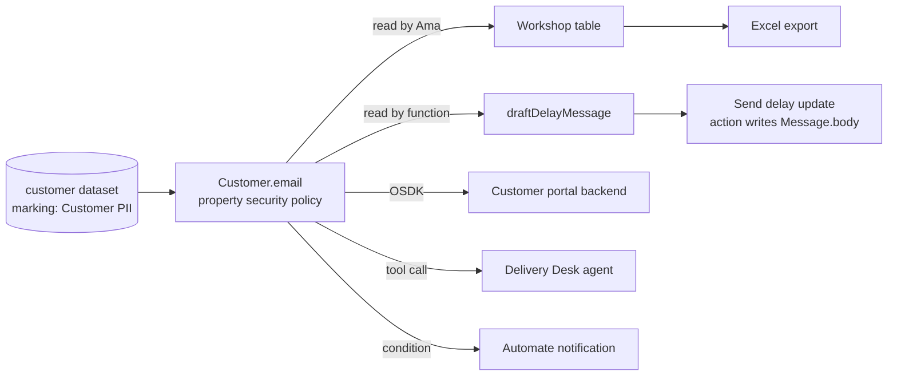

# 04 — Security across actions, functions and APIs

*Sources: [Access control propagation](https://www.palantir.com/docs/foundry/security/access-control-propagation/) · [Permission checks for actions](https://www.palantir.com/docs/foundry/object-edits/permission-checks/) · [Action permissions](https://www.palantir.com/docs/foundry/action-types/permissions/) · [Function permissions](https://www.palantir.com/docs/foundry/functions/permissions/) · [Workshop permissions](https://www.palantir.com/docs/foundry/workshop/concepts-permissions/) · [OSDK overview](https://www.palantir.com/docs/foundry/ontology-sdk/overview/) · [Automate permissions](https://www.palantir.com/docs/foundry/automate/permissions/) · checked October 2, 2026 · Ready for Review*

## The one idea

**[Docs]** "Mandatory controls travel with data through derivation and downstream consumption. Row and column access controls (including restricted views, object security policies, and property security policies) filter what a user can read. These controls do not extend beyond that read."

After a filtered read, "the rows that the user did receive are ordinary data". The docs separate two guarantees:

- **access**: you can't read what you're not allowed to read. This always holds.
- **propagation**: the protection follows the data afterwards. Only **mandatory** controls give this.

Every page in modules 08–10 repeated a short version of this ("read-time enforcement only"). This note follows **one value** through the stack to show what it means in practice.

## Following one value: a customer's email address

`Customer.email` is protected by a **property security policy** carrying `Customer PII` ([03](03-object-and-property-security.md) R2). The backing dataset in `Storefront [Datasource]` carries the `Customer PII` **marking** on `/raw` ([02-04](../02-foundry-data-foundations/04-projects-spaces-and-markings.md#kestrels-layout)).

| Hop | Who reads it | Is the read checked? | Does the protection follow? | Doc basis | Kestrel response |
|---|---|---|---|---|---|
| Workshop table | Ama | Yes: Kofi sees null | — | Widgets "can never display data the user is not authorized to read" | — |
| **Export** to Excel | Ama | Yes, at read | **No.** Nothing in the file carries the policy | Exports "produce artifacts outside Foundry" | **[Explanation]** Limit exports from PII tables where the widget allows it (not covered here); train the team |
| **Function** `draftDelayMessage` | The **calling user** | Yes, as that user | **No.** "The returned value is not policy-bound" | Functions load objects with the end user's permissions; output isn't re-protected ([09-03](../09-functions/03-function-lifecycle.md#who-can-run-it)) | The draft never includes the email |
| **Action** writes `Message.body` | The submitter | Yes, on the objects read | **No.** "The write target's access controls apply" | Action edits ([08-06 Q3](../08-actions/06-action-permissions.md#q3--does-a-restricted-view-protect-the-data-the-action-writes)) | `Message` carries its own PII policy; or use read and write authorizations, which work through **markings** (beta) |
| **OSDK** portal backend | A service user | Yes, as the service user | **No.** "No policy travels with the payload" | [10-04 Q3](../10-applications/04-osdk-and-apis.md#q3--which-security-still-applies) | The backend filters per customer and never logs emails |
| **Agent** tool call | The agent's user | Yes | **No.** Once in the model's context, it can be summarized and output "with no remaining association to the source policy" | AIP Logic tool calls | Agent tools exclude `email` ([16-03](../16-ai-and-agents/03-ontology-tools-for-agents.md)) |
| **Automate** notification | Each **recipient** | Yes, per recipient | — | Notifications use recipients' permissions ([10-06](../10-applications/06-automate-and-ontology-events.md#why-each-choice)) | — |
| **Pipeline** that reads the raw dataset | Priya's transform | Yes, by the **marking** | **Yes.** Derived datasets inherit the marking | Mandatory controls propagate | That's why the marking stays on `/raw` |

**[Docs]** The docs' guidance: if protection must cover derived artifacts, writeback, exports or model outputs, use a **mandatory** control. If you only need to filter reads, use a policy. If you need both, **use both**, for example "a restricted view backed by a marked dataset".

"Can I remove a marking if a granular policy is already in place?" The docs answer no: that "trades a control that travels through derivation for one that does not".

## Whose permissions? A cheat sheet

| Caller | Runs as | Doc source |
|---|---|---|
| A user in Workshop, Object Explorer or Slate | That user | Workshop permissions |
| A **function** called from an app | The **end user**. Users also need **Viewer on the repository** | [09-03](../09-functions/03-function-lifecycle.md#who-can-run-it) |
| A **function-backed action** | The submitter. **Doesn't** need read access to the function, only to the action | Function permissions |
| An **action** | The submitter: must see the edited types and datasources and pass the criteria | [08-06](../08-actions/06-action-permissions.md) |
| An **OSDK** app | The token's user or service user, **∩ the app's restrictions ∩ the requested scope** | [10-04 Q2](../10-applications/04-osdk-and-apis.md#q2--who-is-the-user-and-what-token-do-they-get) |
| An **automation** | The **owner**, or the owning application's service user. Notifications are checked per recipient | [10-06](../10-applications/06-automate-and-ontology-events.md#why-each-choice) |
| A **schedule** triggered by an action | Whoever passes the action's criteria. Control moves to the action's managers | [08-05](../08-actions/05-side-effects.md#schedule-rules) |

## Actions on multi-datasource types

Kestrel's model doesn't have one yet, but it's easy to get wrong. **[Docs]** Permission checks differ when properties come from several datasources:

| Action | The user must… | Not checked |
|---|---|---|
| **Create** | See the datasources whose properties they set. To *re-create* a deleted object, see its row in all of them | The other datasources; their properties start as null |
| **Modify** | See the existing values of the properties they edit | Other datasources. Those properties appear as **null during validation** |
| **Delete** | See the **entire object** | — |
| **Create or delete link** | Load each object in *any* of its datasources | Individual properties |

For single-datasource types: see the object and pass the criteria. **Creating** also needs **view on the input datasource**.

**[Explanation]** The "null during validation" row is the trap. A submission criterion that reads a property the user can't see evaluates against **null**. A criterion written as "riskBand is not HIGH" would therefore *pass* for a user who can't see `riskBand`. Write criteria that fail closed: "riskBand **is** LOW".

## Checking it

**[Docs]** The **Check access** panel covers a user's access to a Workshop or Slate app, including its dependent object types, link types, actions, functions and granular controls. Object security policies have **Test policies** ([03](03-object-and-property-security.md)). Actions have **test runs** that use *your* permissions ([08-03](../08-actions/03-submission-criteria.md#test-cases-run-before-go-live)).

**[Explanation]** Kestrel adds one more: a short list of "propagation questions" for every design review. *Where does this value go after it's read, and what protects it there?*

<!-- security-go-deeper -->
**Go deeper in the Security area:** [03 — Discretionary controls, propagation and diagnosis](../../Security/03-discretionary-controls-propagation-and-diagnosis/README.md) · [06 — Approvals and Checkpoints](../../Security/06-approvals-and-checkpoints/README.md)

---
[Module index](README.md) · Previous: [03 — Object and property security](03-object-and-property-security.md) · Next: [05 — Shared ontologies and cross-organization work](05-shared-ontologies-and-cross-org.md)
