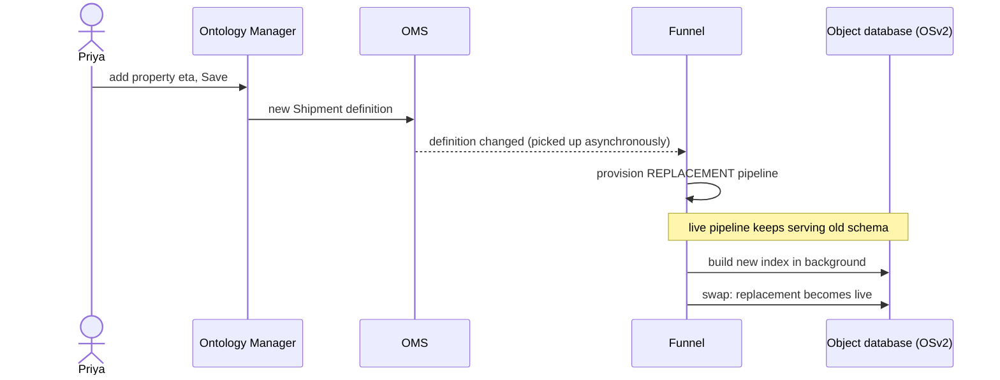
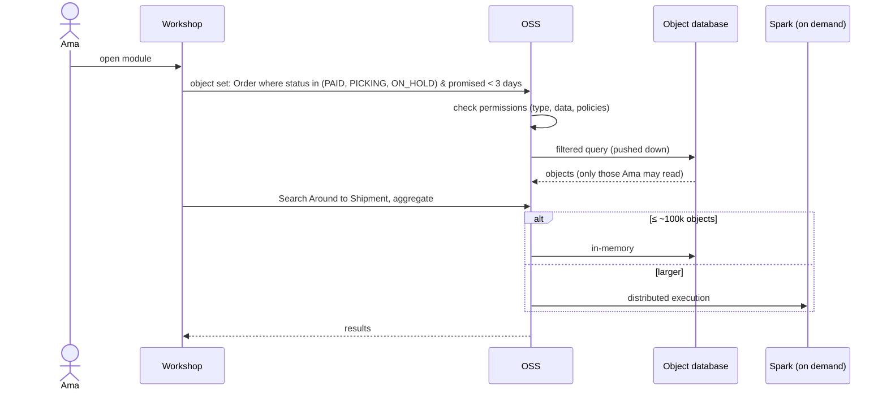
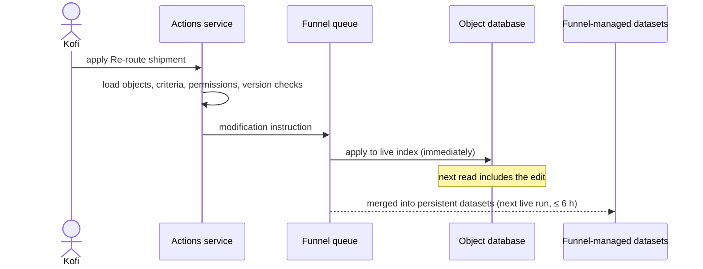

# 01 — Backend services

*Sources: [Ontology architecture overview](https://www.palantir.com/docs/foundry/object-backend/overview/) · [Funnel batch pipelines](https://www.palantir.com/docs/foundry/object-indexing/funnel-batch-pipelines/) · [How user edits are applied](https://www.palantir.com/docs/foundry/object-edits/how-edits-applied/) · [OSS limitations](https://www.palantir.com/docs/foundry/ontologies/oss-limitations/) · checked October 2, 2026 · Ready for Review*

[00-03](../00-orientation/03-architecture-at-a-glance.md) gave the overview. This note traces **three requests** through the backend, one for each of the three jobs the docs say the backend does:

1. datasource management and schema definitions;
2. querying, searching and aggregating, "with support for specific filtering and permissioning";
3. orchestrating writes, both indexing and user edits.

## The cast

**[Docs]**

| Service | Owns | One-line job |
|---|---|---|
| **Ontology Metadata Service (OMS)** | Definitions of object types, link types, action types "and more" | What exists, and its shape |
| **Object databases** (OSv2; OSv1 legacy) | Indexed object data | Storing, indexing, querying, and orchestrating user edits |
| **Object Set Service (OSS)** | Reads | "Searching, filtering, aggregating, and loading" objects for every app |
| **Actions** | Governed writes | Applying user edits, with permissions and conditions; action logs |
| **Object Data Funnel** | Write orchestration (OSv2) | Reads datasources and edits, and indexes them into object databases |
| **Functions on Objects** | Logic | Code that runs against the above ([09](../09-functions/README.md)) |

## Trace 1 — Priya adds a property to `Shipment`

**[Docs]** A schema change ("adding a new property type… changing an existing property type, or replacing the input datasource") needs a **replacement pipeline**. It runs alongside the live one "without impacting the live data being served". After its first successful run, it replaces the live pipeline. Funnel records definition changes **asynchronously**, so there can be a delay of seconds before anything happens. Funnel also sometimes provisions replacement pipelines "for performance reasons".

**[Explanation]** For Priya, that means a saved schema change isn't **live** until the replacement pipeline finishes, and on a big type that's a full re-index. Plan schema changes for a quiet window ([04-04](../04-object-types/04-creating-and-editing-object-types.md)), and don't chain several back to back.

## Trace 2 — Ama opens her late-orders table

**[Docs]** OSS is "responsible for serving reads". It chooses between **pushdown**, **in-memory** and **Spark** execution. The key thresholds are in [03-03](../03-ontology-fundamentals/03-objects-and-object-sets.md#how-a-query-runs) and [05](05-limits-usage-and-compute.md).

**[Docs]** Object sets come in **static** (a list of primary keys) and **dynamic** (filters) forms, and are either **temporary** or **permanent**. Temporary sets pass a set between apps. Only their creator can use them, and they **expire within 24 hours**. Permanent sets are stored for reuse.

**[Explanation]** If someone shares a link to a *temporary* object set and a colleague says "it doesn't open", that's why. Save it as a permanent set, or as an exploration or list ([10-02](../10-applications/02-object-views-and-object-explorer.md#stop-2--the-question-that-isnt-about-one-order)).

## Trace 3 — Kofi re-routes a shipment

**[Docs]** These steps come from *How user edits are applied* ([08-01](../08-actions/01-action-types.md#where-the-edit-goes)):

- The Actions service sends the instruction to a **Funnel queue with offset tracking**.
- OSv2 applies the offsets to the live index. A read after the edit "is guaranteed to contain the user edits".
- The **live pipeline** runs whenever the datasource updates. If there were edits, it runs **every six hours** anyway, so the edits are stored durably in Funnel's merged datasets.

**[Docs] Version checks.** In OSv2 the Actions service checks object versions only for objects **used to generate edits**, and only against edited objects. It loads objects at one version throughout an `/apply`. That gives fewer stale-object conflicts than OSv1 (which checked everything), but weaker guarantees for objects that are only read. The isolation levels in [08-07](../08-actions/07-consistency-reverts-and-logs.md) now describe this more precisely.

## Why the separation matters

**[Docs]** OSv2 "separates dimensions of concern" that OSv1 combined. Indexing and querying are separate subsystems, so each can **scale horizontally** on its own.

**[Explanation]** For a builder, the practical consequence is that **"saved", "indexed" and "visible" are three different moments**:

| Moment | Service | You can check it in |
|---|---|---|
| Definition saved | OMS | Ontology Manager save history |
| Data indexed | Funnel and object databases | The pipeline graph in the Datasources tab: a green tick on the OSv2 node ([02](02-indexing-and-funnel.md)) |
| Visible to a user | OSS + security | Check access, Test policies ([12](../12-security-and-governance/README.md)) |

Most "my objects aren't there" tickets turn out to be confusion between these three moments.

---
[Module index](README.md) · Next: [02 — Indexing and the Funnel](02-indexing-and-funnel.md)
