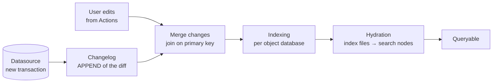

# 02 — Indexing and the Funnel

*Sources: [Indexing overview](https://www.palantir.com/docs/foundry/object-indexing/overview/) · [Funnel batch pipelines](https://www.palantir.com/docs/foundry/object-indexing/funnel-batch-pipelines/) · [Funnel streaming pipelines](https://www.palantir.com/docs/foundry/object-indexing/funnel-streaming-pipelines/) · [Direct datasources](https://www.palantir.com/docs/foundry/object-indexing/direct-datasources/) (beta) · [Data restrictions](https://www.palantir.com/docs/foundry/object-indexing/data-restrictions/) · [Indexing FAQ](https://www.palantir.com/docs/foundry/object-indexing/faq/) · [Change data capture](https://www.palantir.com/docs/foundry/data-integration/change-data-capture/) · checked October 2, 2026 · Ready for Review*

**[Docs]** Indexing is "making tabular or other forms of data in Foundry datasources available for faster data retrieval operations through specialized databases". In OSv2 it is run by **Funnel**, through **batch** or **streaming** pipelines. **Direct datasources** offer a third path for low-latency writes.

The note has two parts: the **anatomy** of each path, then a **troubleshooting table** for "my objects are wrong or missing".

## Part 1 — Anatomy

### Batch pipeline

**[Docs]**

- **Changelog:** Funnel computes the diff for each new datasource transaction and APPENDs it to internal changelog datasets.
- **Merge changes:** changelogs and recent **user edits** are joined on the primary key.
- **Indexing:** one job per object database turns the merged rows into index files.
- **Hydration:** the index files are downloaded onto the search nodes' disks. Its progress shows in Ontology Manager.

All the intermediate datasets are **Funnel-owned and not accessible**.

**[Docs] Live and replacement pipelines.**

- **Live** pipelines run when datasources update, and **every six hours** if there were edits.
- **Replacement** pipelines are built in the background after schema changes, then swapped in ([01](01-backend-services.md#trace-1--priya-adds-a-property-to-shipment)).

**[Docs] Incremental by default.** Only changed rows are re-indexed. A **full reindex** happens when:

- more than **80%** of rows change in one transaction;
- a schema change needs a replacement pipeline;
- a user triggers one in Ontology Manager.

**[Docs] Incremental datasets ("most recent transaction wins"):**

- Across transactions, the row in the **latest transaction** wins.
- **Within one transaction**, a duplicate primary key makes indexing **fail**.
- A column called `is_deleted` **isn't** a deletion column by default. A deletion column is honoured only if it is declared in **legacy OSv1 changelog metadata**.

The docs show a window transform that keeps one row per key, which is the same pattern as [02-02](../02-foundry-data-foundations/02-pipelines-that-feed-the-ontology.md).

**[Docs] Views** (dataset views) have caveats:

- a deletion column forces a **full reindex every time**;
- deduplication values that don't increase with transactions can give inconsistent results;
- retention that deletes from the latest view can surprise you.

### Streaming pipeline

**[Docs]** It indexes in "seconds or minutes". The rules:

- **Order of arrival wins.** "Every stream is treated like a changelog stream". Out-of-order events produce wrong data. Partition by primary key and order by event time *upstream*. The CDC page says the same: the Ontology **ignores the ordering columns** of changelog metadata ([02-03](../02-foundry-data-foundations/03-virtual-tables-and-streams.md#change-data-capture-cdc)).
- **Whole records.** Each record replaces every property of the object. Partial updates aren't supported.
- **Limits:**
  - no user edits;
  - no MDOs;
  - **250 properties**;
  - **1 MB** records;
  - throughput about **2 MB/s per object type**, which support can raise;
  - no pipeline monitors or metrics yet.
- **Latency.** Dominated by Flink checkpointing, once a second by default, for **exactly-once** delivery. Switching to **at-least-once** cuts latency, but downstream automations may fire twice ([10-06](../10-applications/06-automate-and-ontology-events.md)).
- **Other behaviour:**
  - Outside **Workshop**, apps don't live-refresh.
  - Streaming pipelines **can't be cancelled**. They are always running, and always costing. The FAQ suggests prototyping on batch.
  - **Retention windows** are best-effort. Cleanup happens through pipeline replacement, every two weeks by default.
  - **Materializations aren't supported.**
  - You must **explicitly** select the source as a stream, or it falls back to batch indexing.
  - Invalid records are **dropped**, not failed.

### Direct datasources (beta)

**[Docs]** Low-latency writes straight into the Ontology. Today they are written only by **Pipeline Builder**. They support **user edits on stream-like data**, with an optional **source timestamp** that drops out-of-order writes. **Replaying wipes the object view** ([02-03](../02-foundry-data-foundations/03-virtual-tables-and-streams.md)). Liveness (data, schema and latest edit) and logs of dropped primary keys are in the Datasources tab.

### Which path?

| Need | Path | Why |
|---|---|---|
| Hourly or daily data, with user edits | **Batch** | The default, incremental and cheap |
| Seconds-fresh data, read-only | **Stream** | Kestrel's carrier tracking events |
| Seconds-fresh data **and** user edits | **Direct datasource** (beta), or a stream plus a separate editable type | The docs offer both workarounds |
| A huge historical backfill into a stream type | Stream with a Spark-parallel initial index | Internal stream creation is the bottleneck |

## Part 2 — "My objects are wrong or missing"

| Symptom | Likely cause | Doc basis | Fix |
|---|---|---|---|
| **The indexing job fails** after a pipeline change | A **data restriction**: a duplicate primary key in one transaction, an empty string, `NaN` or ±infinity, nested arrays, null array elements, a string over **12 MB**, an array over **100,000** elements, a bad geopoint format (`lat, long`, no parentheses) | Data restrictions: batch jobs **fail**, stream records are **dropped** | Clean upstream; use media references for large text; use links for huge arrays |
| A **type change** fails ("could not be cast") | Existing values incompatible with the new base type | Data restrictions | Fix the data, or migrate the edits ([04-04](../04-object-types/04-creating-and-editing-object-types.md)) |
| An object **reappears with old values** after a source delete | `is_deleted` isn't a deletion column for batch | Batch pipelines | Filter deleted rows in the pipeline |
| **Stream** objects show stale or wrong values | Out-of-order events | Streaming; CDC page | Reorder upstream |
| **Stream** objects missing | Records dropped by validation; source not marked as a stream | Streaming FAQ | Check the source config; check dropped records |
| **Direct datasource** objects all gone | A replay reset the view | Direct datasources | Wait for repopulation; avoid replays in business hours |
| New data **not visible yet** | Hydration still running; replacement pipeline still running | Batch pipelines | Look for the green tick on the OSv2 node in the pipeline graph |
| A job **failed** and then fixed itself | A transient error, retried after about five minutes. Terminal failures retry only on **new data** | FAQ | Push new data, or fix the cause |
| Indexing fails with **disk** errors | Search-node storage full | FAQ | Contact Palantir; reduce volume ([05](05-limits-usage-and-compute.md)) |
| Data is correct but the **user can't see it** | Permissions, not indexing | — | [12-01's five questions](../12-security-and-governance/01-two-layer-permission-model.md#when-an-object-doesnt-show-up) |

**[Docs] Monitoring.** *Monitor the health of this object type* in Ontology Manager opens **monitoring views** in Data Health. There you can add rules for live and replacement pipeline jobs, plus **Sync Propagation Delay** rules for freshness. Users with View on the datasource can open failed jobs from the **Live pipeline** dashboard, or filter Builds by object type.

**[Recommendation]** Kestrel puts a Sync Propagation Delay rule on `Shipment`, because Ama's queue depends on it being under an hour old. It puts job-failure rules on every type that has user edits.

---
[Module index](README.md) · Previous: [01 — Backend services](01-backend-services.md) · Next: [03 — Edits and materializations](03-edits-and-materializations.md)
