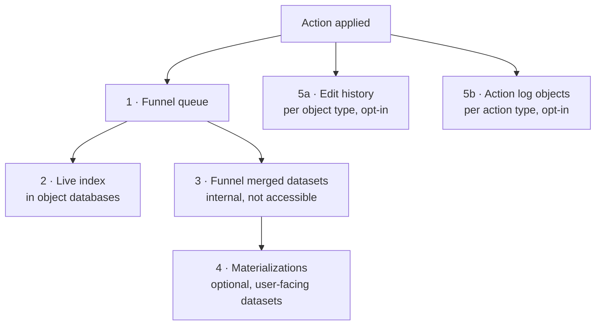

# 03 — Edits and materializations

*Sources: [Object edits overview](https://www.palantir.com/docs/foundry/object-edits/overview/) · [How user edits are applied](https://www.palantir.com/docs/foundry/object-edits/how-edits-applied/) · [Enable user edit history](https://www.palantir.com/docs/foundry/object-edits/user-edit-history/) · [Materializations](https://www.palantir.com/docs/foundry/object-edits/materializations/) · [Manage schema changes](https://www.palantir.com/docs/foundry/object-edits/schema-migrations/) · [Action log](https://www.palantir.com/docs/foundry/action-types/action-log/) · [Object security policies](https://www.palantir.com/docs/foundry/object-permissioning/object-security-policies/) · checked October 2, 2026 · Ready for Review*

[08-01](../08-actions/01-action-types.md#where-the-edit-goes) explained edits from the user's side: what happens when you press the button. This note is the **storage map**. It covers where an edit lives afterwards, who can see each copy, and how long it lasts.

## Five places an edit can be

| # | Store | Created by | Who can read it | Lifetime | Doc notes |
|---|---|---|---|---|---|
| 1 | **Funnel queue** | Every action | Internal | Until merged | Offset tracking supports simultaneous edits |
| 2 | **Live index** | Every action, immediately | Users who pass object security | As long as the object | Indexed data is "ephemeral". The durable copy is store 3 |
| 3 | **Merged datasets** | Funnel live pipeline: on source update, or every **6 h** if there were edits | **No one** (Funnel-owned) | Durable | The persistence backstop |
| 4 | **Materialization** | Configured in the *Materializations* tab | Dataset permissions. With object security policies, the **most restrictive** markings ([12-03](../12-security-and-governance/03-object-and-property-security.md#rules-that-bite)) | **Latest snapshot only**; retention not customisable | Columns use property **API names**; `__`-prefixed columns are internal; can be a dataset or a restricted view |
| 5a | **Edit history** | *Track user edit history* toggle | Anyone who can see the **current** object | From when it was enabled; **deleted if disabled** | Every edit, however it was made |
| 5b | **Action log** | *Create action log objects* on an action type | The log type's permissions | Like any object; no backfill | The **decision**: parameters and context ([08-07](../08-actions/07-consistency-reverts-and-logs.md#incident-4--who-changed-this-and-why)) |

## Materializations, more closely

**[Docs]** There are two use cases:

- downstream pipelines that need the latest state, **edits included**;
- bulk downloads.

For downloads, the docs recommend materializing and then using normal dataset export routes.

**[Docs] Build modes:**

- **Automatic propagation**: edits reach the materialization "with a latency of a few minutes". Can cost more.
- **Periodic**: rebuilt when the inputs change, or every 6 hours.

Materializations "update automatically and cannot be built manually from Dataset Preview". You can create **several**, for example a subset of properties each.

**[Docs] Restricted views as inputs:**

- With one restricted-view input, you can materialize **as a restricted view**.
- With several inputs, you can only materialize to a **dataset**, because different policies can't be combined.
- Materializing is "the only place in the platform where users can convert a restricted view to a dataset". The result doesn't carry restricted-view policies, so creating one needs elevated permissions.

**[Docs] Not available for:** stream-backed types. They have no user edits, so the stream archive already *is* the data.

**[Explanation]** For Kestrel:

- Lena's finance warehouse sync reads `Refund` **with approvals**, which are user edits. So it reads a **materialization**, not the Refund backing dataset.
- **Analyze using SQL** needs a materialization for any type with edits ([10-02](../10-applications/02-object-views-and-object-explorer.md#stop-4--priya-checks-the-numbers-in-sql-beta)).
- Retention is "latest snapshot only", so the month-end refund snapshot is taken by a downstream transform that Lena's team owns.

## Edit history, more closely

**[Docs]**

- Initialization takes a few minutes, during which **actions can't run** on those objects.
- Only edits made **after** enabling are tracked.
- Visibility follows the **current** object. "If an object is deleted and recreated, users can still see the history that occurred prior to the deletion."
- Display it with the **Edit History** widget in Workshop or Workshop-backed Object Views.
- **Disabling** it "permanently deletes all existing edit histories". You get a warning first.

**[Explanation]** The privacy consequence of the third point is easy to miss. If a `Customer` is deleted for data-protection reasons and later recreated with the **same key**, the old history comes back with it. Either use a new key for re-created customers, or don't enable history on PII-heavy types.

**[Docs]** Machinery's log setup can build on edit history. It isn't supported for types with **several datasources or row-level permissions** ([10-05](../10-applications/05-specialized-apps.md)).

## When the schema changes under existing edits

**[Docs]** Edits are tied to primary keys and property IDs. A **breaking** schema change needs a **schema migration** for existing edits: drop, move or cast them. That is covered in [04-04 Part B](../04-object-types/04-creating-and-editing-object-types.md#part-b--change-it-safely). The last-resort migration is **drop all edits** (the *Delete edits* button), which resets the type to its source state.

**[Docs] Conflicts between edits and source updates** are settled by the per-datasource strategy, *apply user edits* or *apply most recent value* ([08-01](../08-actions/01-action-types.md#when-the-source-and-an-edit-disagree)).

## Mapping from OSv1 terms

| OSv1 (Phonograph) | OSv2 | Difference |
|---|---|---|
| **Writeback dataset**, **required** for edits | **Materialization**, **optional** | Edits are enabled by a toggle instead ([04](04-object-storage-v1-vs-v2.md)) |
| Writeback schema copied from the source | Materialization schema uses **API names** | Contact Palantir to keep source names during migration |
| Writeback datasets had customisable retention, so historical snapshots were possible | Latest snapshot only | Keep history downstream |
| Remove the writeback config to wipe edits | **Drop all edits** schema migration | — |
| Couldn't materialize restricted-view types as restricted views | Can | — |

---
[Module index](README.md) · Previous: [02 — Indexing and the Funnel](02-indexing-and-funnel.md) · Next: [04 — Object Storage v1 vs v2](04-object-storage-v1-vs-v2.md)
