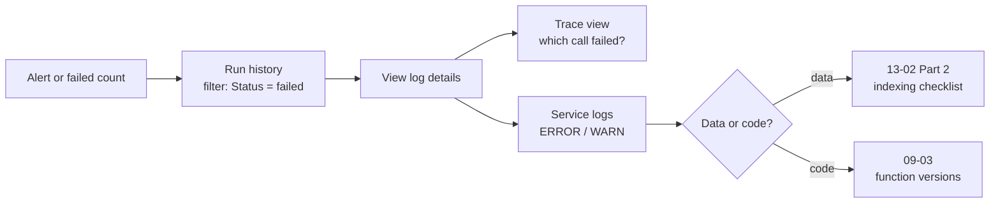

# 06 — Monitoring and cleanup

*Sources: [Ontology metrics](https://www.palantir.com/docs/foundry/ontology-manager/view-usage/) · [Ontology cleanup](https://www.palantir.com/docs/foundry/ontology-manager/cleanup/) · [Observability overview](https://www.palantir.com/docs/foundry/observability/overview/) · [Run history](https://www.palantir.com/docs/foundry/aip-observability/run-history/) · [Metrics](https://www.palantir.com/docs/foundry/aip-observability/metrics/) · [Service logs and debugging](https://www.palantir.com/docs/foundry/aip-observability/service-logs-and-debugging/) · [Action metrics](https://www.palantir.com/docs/foundry/action-types/action-metrics/) · checked October 3, 2026 · Ready for Review*

An ontology that ships and is never looked at again decays. Indexes go stale, nobody notices a failing action, and test types pile up until search is full of `[test] Order v2`. This note is Kestrel's **operations calendar**: what the ontology team looks at, how often, and with which tool. A reference card of the instruments comes after the calendar.

## The calendar

**Revised October 23, 2026.** The [Observability area](../../Observability/README.md) read every page behind this calendar and built the monitoring it assumed: two Data Health monitoring views with rules, health checks, alert routing and SOPs ([Observability 04-01](../../Observability/04-kestrel-case/01-the-delivery-desk-monitored.md)), and a triage design with log access settled ([04-02](../../Observability/04-kestrel-case/02-triage-at-kestrel-from-alert-to-fix.md)). What changes here: the daily row opens the two views' *Troubleshoot alerts* tabs instead of hoping for alerts; the separate automation line is no longer needed, because the *Monitoring status* colour mode shows automations and the Kestrel Pay view alerts on them (the *Failure rate* mode still can't); the triage flowchart below is kept as the short form, with the three worked paths in 04-02; the weekly P95 look moves onto the *Delivery Desk health* page. The cleanup half of this note is unchanged. RQ-26 was re-checked on October 23 and still stands ([Observability 03-01](../../Observability/03-ontology-and-aip-observability/01-overview-and-run-history.md#seven-days-or-thirty-rq-26)).

### Every day (on-call, about 10 minutes)

| Check | Where | Why |
|---|---|---|
| Any Data Health alerts overnight? | Data Health → monitoring views | Index pipeline failures and **Sync Propagation Delay** on `Shipment` and `Order` ([13-02](../13-backend-architecture/02-indexing-and-funnel.md#part-2--my-objects-are-wrong-or-missing)) |
| Failure count on the top actions | Ontology Manager → action type → metrics | *Re-route shipment*, *Hold order*, *Issue refund* ([08-07](../08-actions/07-consistency-reverts-and-logs.md)) |
| Failed runs of *High-risk payment hold* | Workflow Lineage → run history | The automation from [10-06](../10-applications/06-automate-and-ontology-events.md) |

- **[Docs]** Monitoring views generate alerts. Alerts go to Foundry notifications or to external systems such as PagerDuty or Slack.
- **[Docs]** Functions, actions and AIP Logic report near real-time **success/failure counts** and **P95 duration** over the last 30 days. You see them in Ontology Manager, or in Workflow Lineage by selecting the resource node.
- **[Docs]** Automations are **not** in Workflow Lineage's *Failure rate* colour mode. They don't report the metrics it reads, so they show as *No runs* even when they ran. **[Recommendation]** That's why the automation gets its own line above: check its run history directly.

### When something fails (the triage path)

- **[Docs]** Run history covers functions, actions and automations. It can be filtered by status, timestamp range, user, run time, version (functions only), caller and failure type. Filters combine with AND.
- **[Docs]** The **caller** column says what triggered a run: a Workshop app, an agent, a third-party app, an automation, an action. The **source executor** is the top-level function, action or automation in the call chain.
- **[Docs]** To see traces and service logs, an administrator must **enable log access for the project**. Without it, users still see logs for their own executions from the last 24 hours. On CBAC stacks, log access must be enabled even for that.
- **[Docs]** Run history isn't available for Pipeline Builder UDFs run in a sidecar container (Python or Java UDFs).
- **[Recommendation]** Enable log access on the projects holding Kestrel's function repositories and action types before the first incident, not during it. On-call shouldn't have to wait for an admin while a refund action is failing.
- **[Recommendation]** Write logs that include the object key: `console.log("Re-routing", shipmentId, "to", carrierCode)`. A log line without an ID can't be joined back to an object.

### Every week (ontology owner, about 30 minutes)

1. **P95 trend** for the functions behind Ama's queue. A slow creep usually means a Search Around that grew ([09-03 "Watching it"](../09-functions/03-function-lifecycle.md#watching-it), [13-05](../13-backend-architecture/05-limits-usage-and-compute.md)).
2. **Failure categories** on actions. **[Docs]** Action metrics split failures into invalid parameter, scale limit, authentication (the user failed the security submission criteria), side effect, function, user-facing function, conflict and unclassified. **[Recommendation]** A rising share of *authentication* failures is usually a UX problem, not a bug: the app offers the button to people the criteria reject. *Conflict* failures point back to [08-07 Incident 1](../08-actions/07-consistency-reverts-and-logs.md#incident-1--two-refunds-for-one-order).
3. **Open proposals and branches** older than a week ([02](02-branching-and-proposals.md)). **[Docs]** Global branches go Inactive after 35 days by default. **[Recommendation]** Merge or close them before that, or write down why they stay open.

### Every month (cleanup session, about an hour)

This is where the **Ontology cleanup tool** comes in. Kestrel's March session, as an example:

**Start cleanup.** **[Docs]** The tool scans for candidates, which can take a while on a big ontology. The queue is sorted by the highest-priority flag each object type triggers, and can be filtered by flag or by object type group.

| Object type | Flag(s) | Usage (30 days) | Decision |
|---|---|---|---|
| `[test] Order v2` | Display name regex | 0 reads, 0 writes | **Delete** |
| `Return Draft` | Datasource not updated in 90 days · Description missing | 12 reads, 3 active users | **Deprecate**, deadline 30 June |
| `Planning Task` | Trashed datasource | 0 reads | **Deprecate** (it has user edits), then delete after export |
| `Carrier Rate Card` | Description missing | 4,100 reads | **Snooze** 30 days; add a description |

**[Example]** The usage column comes from each type's **Usage** tab. The cleanup decision without it is a guess.

How the four decisions were made:

- **Delete** only when usage is zero **and** there are no user edits. **[Docs]** Delete removes the type and its data from object storage. The docs' own example deprecates a type that has user edits instead of deleting it.
- **Deprecate** when someone still uses it. **[Docs]** The deprecated status shows wherever object type status is shown, with an optional deadline. **[Recommendation]** Use the deadline. Then the *Past deprecation date* flag will raise the type again next month, and the playbook in [03](03-schema-evolution-and-breaking-changes.md) takes over.
- **Snooze** when the type is fine and only the flag is noisy. **[Docs]** Snooze is per user: it hides the type from **your** queue only.
- **Product outputs are different.** **[Explanation]** Don't deprecate or delete an installed resource (for example the Delivery Desk's `Message` type) by hand in prod. The next upgrade would conflict, just as in [04](04-marketplace-packaging.md#release-flow). Retire it in `kestrel-dev` and ship a new product version. The cleanup tool decides *what*; the release flow decides *how*.
- **[Docs]** Deprecations and deletions are **staged** like any other Ontology change. *Save* either saves directly or creates a proposal. **[Recommendation]** For the two protected ontologies, always create the proposal ([01](01-saving-reviewing-and-restoring.md), tier C).

The flags Kestrel uses:

| Flag | What it checks [Docs] | Kestrel setting |
|---|---|---|
| Past deprecation date | Deprecated status **and** a deprecation date in the past | On, top priority |
| Trashed datasource | Any backing datasource trashed in Compass | On |
| Datasource not updated in [x] days | Last modification of the backing datasource, from Compass | 90 days (streaming types never trigger it) |
| Description missing | Blank **object type** description; properties aren't checked | On |
| Display name regex | ECMA regex on display names; default `\[test\|deprecated\]` | `\[test\]\|\[deprecated\]\|^UAT -` |
| Phonograph deindexed | Object Storage v1 types only; no OSv2 equivalent | Off: Kestrel is on OSv2 ([13-04](../13-backend-architecture/04-object-storage-v1-vs-v2.md)) |

- **[Docs]** The flag configuration is **per user**, like snoozing. If you pick a custom set, new flags added later won't switch on automatically.
- **[Recommendation]** Because flags are personal, write the team's flag set down (this table) so two owners don't run different queues.
- **[Explanation]** Read the default regex carefully. In `\[test|deprecated\]` the `|` splits the whole pattern, so it means "`[test` **or** `deprecated]`". It catches `[test]` and `[deprecated]` as intended, but also `[testing] Orders`. Kestrel's explicit pattern, `\[test\]|\[deprecated\]|^UAT -`, says exactly what it means.

### Every quarter (with the governance group)

- **Usage review** of every type in `Commerce [Ontology]`. Types with zero reads for the quarter go on next month's cleanup list.
- **Description and type-class coverage**, because these feed search and AIP ([11](../11-design/README.md)).
- **Re-read the RQ list** in [SOURCES](../SOURCES.md#open-research-questions): doc conflicts often get fixed upstream.

### Before any breaking change

Open the type's **Usage** tab first. **[Docs]** The Overview graph is there so editors can "understand the implications" of a breaking change, and the Usage tab shows who used the type, when, and from which application, over 30 days. It's how step 4 of the [03](03-schema-evolution-and-breaking-changes.md#part-2--a-deprecation-playbook-worked-once) playbook finds consumers. **[Docs]** The metrics are per object type and link type, not per property.

## Reference card: the instruments

| Instrument | Measures | Window | Who sees it |
|---|---|---|---|
| **Ontology metrics** (Overview graph, Usage tab) | Reads, writes, interactions, active users per object and link type | 30 days | Needs the admin toggle (below) |
| **Action / function / AIP Logic metrics** | Success/failure counts, P95 duration, failure categories | 30 days, near real-time | Ontology Manager or Workflow Lineage |
| **Run history** | Every execution: time, status, runtime, caller, source executor | 30 days or 7 days, depending on the page (RQ-26) | Resource **editors** (`view-execution-history`); viewers see metrics only ([Observability 03-03](../../Observability/03-ontology-and-aip-observability/03-log-search-and-log-permissions.md)) |
| **Trace view** | The request across functions, actions and LLM calls | Per execution | Editor on the source executor + project log access + the markings set at enablement |
| **Service logs, log search** | Log lines by level; search across all runs of a source executor | Per execution | Needs project log access (own runs: 24 h) |
| **Data Health monitoring views** | Rules per resource type: schedules, datasets, Funnel jobs, Sync propagation delay, functions, actions, automations; plus health checks ([Observability 01-02](../../Observability/01-monitoring-views/02-monitoring-rules-reference.md)) | Ongoing, alerting by severity to Foundry, PagerDuty, Slack | Subscribers with Viewer on the view and the resources |
| **Observability Chart widget** | The same metrics, embedded in a Workshop app | 30 days | App users |
| **Log export** | Logs, metrics and traces streamed to a dataset | Continuous | May not be enabled on your enrollment |

What "a read" and "a write" mean:

- **[Docs]** A **read** is one load request to Object Storage v1 or the Object Set Service. A Workshop table loading 500 orders counts as **one** read. Usage inside Ontology Manager itself isn't counted.
- **[Docs]** A **write** is one edit request from an action, function, Foundry Form, Object Explorer edit or API call. A bulk edit is **one** write.
- **[Docs]** **Interactions** = reads + writes over 30 days. **Active users** = unique user IDs behind them.
- **[Explanation]** So these are **request counts, not object counts**. A type with 50 reads a month might be a dashboard read by one manager, or the core of a nightly job. Look at the *active users* and *application* columns before deciding anything.
- **[Docs]** The page describes a write as an edit request "sent to Object Storage v1 (Phonograph)". It doesn't say how OSv2 writes are counted. → RQ-27.

Turning it on:

- **[Docs]** Ontology metrics are enabled in **Control Panel → Ontology settings → Ontology metrics**. Only Ontology administrators can switch it, and it can take **up to 60 minutes** to appear.
- **[Docs]** "No usage for the last 30 days" where you'd expect usage may mean internal tables aren't configured. That's a support ticket, not proof the type is unused. **[Recommendation]** Never delete a type on a zero-usage graph alone. Check its datasource lineage and dependents too.
- **[Docs]** On a **shared ontology**, the Usage tab is visible to users of every organization that has metrics on. It counts only users who can see the type **and** whose organization has metrics enabled. **[Explanation]** For Kestrel's `SharedShipment` ([12-05](../12-security-and-governance/05-shared-ontologies-and-cross-org.md)), partner usage disappears from our numbers if the partner leaves metrics off.

## Sources disagree

- **RQ-26.** *Run history* says it shows "all executions over the past 30 days". The *Observability* overview ("seven days of execution history") and *Action metrics* ("over the past seven days") say seven. **[Recommendation]** Plan for seven: triage failures the same week, and export logs if you need longer.
- **RQ-27.** The write definition names only Object Storage v1. Whether OSv2 edits are counted the same way isn't stated.

---
[Module index](README.md) · Previous: [05 — Migration and export/import](05-migration-and-export-import.md) · Next module: [15 — Advanced patterns](../15-advanced-patterns/README.md)
