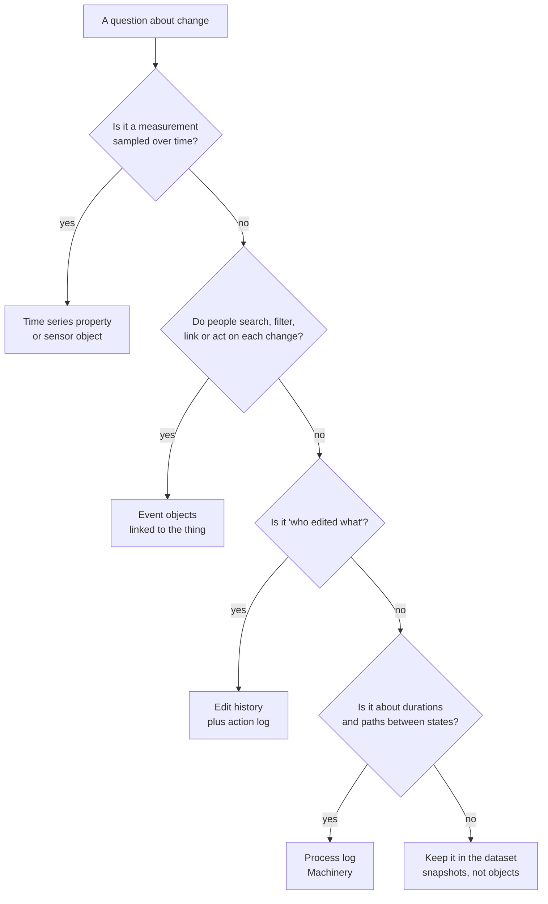

# 01 — Events, history and time

*Sources: [Time series overview](https://www.palantir.com/docs/foundry/time-series/time-series-overview/) · [Enable user edit history](https://www.palantir.com/docs/foundry/object-edits/user-edit-history/) · [Action log](https://www.palantir.com/docs/foundry/action-types/action-log/) · [Ontology design: Anti-patterns](https://www.palantir.com/docs/foundry/ontology/ontology-anti-patterns/) · [Vertex events](https://www.palantir.com/docs/foundry/vertex/events-overview/) · [Machinery core concepts](https://www.palantir.com/docs/foundry/machinery/core-concepts/) · checked October 3, 2026 · Ready for Review*

An object type models a thing **now**. Most real questions are about **change**: when did it happen, what was it before, how fast is it moving. The Ontology has five different places to put time, and they answer different questions. Picking the wrong one is how teams end up with the [Time Machine](../11-design/03-anti-patterns.md#the-time-machine): a new object for every version of the same thing.

This note works backwards from questions. Ama, Kofi, Lena and Priya each ask something about **one shipment**, `DHL|77812`, and each question lands in a different structure.

## Five questions, five structures

| # | Who asks | Question | Structure | Lives in |
|---|---|---|---|---|
| Q1 | Ama | "Where is it **now**, and is it late?" | **Current-state properties** | `Shipment.status`, `eta`, `isLate` |
| Q2 | Ama | "What **happened** to it, in order?" | **Event objects**, linked | `ShipmentEvent` (one per scan, re-route, exception) |
| Q3 | Lena | "**Who changed** the ETA by hand, and from what?" | **User edit history** | Edit history on `Shipment` |
| Q4 | Kofi | "How has the van's **temperature** moved over the trip?" | **Time series property** | A TSP on a linked sensor |
| Q5 | Priya | "How long do shipments **sit** between *picked* and *handed over*?" | **Process log** | Machinery's log object type |

Read the table as a rule: **the question decides the structure**. None of the five is "the history"; each keeps a different kind.

## Q1 — Current state

The object holds what's true now. Its properties are overwritten as the pipeline or an action updates them.

**[Explanation]** This is the default, and most screens need only this. The mistake is trying to make it answer Q2–Q5 as well, by adding `previousStatus`, `eta_v2` or `statusChangedAt` properties. One "previous" property is fine for a badge. A second one is the start of the Time Machine.

## Q2 — Event objects

Each thing that **happened** becomes an object: `ShipmentEvent` with `eventType` (`scanned`, `rerouted`, `exception`), `occurredAt`, `location`, and a link to its `Shipment`. *Re-route shipment* already creates one ([08-02](../08-actions/02-rules-and-parameters.md#when-an-action-has-several-rules)).

- **[Explanation]** Events have their own identity: `eventId`, not the shipment's key plus a timestamp you hope is unique ([01-02](../01-foundations/02-keys-and-identity.md)).
- **[Explanation]** Use event objects when people **search, filter, link or act on** the history: "all exceptions in Kumasi this week", "open the scan before the gap". That's the difference from edit history, which is a log you read, not a set you query.
- **[Docs]** Apps understand events directly. Vertex shows **events** on a timeline beside an object and its time series ([10-05](../10-applications/05-specialized-apps.md)); Map has timeline events too.
- **[Explanation]** Volume matters. A carrier feed with dozens of scans per parcel produces far more events than shipments. Index only the events people use, and keep raw scan data in the dataset.

## Q3 — User edit history

Lena's question is about **edits**, not business events.

- **[Docs]** *Track user edit history* is an opt-in toggle per object type. It records every edit, however it was made, from when it was enabled. Anyone who can see the current object can see its history; **turning it off deletes it** ([13-03](../13-backend-architecture/03-edits-and-materializations.md#edit-history-more-closely)).
- **[Docs]** The **action log** records action runs as objects, with chosen parameters and log properties ([08-07](../08-actions/07-consistency-reverts-and-logs.md#incident-4--who-changed-this-and-why)).
- **[Explanation]** Edit history answers "who set the ETA to Friday?". It **doesn't** see pipeline changes: if the carrier feed moves the ETA, no edit was made. For "how did the ETA move over time, whatever moved it", record ETA changes as events (Q2) or snapshots in the pipeline.

## Q4 — Time series

Measurements sampled over time: temperature, speed, fill level.

- **[Docs]** A **time series property** holds a series ID; values come from a **time series sync** backed by a dataset or stream. Put the TSP on the object type when every object has that series; use a linked **sensor object type** when only some do ([05-08](../05-properties/08-time-series-media-geo-and-vectors.md)).
- **[Docs]** Apps fetch TSPs on an object set, then search around to linked sensors, so both kinds show together.
- **[Example]** Only refrigerated vans carry a temperature probe, so `temperature` is a sensor linked to `Vehicle`, not a TSP on every `Shipment`. A shipment reaches it through its van.
- **[Explanation]** Don't turn measurements into event objects. A probe reading every 30 seconds is a series, not something anyone acts on row by row. Turn **threshold crossings** into events ("temperature above 8 °C for 10 minutes"); those are what people act on.

## Q5 — Process log

Priya wants **durations between states**, across thousands of shipments.

- **[Docs]** Machinery models a **process object** (a string state property with enumerable values) and keeps a **log object type** with `Old state`, `New state` and `Timestamp`. It's fed from a changelog dataset or from edit history ([10-05](../10-applications/05-specialized-apps.md#machinery--processes-and-process-mining)).
- **[Explanation]** The log is history shaped for **process questions**: time in state, common paths, deviations. Event objects (Q2) are shaped for **one object's story**. A team can have both, generated from the same source.
- **[Docs]** Edit-history-fed logs aren't supported for types with **several datasources or row-level permissions**. `Shipment` has a regional policy, so its log comes from a pipeline changelog instead.

## Choosing, in one pass

**[Explanation]** The last box matters: not every historical question needs the Ontology. Monthly trend reports on last year's shipments are an analytics job on snapshot datasets ([01-05](../01-foundations/05-operational-vs-analytical-systems.md)).

## What not to do

| Temptation | Why it fails | Instead |
|---|---|---|
| A new `Shipment` object for each status change | Object count grows with changes, links duplicate, "current" is unclear ([anti-patterns](../11-design/03-anti-patterns.md#the-time-machine)) | One shipment, linked events |
| `eta1`, `eta2`, `eta3` properties | Fixed slots for an unbounded list; nobody knows which is latest | Events, or a snapshot dataset |
| Events keyed on `shipmentId + timestamp` | Two scans in the same second collide; edits and links get orphaned | A stable `eventId` from the source |
| Every probe reading as an event | Millions of objects nobody opens | A time series, with threshold events |
| Relying on edit history for pipeline changes | Pipelines don't make edits | Events or snapshots |

---
[Module index](README.md) · Next: [02 — Scenarios](02-scenarios.md)
