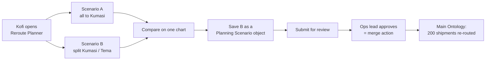

# 02 — Scenarios

*Sources: [Ontology scenarios](https://www.palantir.com/docs/foundry/ontology/overview-ontology-scenario/) · [Temporary scenarios](https://www.palantir.com/docs/foundry/ontology/temporary-scenario/) · [Store scenario metadata as objects](https://www.palantir.com/docs/foundry/ontology/persisted-scenario/) · [Merge scenarios](https://www.palantir.com/docs/foundry/ontology/merge-scenario/) · [Use scenarios with OSDK](https://www.palantir.com/docs/foundry/ontology/osdk-scenario/) · checked October 3, 2026 · Ready for Review*

**[Docs]** Ontology scenarios are **beta** and may not be enabled on your enrollment.

A scenario is a **sandbox of edits** on top of live Ontology data. You apply real actions inside it, look at the result in real apps, compare it with other sandboxes, and then either throw it away or merge it through an action. This note follows one planning decision at Kestrel from first idea to merge, then lists the rules.

## The decision

The Accra warehouse has a dock closure on Friday. Kofi needs to move about 200 shipments to Kumasi or Tema. Moving them is easy: *Re-route shipment* exists. Knowing **which** plan is better isn't: Kumasi has spare dock space but a longer drive, Tema is close but nearly full.

## Step 1 — Try it without consequences (temporary scenarios)

**[Docs]** A **temporary scenario** exists only in the current session and isn't saved. In Workshop:

- enable *Scenarios* and *Scenarios V2* in the module settings, and add a **Scenario Manager** widget, which creates and manages scenarios;
- turn on *Load Data from Scenario* in an Object Table, pointing at the scenario variable from the Scenario Manager, so the table shows the scenario's data, not the live Ontology;
- add a **Scenario Summary** widget to list the changes;
- on the action button, enable **Apply to Scenario** and choose the active scenario. The action now edits the sandbox, not the Ontology;
- **Chart: XY** can show several scenarios as layers. Widgets without scenario settings, such as a Metric Card, can read a scenario through a variable's *Scenario* section.

**[Example]** Daniel builds Kofi a *Reroute Planner* module this way. Kofi creates scenario A, runs *Re-route shipment* on all 200 to Kumasi, and watches the dock-utilisation chart. Then scenario B, with a split.

**[Docs]** Functions run inside a scenario **as they are**: reads see the scenario's data, and edits land in the scenario. **AIP Logic** functions are the exception. They need **staged writes** enabled, on them and on every Logic function they call ([16-04](../16-ai-and-agents/04-human-in-the-loop-and-staged-writes.md)).

## Step 2 — Keep and share it (persisted scenarios)

Kofi wants his operations lead to see scenario B before anything changes.

**[Docs]** A **persisted scenario** is an **object**: a type that implements the **Ontology Scenario** interface, whose primary key is the **Scenario Reference** (a value type). Because it's an object it is shareable, can carry metadata (author, description), can be linked to other objects, and inherits normal permissions.

Setup, per the docs:

- create the object type through the wizard, adding the *Ontology Scenario* interface and mapping *Scenario Reference* to the primary key;
- a **Create object** action with a hidden string parameter constrained to the *Scenario Reference Value* value type, mapped to the key. In Workshop, a button sets that parameter from the active scenario variable;
- to work from saved scenarios, list the objects and use an **object-backed scenario variable** set from the selected object.

**[Example]** Kestrel's type is `Planning Scenario`, with `createdBy`, `status`, `description` and a link to the affected `Warehouse`.

## Step 3 — Govern it

**[Docs]** The docs' approval pattern, which Kestrel adopts unchanged:

| Action | Change | Submission criteria |
|---|---|---|
| *Submit for review* | Draft → In review | Current user is `createdBy`, and status is Draft |
| *Approve scenario* | In review → Approved; optionally reviewer and time | Current user is in the approvals group, and status is In review |
| *Reject scenario* | In review → Rejected | Same as approve |

- The type is set to **only allow edits via actions**.
- An **object security policy** shows each scenario to its creator and to the approvals group. Reference the group by its **stable group ID**, not its name ([12-03](../12-security-and-governance/03-object-and-property-security.md)).
- The *Approve scenario* action can also carry an **Apply Scenario** rule, so approving and merging are **one governed step**.

**[Docs] Criteria can tell where an action runs.** Submission criteria can distinguish execution **in a scenario** from execution **against main**. So planners and agents can have looser criteria inside the sandbox without being allowed to do the same thing for real. Applying the result is controlled separately, by the merge action's own criteria.

**[Example]** Inside a scenario, Kofi can run *Re-route shipment* to **any** destination warehouse. On main, the action's criteria let him re-route only to warehouses in his own region; cross-region moves need an ops lead. The only path from his scenario to main is *Approve scenario*, which only the ops leads can run.

## Step 4 — Merge it

**[Docs]**

- A scenario is merged by an **action**: either a new action type created from the wizard's **Scenario** tab (choosing which object and link types it may apply), or an existing action with an **Apply Scenario** rule added. Its key parameter is the scenario reference.
- Merging commits **all** the scenario's edits (creates, property changes, deletes, link changes) as **one transaction**.
- Because merging is an action, **action limits** apply to it ([08-07](../08-actions/07-consistency-reverts-and-logs.md)).

**[Explanation]** "All the scenario's edits" is the important phrase. There's no cherry-picking at merge time. If Kofi tried three ideas in one scenario, all three go in. One idea per scenario.

## What a scenario is not

| It isn't… | Because [Docs] | Use instead |
|---|---|---|
| A snapshot of the past | "Scenarios are not data versioning tools." They can't show the Ontology at a point in history | Event objects, edit history, snapshots ([01](01-events-history-and-time.md)) |
| A long-term store | Scenarios live **30 days** by default, then are deleted with their edits and their persisted object | Merge, or record the decision on another object |
| A frozen copy | Each scenario is **auto-rebased every 10 minutes** on its base (main or a global branch). You can't rebase on demand or change the interval | — |
| A global branch | Branches are for **builders** changing schema and apps; scenarios are for **users and agents** changing data ([14-02](../14-lifecycle-and-operations/02-branching-and-proposals.md)) | A branch, for schema work |

**[Explanation]** The 10-minute rebase means the sandbox keeps tracking live data. That's usually what a planner wants, but it also means a comparison made at 09:00 may look different at 09:30. Make the decision, persist it, and merge it promptly.

## From code (OSDK, experimental)

**[Docs]** Scenario support in the OSDK is **experimental** (TypeScript, `@osdk/client` 2.27.0+) and **beta** (Python 2.209.0+, inside `AllowBetaFeatures`).

- `createScenario(client)` creates one; `withScenario(client, rid)` attaches to an existing one, including a persisted scenario object's primary key. The result is a **scenario-scoped client**: every read, aggregation and action goes to the sandbox.
- Merge by applying an action with an *Apply Scenario* rule, passing the scenario client as its parameter.
- `getEditedEntityTypes`, `getEditedEntities` and `getEditedLinks` list what changed. They return keys only; re-fetch through the scenario client for values. Only **many-to-many** link edits are listed; one-to-many changes show up as edits to the object holding the foreign key.
- **Not supported:** batch actions inside a scenario, nesting a scenario in a scenario, or combining a scenario with a transaction.

## Agents in scenarios

**[Docs]** The docs list **agent evaluation and forecasting** as a use case: test an agent with different inputs and compare outcomes. **[Recommendation]** Kestrel splits it by size. A **single** re-route the Delivery Desk suggests becomes a `RerouteProposal` object that a lead accepts (rung 2 of the [control ladder](../16-ai-and-agents/04-human-in-the-loop-and-staged-writes.md#the-control-ladder)). A **plan** of many related re-routes, like this closure, goes into a scenario that a person compares and merges (rung 4).

## Open questions

- **RQ-30.** What happens when the 10-minute auto-rebase meets a **conflict**, for example main deletes or edits a shipment the scenario re-routed? The pages don't say.
- **RQ-31.** Do an action's **side effects** (notifications, webhooks) fire when the action runs **inside a scenario**? The pages don't say. Until confirmed, Kestrel keeps side-effect rules off the actions planners use in scenarios.

---
[Module index](README.md) · Previous: [01 — Events, history and time](01-events-history-and-time.md) · Next: [03 — Models in the Ontology](03-models-in-the-ontology.md)
