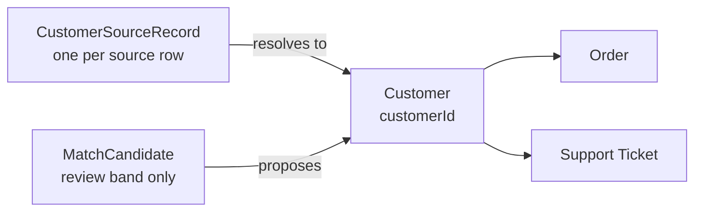

# 04 — Entity resolution across sources

*Sources: [Multi-datasource object types](https://www.palantir.com/docs/foundry/object-permissioning/multi-datasource-objects/) · [Ontology design: Anti-patterns](https://www.palantir.com/docs/foundry/ontology/ontology-anti-patterns/) · [How user edits are applied](https://www.palantir.com/docs/foundry/object-edits/how-edits-applied/) · checked October 3, 2026 · Ready for Review*

Most of this note is **[Explanation]**: entity resolution is pipeline and data-quality work, and the Foundry docs mostly don't prescribe a method. What the docs do fix are the **constraints** the result must meet before it reaches the Ontology. Those are marked **[Docs]**.

It's written as **Priya's design doc** for one problem that [01-02](../01-foundations/02-keys-and-identity.md#kestrel-priya-picks-keys) left open: one `Customer` from three systems.

---

## 1. The problem

| System | Its customer ID | What it knows |
|---|---|---|
| Storefront | `S-88123` | Name, email, addresses, orders |
| Support desk | Requester email | Name as typed, phone, tickets |
| Kestrel Pay | `PAYER-55102` | Card-holder name, billing address, payments |

Three different problems hide in "match the customers", and the [AIP Workflow speedrun](../../../Tracks/Speedrun/Your%20First%20AIP%20Workflow/20-resolve-entities.md) only solves the first:

1. **The same value repeated:** `ama.mensah@…` in 40 tickets. Deduplicate.
2. **Different labels, one person:** `Ama Mensah` (storefront), `A. Mensah` (Kestrel Pay), `ama.m@…` (an old support email). Match.
3. **One label, different people:** two customers called `Kwame Boateng` in Kumasi. **Don't** match.

A naive join on name gets problem 2 wrong and problem 3 badly wrong. Merging two different people's orders is worse than leaving one person split.

## 2. Constraints from the Ontology

**[Docs]**

- **MDOs don't resolve anything.** A column-wise MDO joins datasources on the primary key, and the key "must exist in every input datasource". Row-wise MDOs (unions) don't exist. So the master key has to exist **before** the Ontology; an MDO can only attach each system's columns to it afterwards ([04-02](../04-object-types/02-backing-datasources-and-mapping.md#step-3--several-datasources-for-one-type-mdos)).
- **One source per property.** "Property multiplicity is currently not supported": two datasources can't both feed `email`. Deciding which system wins is the pipeline's job.
- **Edits follow the primary key.** User edits are stored against the object's key ([13-03](../13-backend-architecture/03-edits-and-materializations.md)). **[Explanation]** If a key changes or disappears, its edits no longer have an object to land on ([01-02 "Mistakes that orphan edits"](../01-foundations/02-keys-and-identity.md#mistakes-that-orphan-edits)). That one fact drives most of the design below.

## 3. The pipeline

| Stage | What | Kestrel's choice |
|---|---|---|
| **Standardise** | Clean each source the same way | Lower-case emails, strip spaces, normalise phone numbers to E.164, expand street abbreviations |
| **Block** | Only compare plausible pairs, not every pair | Compare within the same normalised email domain, phone, or postcode |
| **Score** | Compare fields and combine into a score | Exact email or phone = strong; name similarity + same postcode = medium; name alone = never enough |
| **Decide** | Three bands | ≥ 0.95 auto-match; 0.70–0.95 **human review**; below that, no match |
| **Cluster** | Group matched records into one person | Matches are **not** automatically transitive: if A≈B and B≈C but A≉C, send the cluster to review |
| **Assign master ID** | Give each cluster a stable `customerId` | See section 4 |
| **Survive** | Pick each field's value | See section 5 |

**[Explanation]** The review band exists because problem 3 can't be solved by thresholds alone. A fixed share of borderline pairs always needs a person.

## 4. Stable master IDs: the crosswalk

The naive approach, "hash the cluster's members" or "number the clusters on each build", fails: when a new record joins a cluster, the ID changes, and every edit, link and saved list pointing at the old ID breaks.

**Rule: the crosswalk is the source of truth, and it is append-only.**

| `sourceSystem` | `sourceId` | `customerId` | `matchedAt` | `matchedBy` |
|---|---|---|---|---|
| storefront | S-88123 | CUST-000431 | 2026-03-02 | auto 0.98 |
| kestrelpay | PAYER-55102 | CUST-000431 | 2026-03-02 | review: Lena |
| support | ama.m@… | CUST-000431 | 2026-05-19 | review: Ama |

- A **new** source record joins an existing `customerId` if it matches one; otherwise it gets a **new** one. Existing IDs never change.
- **Merging** two masters (they turn out to be one person): the older ID **survives**; the other becomes **retired**, with a `mergedInto` pointer. Before the merge is applied, edits on the retired customer are re-applied to the survivor by an action, or deliberately dropped.
- **Splitting** (two people were wrongly merged): the original ID stays with one of them; the other gets a new ID. Edits made while merged need a human decision, because nothing can tell whose they were.

**[Explanation]** Splits are expensive. That's the strongest argument for a conservative auto-match threshold.

## 5. Survivorship: which value wins

**[Docs]** The anti-patterns guidance on merging silos says to **set precedence rules** for conflicting values, and the notes add that the source owners must agree on them ([11-03](../11-design/03-anti-patterns.md)).

| Property | Winner | Why |
|---|---|---|
| `fullName` | Storefront, unless empty | The customer typed it themselves |
| `email` | Storefront | It's the login |
| `phone` | Most recently updated across sources | Phones change; any source may have the newest |
| `addresses` | Union of storefront addresses | An array of structs ([05-03](../05-properties/03-structs.md)) |
| Billing details | **Not on `Customer`** | Stays in `Payments [Ontology]`, for the same reason the risk profile became its own type ([04-02 option B](../04-object-types/02-backing-datasources-and-mapping.md#step-3--several-datasources-for-one-type-mdos)) |

## 6. What the Ontology gets

- **`Customer`**: backed by the survivorship output, keyed on the crosswalk's `customerId`.
- **`CustomerSourceRecord`**: one object per source row, linked to its `Customer`. Ama can see "this customer is three records" and where each value came from.
- **`MatchCandidate`**: only the review band. Actions *Confirm match* and *Reject match* (criteria: the *data stewards* group) write a decision that the pipeline reads on its next run. **[Explanation]** The action edits the candidate object; the pipeline reads those edits from the type's materialization ([13-03](../13-backend-architecture/03-edits-and-materializations.md)) and appends to the crosswalk. The decision is made in the Ontology; the identity change happens in the pipeline.
- **Links** to `Order` and `Support Ticket` are built in the pipeline by joining each source's ID through the crosswalk. **Never** link on email or name.

## 7. Checks before release

- [ ] No `customerId` changed between the previous build and this one, except retirements recorded with `mergedInto`.
- [ ] Every source record maps to exactly one `customerId`.
- [ ] No cluster mixes two different storefront IDs without a review decision.
- [ ] Retired customers have had their edits moved or deliberately dropped.
- [ ] The match rate per source is within the expected range (a sudden jump usually means a standardisation bug).

---
[Module index](README.md) · Previous: [03 — Models in the Ontology](03-models-in-the-ontology.md) · Next module: [16 — AI and agents](../16-ai-and-agents/README.md)
