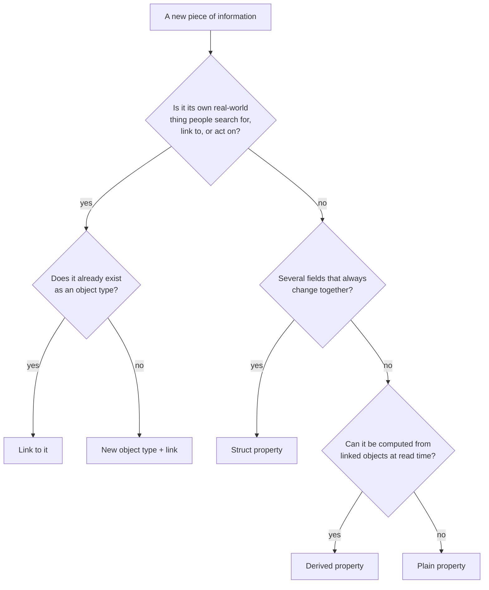
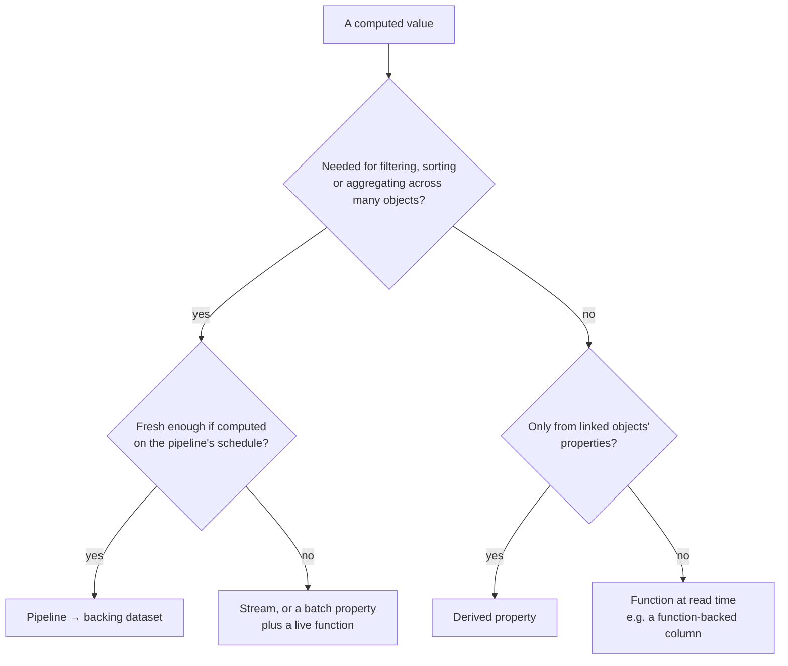
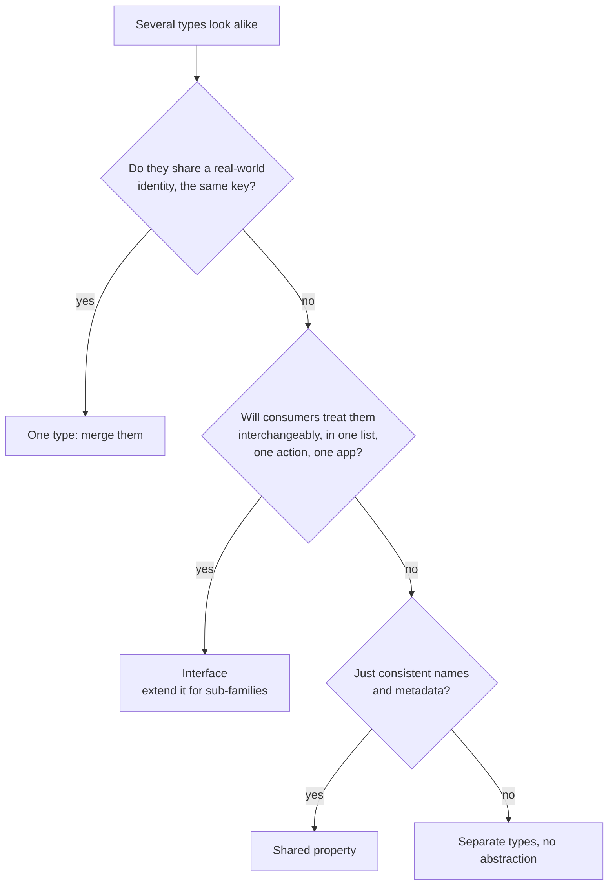
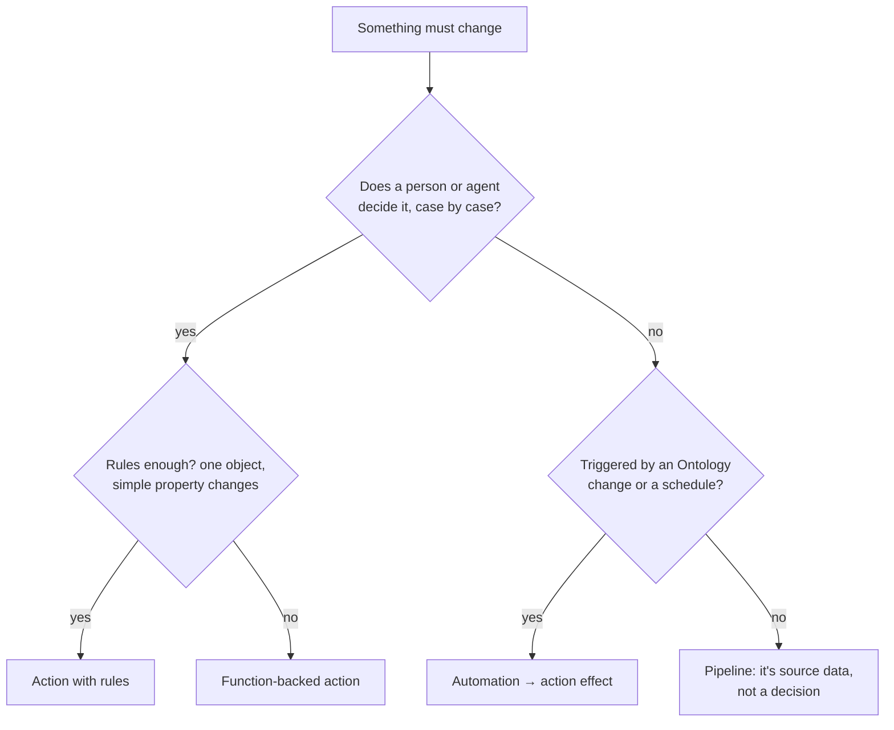
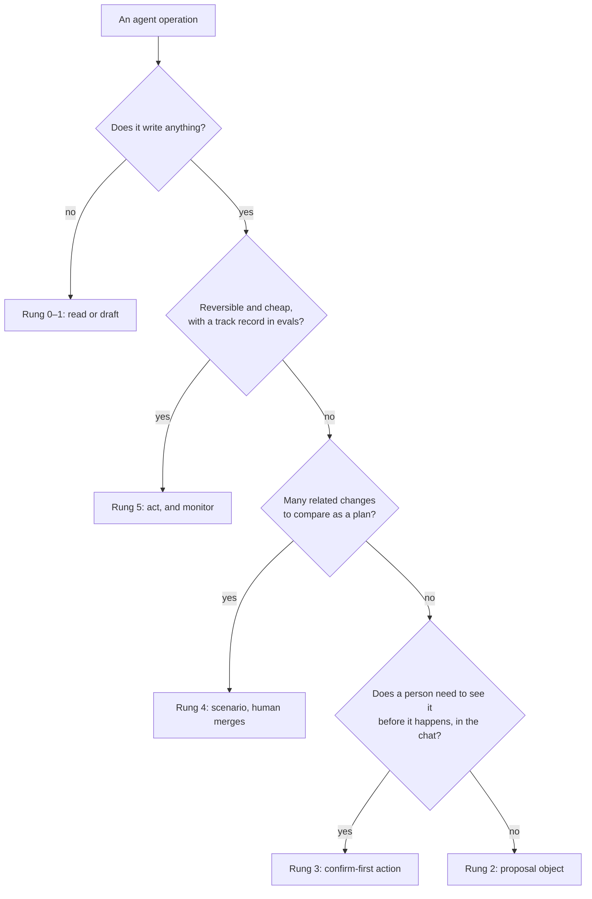

# Decision guide

*Sources: the linked notes and the official pages they cite · compiled October 3, 2026 · Ready for Review*

Five decisions that come up in every Ontology design review, each as a flowchart. The flowcharts are **[Recommendation]**: they compress the reasoning in the linked notes, which give the doc rules behind each branch. For one-line answers to narrower questions, see the [topic map's design questions](../MAP.md#by-design-question).

## 1. Property, struct, link or new object type?

- One thing split across sources is still **one type** (an MDO, or resolved first): [04-02](../04-object-types/02-backing-datasources-and-mapping.md#step-3--several-datasources-for-one-type-mdos), [15-04](../15-advanced-patterns/04-entity-resolution-across-sources.md).
- A relationship with attributes or a lifecycle is an **object** in the middle: [06-02](../06-links/02-many-to-many-and-object-backed-links.md#what-kestrel-chose).
- Structs vs properties vs objects in detail: [05-03](../05-properties/03-structs.md#struct-separate-properties-or-linked-object). Derived properties' limits: [05-05](../05-properties/05-derived-properties.md).

## 2. Where is the value computed?

Normalization first, derive at read time when cheap: [11-02 §1](../11-design/02-structural-guidance.md#1-normalization-and-derived-properties-store-each-fact-once). Models specifically: [15-03](../15-advanced-patterns/03-models-in-the-ontology.md#the-general-pattern).

## 3. Interface, shared property, or a new type?

[07-01](../07-interfaces/01-interfaces.md#three-ways-to-model-a-case-compared), [05-04](../05-properties/04-shared-properties.md#shared-property-or-interface), and the [Rule of Three](../11-design/01-best-practices.md#2-do-not-repeat-yourself-the-rule-of-three). Changing an interface later: [07-02](../07-interfaces/02-implementing-and-extending-interfaces.md).

## 4. Which mechanism changes the data?

- Every route that edits objects ends in an **action**, so criteria, logs and side effects apply: [08-01](../08-actions/01-action-types.md), [08-04](../08-actions/04-function-backed-actions.md), [10-06](../10-applications/06-automate-and-ontology-events.md).
- Don't make one action per variant: [Action Sprawl](../11-design/03-anti-patterns.md#action-sprawl). Don't use the Ontology as a pipeline: [Golden Hammer](../11-design/03-anti-patterns.md#the-golden-hammer).

## 5. How much may an agent do alone?

[16-04 The control ladder](../16-ai-and-agents/04-human-in-the-loop-and-staged-writes.md#the-control-ladder), with Kestrel's placements.

## Also decided elsewhere

| Decision | Note |
|---|---|
| Save directly or branch? | [14-01 tiers](../14-lifecycle-and-operations/01-saving-reviewing-and-restoring.md#1-three-tiers-of-change) |
| Migrate, JSON export, Marketplace or code? | [14-05 four routes](../14-lifecycle-and-operations/05-migration-and-export-import.md#the-four-routes) |
| Object security policy or restricted view? | [12-03](../12-security-and-governance/03-object-and-property-security.md#two-families-of-mechanism) |
| Batch, stream or direct datasource? | [13-02](../13-backend-architecture/02-indexing-and-funnel.md#which-path) |
| Workshop, Slate or OSDK? | [10-03](../10-applications/03-workshop-and-slate.md#choosing-between-them), [10-01](../10-applications/01-choosing-an-ontology-aware-app.md) |
| Events, edit history, time series or process log? | [15-01](../15-advanced-patterns/01-events-history-and-time.md#choosing-in-one-pass) |
| Which analyzer for a string property? | [10-07](../10-applications/07-searching-the-ontology.md#the-lab) |
| Serverless or deployed function? | [09-05](../09-functions/05-writing-functions-in-practice.md#5-where-it-runs) |

---
[Reference index](README.md) · Next: [Docs index](docs-index.md) · [Ontology home](../README.md)
