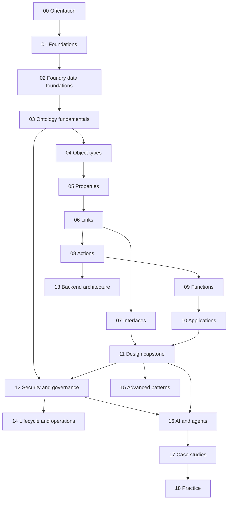

# Ontology

A structured course and working reference for the **Palantir Foundry Ontology**. It is Palantir-first: Data Engineering and AI Engineering ideas appear only where they explain a Foundry concept, and every note says where an analogy helps and where it breaks.

| | |
|---|---|
| Structure | Created October 2, 2026 (Phase 2). Modules 00–05 written October 2, 2026 (Phases 3–4). Replaces the former `Ontology Design/` folder: see [MIGRATION](MIGRATION.md) |
| Notes written | 94 of 94: modules [00](00-orientation/README.md)–[16](16-ai-and-agents/README.md) (81 notes, Phases 3–6), the four design notes ([11](11-design/README.md)), two case studies including the [Kestrel reference model](17-case-studies/02-kestrel-reference-model.md) ([17](17-case-studies/README.md)), three practice pages ([18](18-practice/README.md)) and four reference pages ([99](99-reference/README.md)) |
| Quality | Phase 8 review done October 4, 2026: quotes re-matched against the live docs, links, anchors, diagrams and navigation checked. See [QUALITY-REVIEW](QUALITY-REVIEW.md) |
| Next | Optional: a coverage check of the OSDK docs sidebar (the AIP sidebar is mapped page by page in the [AIP area](../AIP/README.md); Workshop, Slate and Automate are being mapped in the [Apps area](../Apps/README.md), started October 18, 2026); hands-on checks of the *Untested* items |
| Sources | Official Palantir documentation first. Register and corrections: [SOURCES](SOURCES.md) |
| Why it matters | The Ontology is the centre of Foundry. It underpins the Application Developer Associate exam, Workshop/Slate/OSDK work, and every AIP workflow |

## Two ways to use these notes

**To study it:** follow the learning path below, one module at a time. Each module README lists its notes in reading order, its prerequisites, the official pages it draws on, and the course lessons where you already met the idea.

**To look something up while working in Foundry:**
- [MAP](MAP.md): find a note by concept, by task ("I need to…") or by design question.
- [GLOSSARY](GLOSSARY.md): a one-line definition of every term, linked to the note that explains it.
- [99 — Reference](99-reference/README.md): decision guide, limits and thresholds, troubleshooting, and an index from each official docs page to the note that covers it.
- [18 — Self-check](18-practice/03-review-questions-by-module.md): questions per module, if you want to test yourself before a work session or the exam.

## Learning path

| # | Module | What you learn | Status |
|---|---|---|---|
| 00 | [Orientation](00-orientation/README.md) | What the Ontology is, why it exists, the architecture in one picture, the running example | **Ready for Review** |
| 01 | [Foundations](01-foundations/README.md) | Entities, keys, normalization, semantic layers, operational systems: the ideas the docs assume | **Ready for Review** |
| 02 | [Foundry data foundations](02-foundry-data-foundations/README.md) | Datasets, pipelines, virtual tables and streams, projects and spaces, lineage | **Ready for Review** |
| 03 | [Ontology fundamentals](03-ontology-fundamentals/README.md) | Ontologies as resources, Ontology Manager, objects and object sets, type metadata | **Ready for Review** |
| 04 | [Object types](04-object-types/README.md) | Object types, datasources, primary keys and titles | **Ready for Review** |
| 05 | [Properties](05-properties/README.md) | Base types, value types, structs, shared and derived properties, special property kinds | **Ready for Review** |
| 06 | [Links](06-links/README.md) | Link types, cardinality, many-to-many, traversal | **Ready for Review** |
| 07 | [Interfaces](07-interfaces/README.md) | Polymorphism and composition | **Ready for Review** |
| 08 | [Actions](08-actions/README.md) | Governed edits: rules, parameters, criteria, side effects, permissions, audit | **Ready for Review** |
| 09 | [Functions](09-functions/README.md) | Code on the Ontology: queries, edits, lifecycle, models | **Ready for Review** |
| 10 | [Applications](10-applications/README.md) | Object Views, Object Explorer, Workshop, Slate, OSDK, specialized apps, Automate | **Ready for Review** |
| 11 | [Design](11-design/README.md) | Best practices, structural guidance, anti-patterns, validation | **Ready for Review** |
| 12 | [Security and governance](12-security-and-governance/README.md) | Resource vs data permissions, row/column security, security through the stack | **Ready for Review** |
| 13 | [Backend architecture](13-backend-architecture/README.md) | OMS, OSS, Funnel, indexing, edits, OSv2, limits and compute | **Ready for Review** |
| 14 | [Lifecycle and operations](14-lifecycle-and-operations/README.md) | Change management, branching, schema evolution, Marketplace, monitoring | **Ready for Review** |
| 15 | [Advanced patterns](15-advanced-patterns/README.md) | Events and time, scenarios, models, entity resolution | **Ready for Review** |
| 16 | [AI and agents](16-ai-and-agents/README.md) | Grounding, semantic search, agent tools, human-in-the-loop, designing for agents | **Ready for Review** |
| 17 | [Case studies](17-case-studies/README.md) | Our course Ontologies reviewed; the full running-example model | **Ready for Review** |
| 18 | [Practice](18-practice/README.md) | Design exercises, validation drill, self-check by module | 3 of 3 written (not attempted) |
| 99 | [Reference](99-reference/README.md) | Quick-lookup pages: decision guide, limits, troubleshooting, docs index | **Ready for Review** |

**Key prerequisites:** links need keys (01) and object types (04); interfaces need properties and links; actions need objects and links; the design capstone (11) needs modules 04–10; AI (16) needs design and security.

## Conventions

**Labels** (inline, where it matters which kind of claim something is; extended from the original `Ontology Design` set):

| Label | Means |
|---|---|
| **[Docs]** | Paraphrase of an official Palantir page, linked. Only for what the page actually says |
| **[Concept]** | General Data Engineering or AI Engineering knowledge |
| **[Analogy]** | A mental model, always with where it breaks |
| **[Explanation]** | Our interpretation or reasoning about Foundry behaviour that is not stated verbatim |
| **[Recommendation]** | Design advice: our judgement, not documented behaviour |
| **[Example]** | Our own worked example |
| **[Observed]** | Something seen in our own Foundry enrollment (course execution evidence) |

An unconfirmed point is marked **Open question** and listed in [SOURCES](SOURCES.md#open-research-questions).

**Note shape:** there is no fixed template. Each note takes the form that suits its subject: a guided tour (Ontology Manager), a reference sheet (type metadata), a lab (creating an object type), a decision guide (backing datasources), a field checklist (primary keys), or an explanation with a worked example. Every note shares only three things: a one-line *Sources* line at the top, labels where the origin of a claim matters, and navigation at the bottom. See [_templates](_templates/topic-note.md) for the menu of shapes.

**Status words:** Not Started · In Progress · Ready for Review · Blocked (the same words as the rest of `Learn/`).

**Names:** numbered kebab-case folders and files, so the sort order is the reading order and links need no `%20`.

**Running example:** *Kestrel Commerce*, a fictional online retailer with its own payments arm. It covers customers, orders, order lines, products, suppliers, warehouses, shipments, payments, refunds and fraud cases, and it grows from note to note. It's introduced in [00 — The running example](00-orientation/04-running-example.md).

**Course notes stay where they are.** The Learn course notes (Speedrun, Deep Dive, Courses, Application Developer, AIP) are records of what each course taught and what we did in Foundry. Ontology notes link to them under *Seen in our courses*, and they link back.

---
[Learn home](../../README.md) · [Study plan](../../STUDY-PLAN.md) · [Progress](../../PROGRESS.md)
