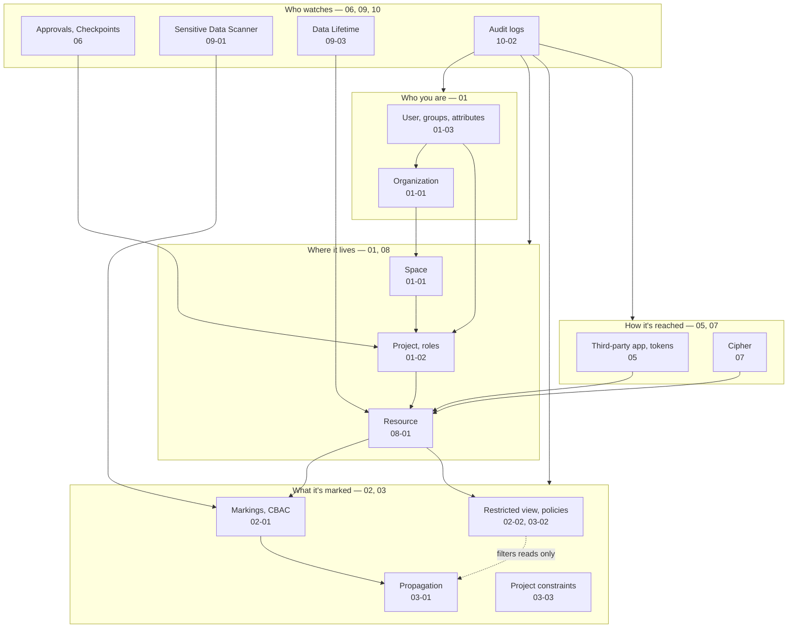

# 01 — The security map

*Sources: [Security and governance](https://www.palantir.com/docs/foundry/security/overview/) · [Shared security responsibility model](https://www.palantir.com/docs/foundry/security/shared-security-responsibility-model/) · [Security glossary](https://www.palantir.com/docs/foundry/security/security-glossary/) · checked October 23, 2026 · Ready for Review*

The area in **one picture and five questions**. Written last, after every module, so that each box on the map points at the note that explains it. Start here if you're new to the area; come back to it when a question doesn't obviously belong to one module.

## Palantir's own summary

**[Docs]** The overview page states the model in a paragraph. Four properties: *strict enforcement*, *granular controls*, *transparency*, *usability*. Two halves: **authentication** "verifies the identity of a user", **authorization** "grants access based on a user's attributes and permissions". And the sentence the whole area turns on: data security "is provided through a combination of mandatory and discretionary controls, which differ in how they propagate". Mandatory controls (markings, CBAC, organizations) "travel with each unit of data through derivation"; discretionary controls (roles; row and column filtering via granular policies) "filter what a user can read; they do not extend to downstream outputs or exports".

**[Docs]** Beyond that: every customer gets the core enterprise features without gating ("We reject the notion of gating, pay-walling, or upselling core security controls like audit logging, single sign-on, and multi-factor authentication"); the managed SaaS adds an infrastructure layer (zero trust, least privilege, defence in depth, hardened baselines, segmentation, IDS, WAF, aggressive patching, monitoring at every layer); and documentation beyond the docs lives on Palantir's SafeBase Trust Center.

## The map

## Five questions, five answers

**[Explanation]** Any access question in Foundry decomposes into these, in this order, and each has a home in the area.

| # | Question | Answer in Foundry terms | Notes |
|---|---|---|---|
| 1 | **Can she know it exists?** | Access requirements: she must be in one of the project's **organizations** and hold **every marking** on the resource; then she needs some role, or the project's default role | [01-01](../01-organizations-projects-users-and-groups/01-organizations-spaces-and-enrollments.md), [02-01](../02-markings-and-mandatory-controls/01-markings-and-classification-based-access-controls.md), [03-04](../03-discretionary-controls-propagation-and-diagnosis/04-diagnosing-access.md) |
| 2 | **Can she see the data in it?** | The **data** requirements: markings inherited through lineage, CBAC data classification; then the read filters: restricted view, object and property security policies | [02-01](../02-markings-and-mandatory-controls/01-markings-and-classification-based-access-controls.md#two-ways-a-marking-is-inherited), [02-02](../02-markings-and-mandatory-controls/02-granular-policies.md), [03-02](../03-discretionary-controls-propagation-and-diagnosis/02-restricted-views.md) |
| 3 | **What can she do with it?** | Her **role** on the project (a set of operations), minus anything a checkpoint pauses and a constraint forbids | [01-02](../01-organizations-projects-users-and-groups/02-projects-roles-and-project-templates.md), [06-02](../06-approvals-and-checkpoints/02-checkpoints.md), [03-03](../03-discretionary-controls-propagation-and-diagnosis/03-project-constraints.md) |
| 4 | **Where can the data go afterwards?** | Mandatory controls follow it everywhere it's derived; discretionary filters stop at the read; downloads, exports, functions, actions, OSDK payloads and model context carry nothing | [03-01](../03-discretionary-controls-propagation-and-diagnosis/01-access-control-propagation.md), [03-05](../03-discretionary-controls-propagation-and-diagnosis/05-download-controls-and-the-two-deprecated-settings.md), [07](../07-cipher/README.md) |
| 5 | **Who decided, and can we prove it?** | Approvals requests, checkpoint records and audit logs; the governance roles that review them | [06](../06-approvals-and-checkpoints/README.md), [10-01](../10-privacy-governance-and-enterprise-security/01-privacy-civil-liberties-and-data-protection.md), [10-02](../10-privacy-governance-and-enterprise-security/02-audit-logs.md) |

**[Explanation]** Questions 1 and 2 are the exam's *resource access vs data access*. Question 4 is the one most designs get wrong, and the overview page puts it in its second paragraph for that reason.

## Mandatory and discretionary, side by side

**[Docs]** From the glossary and the overview, the two families in one table:

| | Mandatory | Discretionary |
|---|---|---|
| Members | Organizations, markings, CBAC | Roles; restricted views; object and property security policies |
| Effect | All-or-nothing: "regardless of a user's Role, a user cannot access a resource in any way unless the user satisfies the resource's mandatory controls" | Additive: "can only add permissions for a user and cannot restrict permissions" |
| Granted by | Centrally: marking administrators, organization permissions | Owners, through sharing workflows |
| Propagates through derivation | Yes | No |
| Diagnosed with | *Access requirements* and *Additional data requirements* in Check access | Roles on the project; emulation mode |

## The shared responsibility model

**[Docs]** "Palantir is responsible for security of the cloud, while customers are responsible for security in the cloud." Palantir and its infrastructure providers: physical security, hosts, networking, application security, encryption in transit and at rest, OS and firewall configuration, infrastructure monitoring, continuous delivery and patching, the foundation services and global infrastructure. Customers: their data, the applications they build, identity and access management, resource permissions, application-level monitoring. The four things a customer is **always** responsible for:

1. **Identity and access through SSO**, including enforcing MFA ([10-03](../10-privacy-governance-and-enterprise-security/03-protecting-identity-tokens-phishing-and-files.md)).
2. **What data is uploaded**, and that it meets the customer's own policies ([08-02](../08-compass/02-moving-sharing-tagging-uploading-and-the-data-catalog.md), [09](../09-sensitive-data-scanner-and-data-lifetime/README.md)).
3. **Applying roles and markings** appropriately ([01](../01-organizations-projects-users-and-groups/README.md)–[04](../04-securing-data-and-applications/README.md)).
4. **Monitoring application-level audit logs** ([10-02](../10-privacy-governance-and-enterprise-security/02-audit-logs.md)).

**[Explanation]** Modules 01 to 09 are item 3 with item 2 attached; module 10 is items 1 and 4. Nothing in this area is Palantir's half, which is why the self-hosted pages in [10-04](../10-privacy-governance-and-enterprise-security/04-infrastructure-security-and-disaster-recovery.md) read like a different book: they are the list of things that stop being Palantir's when you run the platform yourself.

## The glossary, as a reading order

**[Docs]** The security glossary defines 29 terms ([GLOSSARY](../GLOSSARY.md) carries them all, with the note that explains each). Read in this order they tell the story of the area: *Resource* and *Project* (what's being protected); *Organization* and *Marking* as *Access requirements* and *Mandatory controls* (who may know it exists); *Role*, *Permission*, *Workflow*, *Default roles* and *Discretionary controls* (what they may do); *Inheritance* (how both kinds flow down a project); *User*, *Group*, *Attribute*, *Identity provider*, *Realm*, *User manager*, *Credential collector* (where the identities come from); *Restricted view* (reads filtered by attribute); *Reference*, *Space*, *Tag*, *Marking category*, *Organization discoverability*, *Apply organization*, *Expand access* (the administrative edges).

## Where the exam domains land

**[Explanation]** From the exam guide's eight domains: **D8** (application security, governance and operations) is modules 01–04 and 06, with diagnosis in 03-04 and operations in 10; **D5** (OSDK, APIs, external applications) is module 05 together with [DevTools 02](../../DevTools/02-developer-console-and-apis/README.md); **D2** (actions and write-back) meets this area at checkpoints on actions (06-02) and CipherText properties (07-02); **D1** (schema design) meets it at project layout (04-01) and Compass (08). The practice questions in [12](../12-practice/README.md) are tagged accordingly.

---
[Module index](README.md) · Next: [02 — Kestrel's security posture](02-kestrels-security-posture.md)
