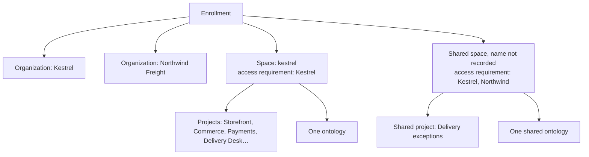

# 01 — Organizations, spaces and enrollments

*Sources: [Organizations and spaces](https://www.palantir.com/docs/foundry/security/orgs-and-spaces/) · [Manage organizations and spaces](https://www.palantir.com/docs/foundry/platform-security-management/manage-orgs-and-spaces/) · [Security and governance overview](https://www.palantir.com/docs/foundry/security/overview/) · checked October 23, 2026 · Ready for Review*

A tour from the outside in. Everything in Foundry sits inside an **enrollment** (your Foundry instance), which holds **organizations** (who) and **spaces** (where), and the spaces hold projects. This note is about the two outer layers; [02](02-projects-roles-and-project-templates.md) takes projects and roles.

## The nesting

**[Concept]** Organizations and spaces are different kinds of thing. An organization is a **mandatory control**: an access requirement that a user either meets or doesn't. A space is a **container**: a grouping of projects with shared settings and one ontology. The two meet because every space carries one or more organizations as its access requirement, and the projects inside inherit that.

## Organizations: the strictest wall

**[Docs]** An organization is an access requirement applied to projects that enforces "strict silos between groups of users and resources". Every user is a **member of exactly one** organization and can be a **guest member** of others. To meet a project's access requirements a user must be a member or guest member of at least one organization applied to it. Organizations are inherited "via the file hierarchy and direct dependencies".

**[Docs]** Organizations are a mandatory control like markings, but they differ in three ways:

| | Organization | Marking |
|---|---|---|
| What it can protect | Spaces, ontologies, projects, users, groups, tag categories and collections. **Not** individual resources | Projects and resources only |
| Discoverability | Governed by cross-organization discoverability rules: administrators decide whether users can see the names, users and groups of other organizations | No discoverability rules |
| Membership | Every user **must** belong to one | No user has to hold any marking |

**[Explanation]** The first row is the one people get wrong. You can't put an organization on a single dataset. If you want a dataset reachable only by Northwind, it goes into a project (or space) whose access requirement is Northwind. Markings are the per-resource tool.

**[Docs]** When to create a second organization: when you want to collaborate with users "who are not part of your organization (for instance, users from another company)" while stopping them seeing your users and groups. Inside one organization, groups do the governing. The terms of collaboration are set by **enrollment administrators** in Control Panel; the steps are in [04-04](../04-securing-data-and-applications/04-cross-organization-collaboration.md).

### The two organization permissions

**[Docs]** Organization permissions are managed in Control Panel under *Organization permissions > Marking permissions* (the UI treats an organization like a marking here):

- **Apply organization**: add this organization as an access requirement on a resource, folder or project.
- **Expand access**: widen the audience by adding other organizations or removing this one.

**[Docs]** The page's own troubleshooting case: a user who moves a resource to another organization, or removes an organization from a resource, and gets an error about lacking *Expand access* needs that permission **on the source organization**.

**[Explanation]** The asymmetry is deliberate. Narrowing access (applying an organization) is cheap to grant; widening it is the dangerous direction, so it's a separate permission held by fewer people. The same shape appears for markings in [02-01](../02-markings-and-mandatory-controls/01-markings-and-classification-based-access-controls.md).

**[Docs]** Home folders, where enabled, are automatically marked with the user's organization. Turning home folders off is a beta option.

## Spaces: the container with the settings

**[Docs]** Spaces were previously called **namespaces**. A space is "a high-level container of projects, with one common ontology", for work with a common purpose shared between a set of organizations. The organizations on a space restrict the projects in it and its ontology. **Most organizations need only one space.** A resource's file path shows the space first: `space/project/sub-folder/my-file`.

**[Docs]** Created in Control Panel on the *Space management* page. The settings:

| Setting | What it decides | Changeable later? |
|---|---|---|
| Access requirements | Which organizations can access the space; projects in it can be visible only to organizations on this list | Yes (see multi-organization spaces) |
| Deletion policy | When the space and its projects are deleted: only after **all** organizations in the policy have been deleted | — |
| Filesystem | Where project data is stored | **No** |
| Usage account | Default billing account for the space's projects; can be overridden per project | Yes |
| Resource queue | Where projects get compute; all projects in the space use it | — |
| Role set | Which roles projects can use; defaults to *Project defaults*, or a custom set | Yes, with a role-mapping step ([02](02-projects-roles-and-project-templates.md#role-sets)) |

**[Docs]** After creation you can also set a **Maven identifier** (uniquely identifies resources published from the space) and **project inherited roles**: roles every project in the space inherits, with separate pickers for regular projects and for locked Marketplace projects. If an enrollment administrator can't create a space, the enrollment may be unsuitable or at a quota; the page says to contact Palantir Support.

**[Docs]** *Space permissions* in Control Panel set the roles users hold on the space itself, from default roles or custom ones built from workflows. Custom roles are "frozen": a workflow added later to a default role doesn't reach the custom role until someone edits it.

**[Docs]** Legacy spaces may show two more settings: *Roles* (a user needs a role on the space and must meet its access requirements to create projects or change settings) and *Role grants on folders and files* (whether new projects start with per-file role grants allowed; it initializes new projects only and doesn't enforce anything on existing ones).

### Multi-organization spaces

**[Docs]** For a collaboration, create a dedicated space with several organizations. Projects inside it can carry **any subset** of the space's organizations. The docs' example is Sky Industries and Sunrise Airline: a project in their shared space can be Sky-only, Sunrise-only, or both.

**[Explanation]** The subset rule is what makes a shared space safe to use for more than the joint work: each company can keep a private project in the shared space without the other seeing it. But the space's ontology carries both organizations, so anything in the **ontology** is governed by both ([Ontology 12-05](../../Ontology/12-security-and-governance/05-shared-ontologies-and-cross-org.md)).

## The enrollment, and where things are managed

**[Explanation]** The pages name two places. **Control Panel** holds enrollment- and organization-level settings: organization permissions, space management, space permissions. **Foundry Settings** (also *Platform Settings*) holds the rest of organization configuration: roles, users, groups ([02](02-projects-roles-and-project-templates.md), [03](03-users-groups-and-portfolios.md)). Enrollment administrators and organization administrators are different people with different reach; the role names come up throughout this module.

## For Kestrel

**[Example]** Kestrel's layout was decided in [Ontology 02-04](../../Ontology/02-foundry-data-foundations/04-projects-spaces-and-markings.md#kestrels-layout) and [12-05](../../Ontology/12-security-and-governance/05-shared-ontologies-and-cross-org.md): one organization, one space `kestrel` with one ontology, and for the Northwind Freight collaboration a second organization and a shared space with both organizations applied. What this note adds:

- **Northwind can't be fenced off with a marking.** Northwind is an organization, so the fence is the space and project access requirements, not a marking on their datasets. Kestrel's private projects stay in `kestrel`; only the joint project lives in the shared space, with both organizations applied.
- **Expand access is the permission to guard.** Removing the Kestrel organization from a resource is exactly step 3 of 12-05's data-sharing checklist (stop inheriting the source organization requirement). *Adopted:* grant *Expand access* on the Kestrel organization only to the security reviewer group that 12-05 requires for that step, not to pipeline developers.
- **Space settings Kestrel sets once:** usage account for the `kestrel` space, with `Payments [Ontology]` overriding it to a Kestrel Pay account so finance sees its own compute; the shared space on its own usage account so the Northwind collaboration's cost is visible. *Adopted.* The filesystem can't be changed later, so the shared space is created on the same filesystem as `kestrel` unless Northwind's data residency says otherwise, which isn't recorded.
- **Project inherited roles:** *adopted:* the Kestrel platform administrators group inherits Owner on every project in `kestrel`, so no project can become ownerless when someone leaves. Adopted in Phase 7 ([11-01](../11-kestrel-case/01-kestrels-access-model-built-out.md)).

---
[Module index](README.md) · Next: [02 — Projects, roles and project templates](02-projects-roles-and-project-templates.md)
