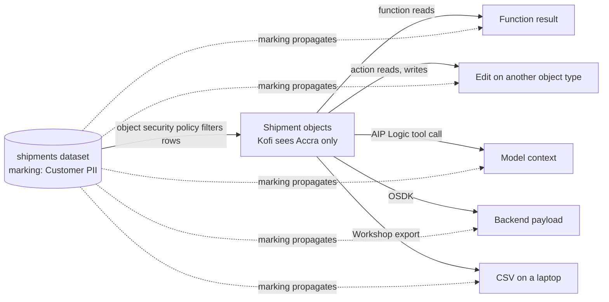

# 01 — Access control propagation

*Sources: [Access control propagation](https://www.palantir.com/docs/foundry/security/access-control-propagation/) · checked October 23, 2026 · Ready for Review*

One page, one idea, and the idea decides most security designs in this area. Written as **a value trace**: follow one protected row through Foundry and watch which controls stay with it. [Ontology 12-04](../../Ontology/12-security-and-governance/04-security-across-actions-functions-and-apis.md) and [02-04](../../Ontology/02-foundry-data-foundations/04-projects-spaces-and-markings.md#propagation-where-discretionary-controls-stop) used this page for the Ontology consequences; this note is the model itself.

## The idea

**[Docs]** Foundry has two families of control, and they differ in one property, **propagation**: "Mandatory controls travel with data through derivation and downstream consumption. Row and column access controls (including restricted views, object security policies, and property security policies) filter what a user can read. These controls do not extend beyond that read."

| Family | Members | Enforced by | After a read |
|---|---|---|---|
| **Mandatory** | Markings (datasets, transactions, files, columns); CBAC (column-level, keyed to clearance); organizations | The platform, "regardless of any user's role or any application's logic" | **Travels.** A dataset built from a marked input inherits the marking on its transactions; a CBAC-tagged column keeps its classification when copied; a resource made in an organization-scoped project inherits the organization |
| **Discretionary** | Project roles; restricted views; object security policies; property security policies | Comparing the user's attributes and groups against the policy at the read | **Stops.** The rows received "are ordinary data. They carry no metadata, classification, or tag that subsequent code can use to re-apply the policy" |

**[Docs]** Mandatory controls are evaluated "against the running user's identity at every point of access", so "no derived artifact can expose data to a user who lacks the required marking, classification, or organization membership".

## The trace

**[Example]** A `Shipment` row for Accra, readable by Kofi under the regional object security policy ([Ontology 12-03](../../Ontology/12-security-and-governance/03-object-and-property-security.md)), backed by a dataset that carries `Customer PII` through its `customerId` join.

**[Docs]** The page lists exactly where the discretionary filter is left behind:

| Operation | What carries over | What doesn't |
|---|---|---|
| **Function return values** | The result is computed under the running user's permissions | The value "is not policy-bound; any consumer that receives it sees the data as-is" |
| **Action edits** | The write target's own access controls | The source policy. An action can read under one policy and write to a type with a different or no row policy |
| **AIP Logic tool calls** | — | Once data is in the model's context, it "can be summarized, transformed, and returned through any of the model's output paths with no remaining association to the source policy" |
| **OSDK responses** | The user's context at the call | "no policy travels with the payload"; the app can render, log, forward |
| **Pipeline Builder Ontology outputs** | The destination object type's controls | Any restricted view policy on the source |
| **Writeback** | The writeback target's controls | The restricted view's policy on the object it backs |
| **Exports and downloads** | Nothing: the artifact is outside Foundry | Everything |

**[Docs]** In every row "the access guarantee holds": the user never read what they weren't allowed to. "What does not hold is propagation".

**[Explanation]** The dotted lines in the diagram are why the marking matters more than the policy in the long run. Kofi's export has Accra rows only, because the policy filtered the read; but the CSV is governed by nothing. If the dataset is **marked**, then every Foundry artifact on the solid lines still requires `Customer PII` from whoever opens it, and the people who may build on `shipments` are the marking's members. The policy decides *which rows Kofi gets*; the marking decides *who may ever hold shipment rows at all*. Only the laptop is beyond both, which is what [05 — Download controls](05-download-controls-and-the-two-deprecated-settings.md) is for.

## Choosing

**[Docs]** Three questions:

| The requirement is… | Use |
|---|---|
| To protect derived artifacts, writebacks, exports or model outputs | A **mandatory** control: marking, CBAC, organization |
| To filter what a user sees at the read, without restricting later derivation | A restricted view, object security policy or property security policy |
| Both | **Both**: a restricted view on a **marked** backing dataset filters rows for users while the marking governs the source and its derivatives |

**[Docs]** "For stronger protection, apply a marking to a restricted view's backing dataset." That also covers consumers who read a **sibling** restricted view or bypass the view entirely.

## The four FAQs, answered

**[Docs]**

1. **Does a read-only restricted view protect data after the read?** No. Read-only "prevents its schema and columns from being altered"; it's an integrity property of the resource, "not a confidentiality guarantee on the rows a user can read".
2. **Can I remove a marking once a granular policy is in place?** You'd be trading "a control that travels through derivation for one that does not". Keep the marking.
3. **Does respecting the security model guarantee enforcement downstream?** It guarantees a user can't read what they're not allowed to. It doesn't keep what they read under the source policy afterwards: "User-permission inheritance provides the access guarantee; it does not provide the propagation guarantee."
4. **Are projects a security boundary?** They're "the primary container for discretionary role grants". A hard boundary that derived artifacts can't escape is a mandatory control; "projects provide role-grant convenience".

**[Explanation]** FAQ 4 is the one to carry into the exam. *Put it in a separate project* answers *who can be granted a role*. It never answers *where can this data end up*. Only a marking, CBAC or organization answers that, and the answer is *everywhere it's derived, and nowhere else*.

## For Kestrel

**[Example]** Kestrel's design already follows the page's three questions: `Kestrel Pay – Financial` and `Customer PII` are markings on the datasets, and the regional and PII **policies** sit on top for reads ([Ontology 12-03](../../Ontology/12-security-and-governance/03-object-and-property-security.md)). Two things this note tightens, *adopted* in Phase 7 ([11](../11-kestrel-case/README.md)):

- **Delivery Desk's exports.** If the queue module's object table keeps Workshop's export to Excel or CSV enabled ([Apps 11-01](../../Apps/11-kestrel-case/01-delivery-desk-queue-built-out.md) doesn't say either way), those exports are the last row of the table: nothing follows them. Kestrel pairs the export with a download **checkpoint** ([05](05-download-controls-and-the-two-deprecated-settings.md), [06-02](../06-approvals-and-checkpoints/02-checkpoints.md)) rather than trusting the regional policy, which stopped at the read.
- **`draftDelayMessage` and the agent.** [Ontology 16-04](../../Ontology/16-ai-and-agents/04-human-in-the-loop-and-staged-writes.md) already keeps the Delivery Desk agent from writing customer contact details into messages. The AIP Logic row above is the platform reason: once a tool returns the `Customer` object into the model's context, the property security policy that hid the email from Kofi has no hold on the text the model writes. The marking still governs who may run the Logic function and see its output; the policy doesn't govern the output's content.

---
[Module index](README.md) · Next: [02 — Restricted views](02-restricted-views.md)
