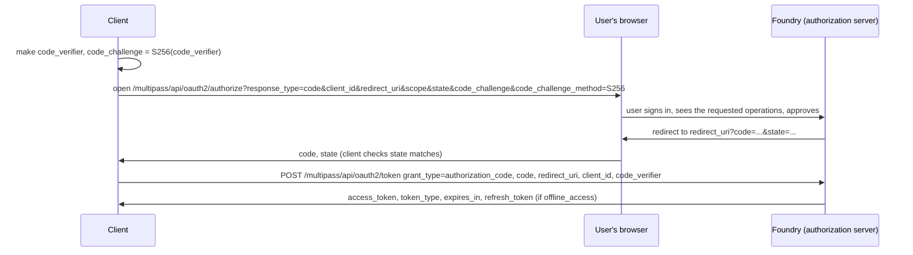

# 02 — OAuth2 clients and user-generated tokens

*Sources: [Writing OAuth2 clients for Foundry](https://www.palantir.com/docs/foundry/platform-security-third-party/writing-oauth2-clients/) · [User-generated tokens](https://www.palantir.com/docs/foundry/platform-security-third-party/user-generated-tokens/) · checked October 23, 2026 · Ready for Review*

A **reference card** for the two ways a program gets a token, followed by a **sequence diagram** of the grant the exam asks about most. [DevTools 02-04](../../DevTools/02-developer-console-and-apis/04-platform-apis.md#authentication) says which grant to use when; this note is what each grant actually sends and receives, and the token rules that cause the 401s.

**[Docs]** OAuth2 lets a client get access "through the use of specifically-issued access tokens and refresh tokens, rather than a user's credentials or static bearer tokens". Grants are "methods of obtaining access tokens". Throughout: *client* is the third-party app, *authorization server* is Foundry, *user* is the end user. Registration ([01](01-third-party-applications-in-control-panel.md)) comes first. The **Foundry Third-Party Application & API Agreement** governs all of it ([03](03-third-party-application-and-api-guidance.md)).

## The two grants

| | Authorization code | Client credentials |
|---|---|---|
| Acts as | An existing Foundry **user**, who "must explicitly grant the client access" | A **service user** created for the client; "not associated to normal Foundry users"; its username is the **client ID** |
| Starting permissions | The user's, narrowed by the requested scope | **None**: "A Foundry administrator must assign the desired roles and permissions to the service user" |
| PKCE | Recommended for confidential clients, **required** for public ones | Not applicable |
| Refresh token | Yes, with the `offline_access` scope | No (just request a new token) |
| Client secret | At the token exchange (confidential clients) | Always |

## Authorization code grant, step by step

**[Docs]** The pieces:

- **`code_verifier`**: a cryptographically random string of `A-Z a-z 0-9 - . _ ~`, **43 to 128** characters. **`code_challenge`**: its SHA-256, Base64-URL-encoded without padding; `code_challenge_method` is `S256`.
- **`scope`**: space-separated; the public API scopes are in the API documentation; add **`offline_access`** for a refresh token.
- **`state`**: a random string the app generates and checks on return "to prevent CSRF attacks".
- **`redirect_uri`**: if omitted, "it will default to the first redirect URI value" registered. The authorization **code expires after 10 minutes**.
- The **token request** is `application/x-www-form-urlencoded`. The response carries `access_token`, `token_type`, `expires_in` (seconds), and `refresh_token` only if `offline_access` was requested.

**[Explanation]** Why the verifier and the challenge are two things: the challenge goes through the browser, where it can be seen; the verifier never leaves the client. An attacker who steals the code from the redirect can't exchange it without the verifier. That's what makes a public client safe without a secret, and why the registration page insists on PKCE for anything whose binary users can read.

## Client credentials grant

**[Docs]** One call: `POST` the token endpoint with `grant_type=client_credentials`, `client_id` and `client_secret`; get `access_token`, `token_type`, `expires_in`. No refresh token: the client simply asks again.

## Refreshing, and the rules that revoke

**[Docs]** Access tokens expire. A client that must work while the user is away requests `offline_access`, saves the `refresh_token`, and when the access token expires calls the token endpoint with `grant_type=refresh_token`, the `refresh_token`, `client_id` and `client_secret`. The response includes a **new** refresh token: "Foundry rotates the refresh token each time the previously issued refresh token is used. Make sure you save both the access_token and the refresh_token."

| **[Docs]** Rule | Effect |
|---|---|
| **Rotation** | Every use of a refresh token issues a new one; the old one is spent |
| **Reuse detection** | If a refresh token is reused more than **one minute** after its first use, "all access tokens created from this grant are invalidated and a new authorization flow is required". The one-minute grace covers transient failures such as a network error |
| **Inactivity** | Refresh tokens unused for **30 days** are invalidated |

**[Explanation]** Rotation plus reuse detection is a stolen-token alarm. If both the client and a thief hold the same refresh token, whichever uses it second (after a minute) trips the detector and both lose access, which is the outcome you want. The practical consequence for developers: store the newest refresh token **atomically** with the access token. A client that crashes between receiving the pair and saving it will present the old token next time, look like a thief, and force the user back through the browser.

## The endpoints

**[Docs]**

| Endpoint | Parameters |
|---|---|
| `GET /multipass/api/oauth2/authorize` | `response_type=code`, `client_id`, `redirect_uri` (must match a registered one), `scope`, optional `state`, `code_challenge`, `code_challenge_method` |
| `POST /multipass/api/oauth2/token` | Header `Content-Type: application/x-www-form-urlencoded`; body `grant_type` (`authorization_code`, `refresh_token` or `client_credentials`), then `code`, `refresh_token`, `redirect_uri`, `scope`, `client_id`, `client_secret`, `code_verifier` as the grant requires |

**[Docs]** Errors: the browser is redirected only when access is **denied**; otherwise an HTML error page carries `error` and `error_description`. Codes: `invalid_request`, `unauthorized_client`, `access_denied`, `unsupported_response_type`, `invalid_scope`, `server_error`.

## User-generated tokens

**[Docs]** A personal token, made under *Account > Settings > Tokens* with a name, description and expiry, is shown once and "equivalent to possessing a user's username and password". Tokens can be **disabled** (temporary) or **revoked** (permanent) there. The boxed warning: personal tokens "must not be used in production applications or committed to shared or public code repositories"; keep test tokens in environment variables; production applications register an OAuth2 application.

**[Docs]** The inactivity rule from [01-03](../01-organizations-projects-users-and-groups/03-users-groups-and-portfolios.md): after **30 days** without a login the account is deactivated and its user-generated tokens **and** tokens issued to OAuth2 clients become invalid, while the user "will otherwise appear fully active" and their scheduled work, such as schedules they own, keeps running. Logging in reactivates everything; exemptions are arranged with Palantir.

**[Explanation]** That last sentence is the diagnostic clue the exam likes: *the schedule still runs but the integration gets 401s* means the owner hasn't logged in for a month, not that the token was revoked. The fix is a login, or moving the integration to a service user, which never has this problem because it never "logs in" at all.

## For Kestrel

**[Example]** Kestrel's portal already uses client credentials with a service user and keeps the secret in a secret store ([DevTools 09-01](../../DevTools/09-kestrel-case/01-customer-portal-built-out.md)). *Adopted* in Phase 7 ([11](../11-kestrel-case/README.md)):

- The **support portal**, which acts as support staff, uses the authorization code grant **with PKCE even though it's a confidential client**, as the page recommends, requests `offline_access` so an agent's open case view survives an expired token, and stores the rotated refresh token atomically.
- **No personal tokens in any Kestrel repository**: a code-scanning rule ([10-05](../10-privacy-governance-and-enterprise-security/05-code-scanning.md)) flags the token shape, and developers use short-lived personal tokens in environment variables for local testing only.
- Any scheduled job that calls a Foundry API on Kestrel Pay's behalf (the model records none yet; month-end reporting is the likely first) is owned by a **service user** in `kestrel-service-users` ([01-03](../01-organizations-projects-users-and-groups/03-users-groups-and-portfolios.md#for-kestrel)), never by Lena, so a month without her logging in can't silently break it.

---
[Module index](README.md) · Previous: [01 — Third-party applications in Control Panel](01-third-party-applications-in-control-panel.md) · Next: [03 — Third-party application and API guidance](03-third-party-application-and-api-guidance.md)
