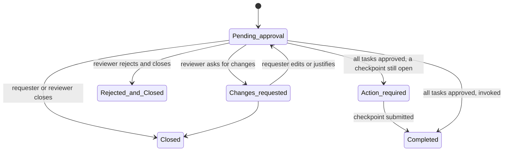

# 01 — Approvals

*Sources: [Approvals](https://www.palantir.com/docs/foundry/approvals/overview/) · [Review a request](https://www.palantir.com/docs/foundry/approvals/review-a-request/) · checked October 23, 2026 · Ready for Review*

A **state machine and a reviewer's guide**. Approvals is the application that every "request access" button in module 01, every ontology proposal in [Ontology 14-02](../../Ontology/14-lifecycle-and-operations/02-branching-and-proposals.md) and every restricted-view merge in [03-02](../03-discretionary-controls-propagation-and-diagnosis/02-restricted-views.md#on-a-branch) lands in. The earlier areas used it; this note explains it.

**[Docs]** The loop: a user who lacks permission to make a change **requests** it; the request is routed to administrators for **approval**; when the necessary approvals are in, the request is **invoked** and the change applied. The application "consolidates compliance, governance, and peer-review workflows", reachable in Foundry or, for some administrative workflows, in Control Panel. Named examples: project access requests and ontology proposals. The privacy framing: use approval steps "for sensitive or consequential changes that require accountability to a designated person".

## Requests and tasks

**[Concept]** A **request** is a bundle of **tasks**; "All tasks associated with a request must be approved for the request to be invoked and requested changes to be applied." A task is one change, with its own eligible reviewers:

| **[Docs]** Task | Who can approve |
|---|---|
| **Group membership** | *Manage permissions* or *Manage membership* on the group |
| **Project access request** (a role granted directly) | **Owner** on the project |
| **Marking access request** | *Manage permissions* on the marking |
| **Add reference request** | **Editor or Owner** on the project |
| **Ontology proposal** (opens Ontology Manager) | **Owner** on the Ontology |

**[Explanation]** The table is the permission model of modules 01–02 seen from the other side: whoever could have done the thing directly is who can approve someone else doing it. The page states this as the default rule for eligibility: "users who have the permission to perform an action themselves are eligible to review the corresponding task". So a request for `Customer PII` plus a project role is **two** tasks with two reviewer pools, and it completes only when both have said yes.

### States

**[Docs]** Request states: *Pending approval*; *Closed* (without invoking; "cannot be reopened"); *Rejected and Closed* (likewise final); *Changes requested* (stays open; the requester can edit or add justification); *Action required* (every task approved but something else is needed, for example a required **checkpoint** not yet submitted); *Completed* (invoked). Task states: *Review* (default), *Approved*, *Rejected*; a rejected task can still be **overridden with an approval** by an eligible reviewer while the request is open.

**[Docs]** Who may act: the requester or any eligible reviewer can **edit or close**; only eligible reviewers can **approve, reject, or reject and close**. Actions are taken at request level and applied only to the tasks that reviewer is eligible for.

## Reviewing

**[Docs]** Filter the inbox to *Requests to review* (also *Your inbox*, *Created by you*; completed requests are kept "as an audit log of past decisions"). The page's advice: "Consider the effect of the entire request when reviewing, even though you can review and approve tasks individually." Its example: a reviewer with *Manage permissions* on the *Aircraft delays [Datasource] - Viewer* group but not on the PII marking can approve the group task and must wait for a marking administrator to approve the other.

| Tool | **[Docs]** use |
|---|---|
| **Comments** | On the whole request or one task; links and file uploads allowed, for example to "upload necessary legal documents required for approval" |
| **Invite reviewers** | Eligible users are usually assigned automatically; inviting someone else notifies them, but "does not grant permissions to view a request or approve tasks" |
| **+ Review** | Approve or reject one task; *Approve all* / *Reject all* act on every task you're eligible for |

**[Docs]** If a **checkpoint** is configured for the action behind a task, its justification is required too; the requester usually completes it when requesting, and if not "eligible reviewers can complete checkpoints on behalf of the requesting user" ([02](02-checkpoints.md)).

**[Docs]** Notifications (email or in Foundry, under *Account > Settings > Notifications*): *Added as reviewer* (on creation, or when added manually; sent for group-based eligibility only when the group has **fewer than 50** members), *Invocation succeeded*, *Request closed*, *Request created*, *Reviewer nudge*.

**[Explanation]** The fewer-than-50 rule is why a "request access" that routes to a big viewers group can sit unnoticed: nobody was told. Keep the groups that **approve** small (the owners group, the marking administrators) and let the big groups be the ones people join, which is the three-group pattern from [01-03](../01-organizations-projects-users-and-groups/03-users-groups-and-portfolios.md#the-recommended-project-setup) again.

## For Kestrel

**[Example]** Kestrel's existing approvals: the two-approval policy on protected ontology projects ([Ontology 14-01](../../Ontology/14-lifecycle-and-operations/01-saving-reviewing-and-restoring.md)), proposals on branches ([DevTools 06-01](../../DevTools/06-branching-and-cross-app/01-global-branching.md)), and the access requests module 01 set up. *Adopted* in Phase 7 ([11](../11-kestrel-case/README.md)):

- **Who approves what**, so no request stalls: `-owners` groups are three to five people per project; `Customer PII` and `Kestrel Pay – Financial` each have two *Manage permissions* holders (not one, so holidays don't block); the Ontology Owner pool for proposals is the `ontology-governance` group that already approves on `Commerce [Ontology]` ([Ontology 14-02](../../Ontology/14-lifecycle-and-operations/02-branching-and-proposals.md)).
- **A request to join `commerce-ontology-viewers` and gain `Customer PII`** is one request with two tasks; Kestrel's cover page ([02-03](../02-markings-and-mandatory-controls/03-property-security-markings-and-cover-pages.md)) tells the requester to expect two reviewers and to attach the training certificate in the request's comments, which the docs say is what comments are for.
- **Completed requests are the access audit trail.** Lena's quarterly review of who holds `Kestrel Pay – Financial` starts from the Approvals inbox filtered to marking-access tasks, before the audit logs ([10-02](../10-privacy-governance-and-enterprise-security/02-audit-logs.md)).

---
[Module index](README.md) · Next: [02 — Checkpoints](02-checkpoints.md)
