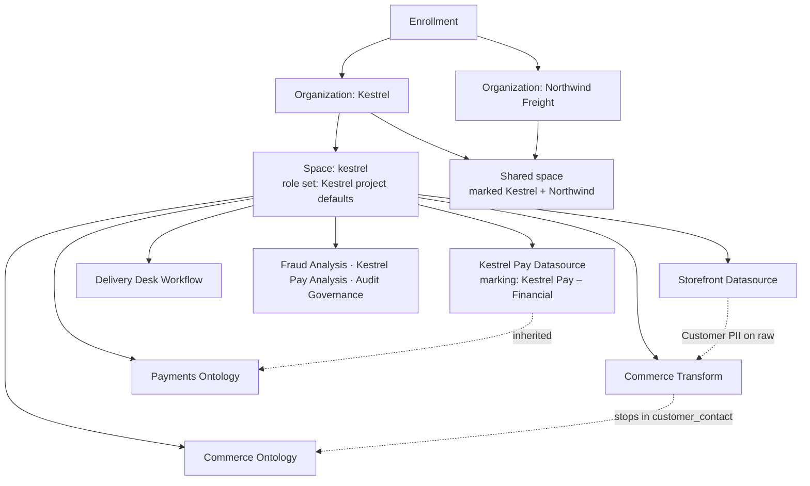

# 01 — Kestrel's access model, built out

*Sources: no new doc pages; every row links to the note that holds the docs' wording · written October 23, 2026 · Ready for Review. Everything here is **[Example]** unless a line says otherwise.*

[Ontology 17-02 §7](../../Ontology/17-case-studies/02-kestrel-reference-model.md#7-security-environments-and-governance) recorded Kestrel's security in nine lines, written while the Ontology area was the only area. This page is the **build record** of the containers, roles, groups and markings the Security notes added around those lines: each decision, the choice, and the note that holds the doc rule behind it. The register that fed it is [00-02](../00-orientation/02-kestrels-security-posture.md); its row numbers appear in the first column so the two can be checked against each other. With this note, 17-02 §7 is updated and the *proposed* markers in modules 01–10 are **adopted**, except where a row below says otherwise.

**What the model has to do:** let Ama's operations team, Kofi's regional warehouse staff, Daniel's portal and the Delivery Desk agent work on commerce data; keep Kestrel Pay's ledger in Lena's and Tomás's hands; let Northwind Freight see shipments and nothing else; and leave a trail Kestrel can audit.

## The shape

**[Explanation]** Three walls, three mechanisms. Organizations keep Northwind out of everything but the shared space ([01-01](../01-organizations-projects-users-and-groups/01-organizations-spaces-and-enrollments.md)); markings keep the ledger and the customer contact details inside the groups that need them, wherever the data flows ([02-01](../02-markings-and-mandatory-controls/01-markings-and-classification-based-access-controls.md)); roles decide what each person may *do* inside what they are allowed to *see* ([01-02](../01-organizations-projects-users-and-groups/02-projects-roles-and-project-templates.md#6-what-exactly-does-a-role-let-someone-do)). Nothing below relies on one mechanism to do another's job.

## Containers

| Row | Decision | Choice | Note |
|---|---|---|---|
| 1 | *Expand access* on the Kestrel organization | Held by the security reviewer group only; *Apply organization* is wider. Widening access is the dangerous direction | [01-01](../01-organizations-projects-users-and-groups/01-organizations-spaces-and-enrollments.md#for-kestrel) |
| 2 | Usage accounts | The `kestrel` space default; `Payments [Ontology]` overridden to a Kestrel Pay account; the shared space on its own account | [01-01](../01-organizations-projects-users-and-groups/01-organizations-spaces-and-enrollments.md#for-kestrel) |
| 3 | Project inherited roles on `kestrel` | The platform administrators group inherits Owner on every project; nothing else is inherited | [01-01](../01-organizations-projects-users-and-groups/01-organizations-spaces-and-enrollments.md#for-kestrel) |
| 23 | Projects | The six in the chain plus three added by this area: `Fraud [Analysis]` (row 19), `Kestrel Pay [Analysis]` (row 18), `Audit [Governance]` (row 42). The data foundation walkthrough's shape, with raw data governed by roles and markings, never by project markings | [04-01](../04-securing-data-and-applications/01-securing-a-data-foundation.md#for-kestrel) |
| 26 | Northwind | Mutual organization discoverability; Kestrel's users and groups hidden from Northwind except the shared-project groups; Northwind's administrators through a group synced from their identity provider; the shared space marked with both organizations | [04-04](../04-securing-data-and-applications/04-cross-organization-collaboration.md#for-kestrel) |
| 6 | Role set | A Kestrel copy of *Project defaults* on the `kestrel` space, adding the `Merger` role (Viewer plus the merge operations) for release engineers who may merge to protected branches without being Editors | [01-02](../01-organizations-projects-users-and-groups/02-projects-roles-and-project-templates.md#for-kestrel) |

## Projects and templates

| Row | Decision | Choice | Note |
|---|---|---|---|
| 4 | Templates | `kestrel-standard`: creates `<project>-viewers`, `-editors`, `-owners` groups, the owner group managing the other two, Discoverer as the default role, the creator as Owner. `kestrel-pay`: the same, plus the `Kestrel Pay – Financial` marking at project level and the constraint in row 19; used by `Kestrel Pay [Datasource]` only. `Payments [Ontology]` takes `kestrel-standard` plus the constraint and stays unmarked at project level, as [Ontology 02-04](../../Ontology/02-foundry-data-foundations/04-projects-spaces-and-markings.md#kestrels-layout) decided, so its types' existence is visible and the marking arrives on the datasets by inheritance | [01-02](../01-organizations-projects-users-and-groups/02-projects-roles-and-project-templates.md#for-kestrel) |
| 5 | Role grants on folders and files | Off in every project, so there are no per-file grants and no share links; sharing means a role on the project or a move | [01-02](../01-organizations-projects-users-and-groups/02-projects-roles-and-project-templates.md#role-grants-on-folders-and-files) |
| 19 | Project constraints | *Allowed markings*: `Kestrel Pay – Financial` only on `Kestrel Pay [Datasource]`, `Payments [Ontology]`, `Kestrel Pay [Analysis]`. *Prohibited*: `Kestrel Pay – Financial` on `Delivery Desk [Workflow]`, so a ledger dataset can never be moved or derived into the operations app. `Fraud [Analysis]` allows both markings, the one project where Tomás joins customer and payment data | [03-03](../03-discretionary-controls-propagation-and-diagnosis/03-project-constraints.md#for-kestrel) |
| 15 | Cover pages | Every project has one; the payments projects' pages are discoverable to the whole organization with purpose, owner and the request path, and nothing about the data | [02-03](../02-markings-and-mandatory-controls/03-property-security-markings-and-cover-pages.md) |
| 34 | Compass | Resource Curator on the space for Ama and Lena; the Delivery Desk queue and two Object Views promoted; the payments projects' trash permanently emptied monthly | [08-01](../08-compass/01-compass-projects-and-navigation.md#for-kestrel) |
| 35 | Tags and uploads | Tag categories `source`, `refresh`, `owner`; a `Delivery Desk` collection curated by Ama; manual uploads allowed only in `Storefront [Datasource]/manual`, behind the import checkpoint | [08-02](../08-compass/02-moving-sharing-tagging-uploading-and-the-data-catalog.md#for-kestrel) |

## Groups and people

| Row | Decision | Choice | Note |
|---|---|---|---|
| 8 | Portfolios | `Commerce` (curator Ama: the four commerce projects, the Delivery Desk's documentation as its page) and `Kestrel Pay` (curator Lena); none for the shared space. Closes the gap 17-02 §9 had carried since the Ontology area | [01-03](../01-organizations-projects-users-and-groups/03-users-groups-and-portfolios.md#for-kestrel) |
| 9 | Group hygiene | Groups synced from the identity provider are nested inside the template groups, never granted roles directly; `kestrel-service-users` excluded from the 30-day inactivity rule; `kestrel-pay-auditors` carries a maximum membership duration; the `region` attribute comes from the identity provider for Kofi's policy | [01-03](../01-organizations-projects-users-and-groups/03-users-groups-and-portfolios.md#for-kestrel) |
| 24 | Audiences of the Delivery Desk | CS agents and warehouse staff through `delivery-desk-viewers`; Daniel through `delivery-desk-editors` and `commerce-ontology-editors`; Priya through the transform and datasource editor groups; Lena's team on the payments projects; Tomás in `fraud-analysis-editors`; Kestrel Pay engineers in the Kestrel Pay groups. Writeback datasets stay in `Commerce [Ontology]` | [04-02](../04-securing-data-and-applications/02-securing-an-operational-application.md#for-kestrel) |
| 37 | Data Governance Officers | Lena and one platform administrator, each with Viewer on the space, which is what lets them scan it and review checkpoint records | [09-02](../09-sensitive-data-scanner-and-data-lifetime/02-match-conditions-match-actions-best-practices-and-media-sets.md#for-kestrel) |
| 41 | Chain of responsibility | Data owners (Priya for storefront and commerce data, Lena for Kestrel Pay, Ama for customer-service records); Lena as governance lead with Priya and a platform administrator; the two officers; legal for retention and the privacy notice. A purpose statement per project, summarized on its cover page; the review calendar | [10-01](../10-privacy-governance-and-enterprise-security/01-privacy-civil-liberties-and-data-protection.md#for-kestrel) |

### Who holds what

The people from [Ontology 00-04](../../Ontology/00-orientation/04-running-example.md), read against the groups above. Roles are on projects; markings are memberships; the last column is what the combination lets them do.

| Person | Roles (through groups) | Marking memberships | Net effect |
|---|---|---|---|
| **Ama** (operations lead) | Data owner of the customer-service records (row 41); `-owners` on `Delivery Desk [Workflow]` (new here: the app her team runs); her CS agents are `-viewers` on `Commerce [Ontology]` and `Delivery Desk [Workflow]`; Resource Curator; `Commerce` Portfolio curator | `Customer PII` (her team lead grants it after training) | Runs the commerce side end to end; never sees the ledger |
| **Kofi** (Accra, regional) | `-viewers` on `Commerce [Ontology]` and `Delivery Desk [Workflow]` with the warehouse staff | None | Sees his region's shipments only, because the object security policy on `Shipment` compares his `region` attribute; the property policy hides customers' contact details from him ([Ontology 12-03](../../Ontology/12-security-and-governance/03-object-and-property-security.md)) |
| **Lena** (Kestrel Pay finance) | Data owner of the payments projects; her team `-viewers` on `Payments [Ontology]` and `Commerce [Ontology]`; Editor on `Kestrel Pay [Analysis]` (new here); `checkpoints:review-records` on the payments projects through a custom role; Data Governance Officer; `Kestrel Pay` Portfolio curator | `Kestrel Pay – Financial`, `Customer PII` | Owns the ledger data, reviews its checkpoint records, runs the scans and the deletion policies |
| **Tomás** (fraud) | `-viewers` on `Payments [Ontology]` and `Commerce [Ontology]`; Editor on `Fraud [Analysis]` (new here); the Operational User decrypt licence | Both markings | The only person who joins payments to customers, and only inside `Fraud [Analysis]` |
| **Priya** (data engineer) | `-editors` on the datasource and transform projects and on `Commerce [Ontology]`; `-viewers` on `Delivery Desk [Workflow]`; her senior pipeline developers hold `Merger` | `Customer PII` | Builds the commerce pipelines; a marking is lifted only through the security-approved branch policy (row 11) |
| **Kestrel Pay engineers** | `-editors` on `Payments [Ontology]` and `Kestrel Pay [Datasource]`; *Apply* and *Remove* on `Kestrel Pay – Financial`; the Data Manager encrypt licence | `Kestrel Pay – Financial` | Own the ledger pipeline and the Cipher channel; never touch the keys |
| **Daniel** (app developer) | `-editors` on `Commerce [Ontology]` and `Delivery Desk [Workflow]`; no role on the payments projects; not an administrator | `Customer PII` | Builds the app and the portal; cannot see the ledger; cannot emulate Kofi's attribute |
| **Service users** (portal, nightly export, `kestrel-audit-reader`) | Reads through the restricted applications; an explicit branch in `Shipment`'s policy for the portal | None, except the audit reader's membership of the `Audit` marking | Each sees exactly what its application restrictions allow ([DevTools 09-01](../../DevTools/09-kestrel-case/01-customer-portal-built-out.md)) |

**[Explanation]** Daniel's row is the one the exam likes. He is Editor on the application project and the ontology project, so he can change almost anything the Delivery Desk is made of, and he still cannot open a payments dataset: an Editor role is a set of operations on resources he is allowed to see, and the marking decides what he is allowed to see ([01-02](../01-organizations-projects-users-and-groups/02-projects-roles-and-project-templates.md#6-what-exactly-does-a-role-let-someone-do)). Tomás is the mirror image: a Viewer almost everywhere, and the only Editor in the one project whose constraints let both markings meet.

## Markings and the other mandatory controls

| Row | Decision | Choice | Note |
|---|---|---|---|
| 10 | Category and permissions | One visible category `Kestrel data` holding `Customer PII`, `Kestrel Pay – Financial` and `Audit` (row 42), restricted to the Kestrel organization. *Manage permissions* with the platform administrators; *Apply* and *Remove* `Customer PII` with the pipeline leads, `Kestrel Pay – Financial` with the Kestrel Pay engineers; membership granted by Ama's and Lena's leads after training, with the certificate in the request | [02-01](../02-markings-and-mandatory-controls/01-markings-and-classification-based-access-controls.md#for-kestrel) |
| 11 | Where `Customer PII` stops | In `Commerce [Transform]`: `customer_contact` (new, keeps the marking) splits from `customer_master` (`stop_propagating`). The `Customer` object type backs onto both, and the property security policy hides the contact properties from anyone outside the marking. The transform project's main branch is protected with security approvals, because that merge is the single point where a mandatory control is lifted | [02-01](../02-markings-and-mandatory-controls/01-markings-and-classification-based-access-controls.md#for-kestrel) |
| 13 | Granular policies | Kofi's regional policy reads a dedicated `policyRegion` column, kept non-null and valid by an invariant transform, with a statistics check that stops the build if more than a fifth of the values shift between runs; no NOT conditions anywhere | [02-02](../02-markings-and-mandatory-controls/02-granular-policies.md#for-kestrel) |
| 14 | Property security marking pills | Shown on the Kestrel Pay Object Tables, off on the warehouse-floor module. A display feature, never a control | [02-03](../02-markings-and-mandatory-controls/03-property-security-markings-and-cover-pages.md) |
| 16 | Propagation | Delivery Desk exports pass a download checkpoint; the agent's message drafts are governed by the markings on the data it reads, not by the property policy | [03-01](../03-discretionary-controls-propagation-and-diagnosis/01-access-control-propagation.md#for-kestrel) |
| 18 | Restricted view | `refunds_rv` in `Kestrel Pay [Analysis]` for Lena's Contour analyses, protected; the marking stays on the underlying dataset | [03-02](../03-discretionary-controls-propagation-and-diagnosis/02-restricted-views.md#for-kestrel) |

## Applications and tokens

| Row | Decision | Choice | Note |
|---|---|---|---|
| 27 | Control Panel | Both portals managed by Kestrel and not discoverable to Northwind; organization-level consent off; enablement restrictions unrestricted, because the Developer Console restrictions already bound the tokens; the *Third-party application administrator* role held by the platform administrators only | [05-01](../05-third-party-applications-and-tokens/01-third-party-applications-in-control-panel.md#for-kestrel) |
| 28 | OAuth2 | The support portal uses authorization code with PKCE and `offline_access`, storing rotated refresh tokens atomically; API-calling jobs are owned by service users, never by a person's token; a code-scanning rule catches personal tokens in repositories (row 45) | [05-02](../05-third-party-applications-and-tokens/02-oauth2-clients-and-user-generated-tokens.md#for-kestrel) |
| 29 | Integration review | The six-item review for every new integration; the support portal's standing rule that every query runs with the current agent's own token | [05-03](../05-third-party-applications-and-tokens/03-third-party-application-and-api-guidance.md#for-kestrel) |
| 43 | Identity | A service-account register with owner, purpose, rotation date and allowed address range; hardware keys for administrators, the officers and marking managers, authenticator apps for everyone else; the office and VPN ranges allow-listed and mirrored in conditional access; the token-spill procedure; uploads only from managed workstations. Central Auth not adopted (Kestrel has its own identity provider) | [10-03](../10-privacy-governance-and-enterprise-security/03-protecting-identity-tokens-phishing-and-files.md#for-kestrel) |
| 45 | Code scanning | Enrollment-wide, Error mode; two custom rules: the shape of a Foundry token, and any use of `stop_propagating` or `stop_requiring` outside the approved transform | [10-05](../10-privacy-governance-and-enterprise-security/05-code-scanning.md#for-kestrel) |

## Diagnosis, approvals and release

| Row | Decision | Choice | Note |
|---|---|---|---|
| 20 | Release checklist | Before a Delivery Desk release: emulation mode with `delivery-desk-viewers` only; *Check access* for one newly added agent; Kofi's regional policy tested in the test enrollment, because emulation cannot change an attribute | [03-04](../03-discretionary-controls-propagation-and-diagnosis/04-diagnosing-access.md#for-kestrel) |
| 30 | Approvals | Every approver pool has two or more members; `ontology-governance` approves ontology proposals; marking requests carry the training certificate; the Approvals history is the first source for the quarterly marking review | [06-01](../06-approvals-and-checkpoints/01-approvals.md#for-kestrel) |
| 31 | Checkpoints | Four configurations: payments export, *Issue refund*, marking member addition, secret rotation (detailed in [02](02-kestrel-pays-sensitive-data.md)); none on *Re-route shipment* or *Hold order* | [06-02](../06-approvals-and-checkpoints/02-checkpoints.md#for-kestrel) |
| 42 | Audit | An audit.3 export in `Audit [Governance]` behind the `Audit` marking; the `kestrel-audit-reader` application; four standing queries; portal usage reconciled with Developer Console metrics | [10-02](../10-privacy-governance-and-enterprise-security/02-audit-logs.md#for-kestrel) |
| 44 | Recovery | Every dataset re-ingestable from its source system; Rescue retention requested at 30 days; monthly dependency rebuilds; SafeBase subscription; the incident route | [10-04](../10-privacy-governance-and-enterprise-security/04-infrastructure-security-and-disaster-recovery.md#for-kestrel) |

## Considered, not adopted

| Row | Candidate | Why not |
|---|---|---|
| 7 | A `Merger` role in the shared Northwind space | Nothing in the shared space is merged by Kestrel staff who aren't Editors; the role set there stays *Project defaults* ([01-02](../01-organizations-projects-users-and-groups/02-projects-roles-and-project-templates.md#for-kestrel)) |
| 12 | Classification markings (CBAC) | Kestrel has two categories of sensitive data and no classification hierarchy; ordinary markings express it ([02-01](../02-markings-and-mandatory-controls/01-markings-and-classification-based-access-controls.md#part-3--classification-markings-cbac)) |
| 17 | A restricted view for Kofi's region | The object security policy already does the work at the ontology layer, and a restricted view can't feed a transform ([03-02](../03-discretionary-controls-propagation-and-diagnosis/02-restricted-views.md#for-kestrel)) |
| 33 | A decrypting function, visual obfuscation, shipping the Cipher channel in a product | Covered in [02](02-kestrel-pays-sensitive-data.md#considered-not-adopted) |
| 40 | Latest-view-only deletion policies | Covered in [03](03-the-customer-data-lifecycle.md#considered-not-adopted) |

## Still open

| Row | Question | Needs |
|---|---|---|
| 21, 22 | How Kestrel's enrollment enforces downloads; if enforced, an `Exporter` role and `foundry-data-proxy:get-files` removed from the default roles | Palantir ([03-05](../03-discretionary-controls-propagation-and-diagnosis/05-download-controls-and-the-two-deprecated-settings.md#for-kestrel)) |
| 25 | The transaction types of Kestrel's pipelines, which decide how a marking is removed and how deletion policies behave | Priya's pipeline records ([04-03](../04-securing-data-and-applications/03-protecting-sensitive-data-and-requesting-justification.md)) |
| 26 | Northwind's ingress addresses | Northwind ([04-04](../04-securing-data-and-applications/04-cross-organization-collaboration.md#for-kestrel)) |
| 34 | Whether autosave stays on in the payments projects | Lena ([08-01](../08-compass/01-compass-projects-and-navigation.md#for-kestrel)) |

These are carried into [17-02 §9](../../Ontology/17-case-studies/02-kestrel-reference-model.md#9-known-gaps-in-the-example) with the ledger-retention and Rescue-retention questions from [02](02-kestrel-pays-sensitive-data.md) and [03](03-the-customer-data-lifecycle.md).

---
[Module index](README.md) · Next: [02 — Kestrel Pay's sensitive data](02-kestrel-pays-sensitive-data.md)
