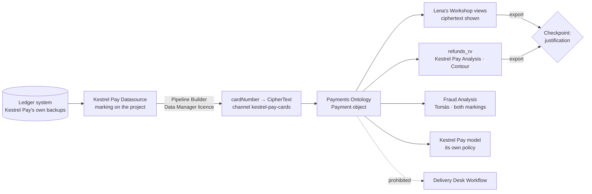

# 02 — Kestrel Pay's sensitive data

*Sources: no new doc pages; every row links to the note that holds the docs' wording · written October 23, 2026 · Ready for Review. Everything here is **[Example]** unless a line says otherwise.*

The ledger is the data Kestrel can least afford to leak and most needs to use: Lena's team reconciles it, Tomás hunts fraud in it, the Kestrel Pay model reads it, and the Delivery Desk must never see it. [01](01-kestrels-access-model-built-out.md) built the containers; this page follows **one payment record** from the ledger to each of its readers and records which control sits at each step. The register rows from [00-02](../00-orientation/02-kestrels-security-posture.md) are in the first column.

## The path

## Step by step

| Row | Step | Control | Note |
|---|---|---|---|
| — | The ledger arrives in `Kestrel Pay [Datasource]` | `Kestrel Pay – Financial` is on the **project**, so every dataset in it and every dataset derived from them carries the marking without anyone applying it ([Ontology 02-04](../../Ontology/02-foundry-data-foundations/04-projects-spaces-and-markings.md#kestrels-layout)). The `kestrel-pay` template applies it to any new payments datasource project; `Payments [Ontology]` itself stays unmarked and its datasets inherit | [02-01](../02-markings-and-mandatory-controls/01-markings-and-classification-based-access-controls.md#two-ways-a-marking-is-inherited), [01-02](../01-organizations-projects-users-and-groups/02-projects-roles-and-project-templates.md#for-kestrel) |
| 19 | The marking may not leave | *Allowed markings* on the three payments projects; *Prohibited* on `Delivery Desk [Workflow]`. A move or a derived dataset into the operations app fails at the constraint, before anyone has to notice | [03-03](../03-discretionary-controls-propagation-and-diagnosis/03-project-constraints.md#for-kestrel) |
| 32 | Card numbers are encrypted at ingestion | Channel `kestrel-pay-cards`, AES_SIV, deterministic so fraud analysis can count payments per card; the ledger pipeline encrypts the column in Pipeline Builder with a Data Manager licence, so nothing in Kestrel needs the keys; **no Admin licence** exists | [07-01](../07-cipher/01-cipher-concepts-and-getting-started.md#for-kestrel), [07-02](../07-cipher/02-cipher-workflows.md#for-kestrel) |
| 32 | `Payment.cardNumber` is a CipherText property | Plaintext type string. Lena's Workshop views show the ciphertext and offer no decryption; Tomás's group holds the only decrypt licence, Operational User, rate-limited to 20 decryptions an hour, with the justification prompt as the audit trail, and not allowed to bypass checkpoints | [07-02](../07-cipher/02-cipher-workflows.md#for-kestrel) |
| 14 | Readers see what is protecting the row | Property security marking pills on the Kestrel Pay Object Tables. A display feature: it tells Lena's team why a column is blank, it protects nothing | [02-03](../02-markings-and-mandatory-controls/03-property-security-markings-and-cover-pages.md) |
| 18 | Lena's analyses read a restricted view | `refunds_rv` in `Kestrel Pay [Analysis]`, protected, the marking left on the underlying dataset. A restricted view filters rows for Contour; it can't be an input to a transform, so nothing derives from it | [03-02](../03-discretionary-controls-propagation-and-diagnosis/02-restricted-views.md#for-kestrel) |
| 19 | Tomás joins payments to customers | Only in `Fraud [Analysis]`, the one project whose constraints allow both markings; he holds both memberships and is Editor there, Viewer elsewhere | [03-03](../03-discretionary-controls-propagation-and-diagnosis/03-project-constraints.md#for-kestrel), [01](01-kestrels-access-model-built-out.md#who-holds-what) |
| — | The Kestrel Pay model reads the ledger | The model's own policy allows `Customer PII` and `Kestrel Pay – Financial`; users holding the payments marking use scoped sessions for every other model, so a marked row never reaches a model that isn't allowed it | [AIP 08-03](../../AIP/08-security-governance-and-admin/03-llm-data-access-with-markings.md) |
| 31 | An export asks why | Three checkpoint configurations (Compass export, object set export, Contour export) matched on the `Kestrel Pay – Financial` marking, `kestrel-service-users` exempt; dropdown reason plus mandatory free text. *Issue refund* asks for a ticket reference; marking-member addition asks for the training acknowledgment; rotating a client secret asks for re-authentication | [06-02](../06-approvals-and-checkpoints/02-checkpoints.md#for-kestrel) |
| 21, 22 | Whether the download itself is blocked | Depends on how the enrollment enforces downloads: open. If enforced, `foundry-data-proxy:get-files` leaves the default roles and an `Exporter` role is granted to Lena's group and the release group | [03-05](../03-discretionary-controls-propagation-and-diagnosis/05-download-controls-and-the-two-deprecated-settings.md#for-kestrel) |
| 36 | New card numbers are found before they spread | The boundary scan includes `Kestrel Pay [Datasource]` with the built-in card-number condition and a content regex at a 60% threshold; run first without actions, then marking the match | [09-01](../09-sensitive-data-scanner-and-data-lifetime/01-sensitive-data-scanner-concepts-and-scans.md#for-kestrel), [09-02](../09-sensitive-data-scanner-and-data-lifetime/02-match-conditions-match-actions-best-practices-and-media-sets.md#for-kestrel) |
| 42 | Every export leaves a trace | The first standing audit query: `dataExport` events touching the payments projects, joined to the `userJustify` records of the same trace, so an export without a justification stands out; `managementMarkings` changes on `Kestrel Pay – Financial` reviewed weekly by Lena | [10-02](../10-privacy-governance-and-enterprise-security/02-audit-logs.md#for-kestrel) |
| 37 | Someone owns the review | Lena, as Data Governance Officer with `checkpoints:review-records` on the payments projects, reviews the checkpoint records weekly; the marking memberships quarterly from the Approvals history | [06-02](../06-approvals-and-checkpoints/02-checkpoints.md#for-kestrel), [06-01](../06-approvals-and-checkpoints/01-approvals.md#for-kestrel) |

**[Explanation]** Count the layers a card number passes through before Tomás reads one: organization (Northwind never sees the space), marking (membership), project constraint (the marking can't travel), Cipher (the value is ciphertext even to members), licence (only his group may decrypt), rate limit (twenty an hour), justification prompt (why this one), audit (`userJustify` next to the read). Each layer answers a different question, and removing any one of them leaves the others standing. That is the design the whole area argues for: no single control is asked to be perfect.

**[Explanation]** The step that is *not* on the list is also deliberate. The regional policy on `Shipment` ([Ontology 12-03](../../Ontology/12-security-and-governance/03-object-and-property-security.md)) has no counterpart on `Payment`: the ledger isn't partitioned by who may see which rows, it is partitioned by who may see it at all, and a marking does that more legibly than a policy ([02-02](../02-markings-and-mandatory-controls/02-granular-policies.md)).

## Considered, not adopted

| Row | Candidate | Why not |
|---|---|---|
| 33 | A decrypting function on `Payment` | It would make decryption a side effect of whatever calls the function; the single-value prompt in Object Explorer is the audit trail the fraud team wants ([07-02](../07-cipher/02-cipher-workflows.md#for-kestrel)) |
| 33 | Visual obfuscation | Kestrel's media sets are carrier invoice PDFs, which the feature doesn't cover ([07-02](../07-cipher/02-cipher-workflows.md#for-kestrel)) |
| 33 | Shipping the Cipher channel in the Delivery Desk product | Excluded; a second enrollment creates its own channel by hand, so nobody expects shipped ciphertext to open ([07-02](../07-cipher/02-cipher-workflows.md#for-kestrel)) |
| 17 | A restricted view instead of a marking for the ledger | Rows aren't the unit of secrecy here; the dataset is ([03-02](../03-discretionary-controls-propagation-and-diagnosis/02-restricted-views.md#for-kestrel)) |

## Still open

| Row | Question | Needs |
|---|---|---|
| 39 | Retention on the ledger: Data Lifetime can't promise keeping, and the statutory period is longer than anything Kestrel would delete; whether the Retention application is used at all | Lena and legal ([09-03](../09-sensitive-data-scanner-and-data-lifetime/03-data-lifetime-concepts-and-deletion-policies.md#for-kestrel)) |
| 34 | Autosave in the payments projects, which decides how much ends up in the trash that is emptied monthly | Lena ([08-01](../08-compass/01-compass-projects-and-navigation.md#for-kestrel)) |
| 21 | Download enforcement, above | Palantir |

---
[Module index](README.md) · Previous: [01 — Kestrel's access model, built out](01-kestrels-access-model-built-out.md) · Next: [03 — The customer-data lifecycle](03-the-customer-data-lifecycle.md)
