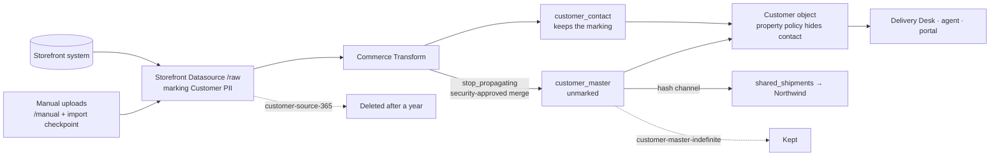

# 03 — The customer-data lifecycle

*Sources: no new doc pages; every row links to the note that holds the docs' wording · written October 23, 2026 · Ready for Review. Everything here is **[Example]** unless a line says otherwise.*

Customer data is the opposite problem from the ledger ([02](02-kestrel-pays-sensitive-data.md)): it is **meant** to flow, into the Ontology, the Delivery Desk, the agent, the portal and Northwind's shared projection, and the job is to make sure only the parts each reader needs flow that far, and that what arrived eventually leaves. This page follows **one customer's record** through six stages, arrive, minimize, serve, scan, expire, prove, with the control at each. Register rows from [00-02](../00-orientation/02-kestrels-security-posture.md) are in the first column.

## The path

## Stage 1 — Arrive

| Row | Control | Note |
|---|---|---|
| — | Source records land in `Storefront [Datasource]/raw`, and the folder carries `Customer PII`, so every derived dataset inherits it until something stops it | [Ontology 02-04](../../Ontology/02-foundry-data-foundations/04-projects-spaces-and-markings.md#kestrels-layout), [02-01](../02-markings-and-mandatory-controls/01-markings-and-classification-based-access-controls.md#two-ways-a-marking-is-inherited) |
| 35 | Hand-carried files go only into `Storefront [Datasource]/manual`, owned by Priya's group, behind the Compass import checkpoint that asks for the source and the approval reference; CS agents hold no Editor role anywhere an upload could land | [08-02](../08-compass/02-moving-sharing-tagging-uploading-and-the-data-catalog.md#for-kestrel) |
| 43 | Uploads come from managed workstations with endpoint protection; the file as an object is the workstation's problem, the data in it is Foundry's | [10-03](../10-privacy-governance-and-enterprise-security/03-protecting-identity-tokens-phishing-and-files.md#for-kestrel) |
| 44 | Every dataset here is re-ingestable from the storefront system: the source of truth is outside Foundry, which is also the disaster-recovery plan for object storage | [10-04](../10-privacy-governance-and-enterprise-security/04-infrastructure-security-and-disaster-recovery.md#for-kestrel) |

## Stage 2 — Minimize

| Row | Control | Note |
|---|---|---|
| 11 | In `Commerce [Transform]`, email and address move into `customer_contact`, which keeps the marking; `customer_master` continues with `stop_propagating`. The merge that does this is the one place a mandatory control is lifted, so the project's main branch requires security approvals and the two-approval policy is extended to it | [02-01](../02-markings-and-mandatory-controls/01-markings-and-classification-based-access-controls.md#for-kestrel), [04-03](../04-securing-data-and-applications/03-protecting-sensitive-data-and-requesting-justification.md) |
| 45 | The code-scanning rule flags any other `stop_propagating` or `stop_requiring`, so a second lifting point can't appear quietly | [10-05](../10-privacy-governance-and-enterprise-security/05-code-scanning.md#for-kestrel) |
| 25 | How the marking is removed from already-built outputs depends on the pipelines' transaction types, which aren't recorded: open | [04-03](../04-securing-data-and-applications/03-protecting-sensitive-data-and-requesting-justification.md) |
| 32 | For Northwind, the customer email is hashed through `kestrel-customer-hash` (SHA-256 with a pepper) in the shared projection: Northwind matches exceptions to Kestrel's records and never reads an address | [07-01](../07-cipher/01-cipher-concepts-and-getting-started.md#for-kestrel), [Ontology 12-05](../../Ontology/12-security-and-governance/05-shared-ontologies-and-cross-org.md) |
| 26 | The pull request that stops requiring the Kestrel organization on `shared_shipments` needs Lena and a security reviewer, under the same protected branch policy | [04-04](../04-securing-data-and-applications/04-cross-organization-collaboration.md#for-kestrel) |

**[Explanation]** Minimization happens in a transform, not in a permission. Once the contact columns are in their own dataset, the question *who may see a customer's email* has a single answer, membership of `Customer PII`, wherever that dataset flows; and the question *who may see the rest* has a different answer, a project role. The property security policy in the next stage is a view of the same split, not a second copy of the rule.

## Stage 3 — Serve

| Row | Control | Note |
|---|---|---|
| — | The `Customer` object type backs onto both datasets; the property security policy hides the contact properties from anyone outside the marking. Kofi sees the customer, not the email | [Ontology 12-03](../../Ontology/12-security-and-governance/03-object-and-property-security.md), [01](01-kestrels-access-model-built-out.md#who-holds-what) |
| 13 | The regional policy on `Shipment` reads the `policyRegion` column, kept valid by an invariant transform, with a statistics check that halts the build if more than a fifth of the values shift; Kofi's `region` attribute comes from the identity provider | [02-02](../02-markings-and-mandatory-controls/02-granular-policies.md#for-kestrel), [01-03](../01-organizations-projects-users-and-groups/03-users-groups-and-portfolios.md#for-kestrel) |
| 16 | The Delivery Desk agent's drafts are governed by the markings on what it reads, because the property policy has no hold on text a model writes; `draftDelayMessage` is already kept away from contact details | [03-01](../03-discretionary-controls-propagation-and-diagnosis/01-access-control-propagation.md#for-kestrel), [Ontology 16-04](../../Ontology/16-ai-and-agents/04-human-in-the-loop-and-staged-writes.md) |
| 16 | A Delivery Desk export passes a download checkpoint, because the read-time policies stop at the read | [03-01](../03-discretionary-controls-propagation-and-diagnosis/01-access-control-propagation.md#for-kestrel), [06-02](../06-approvals-and-checkpoints/02-checkpoints.md#for-kestrel) |
| 24 | Audiences: CS agents and warehouse staff as viewers, Daniel and Priya as editors where they build, the writeback datasets beside the backing datasets in `Commerce [Ontology]` | [04-02](../04-securing-data-and-applications/02-securing-an-operational-application.md#for-kestrel) |
| 28, 29 | The portal reads `Shipment` through a restricted application with its own branch in the regional policy; the support portal runs every query as the agent using it | [05-02](../05-third-party-applications-and-tokens/02-oauth2-clients-and-user-generated-tokens.md#for-kestrel), [05-03](../05-third-party-applications-and-tokens/03-third-party-application-and-api-guidance.md#for-kestrel), [DevTools 09-01](../../DevTools/09-kestrel-case/01-customer-portal-built-out.md) |
| 20 | Before each release: emulation as `delivery-desk-viewers`, *Check access* for a new agent, the regional policy tested in the test enrollment | [03-04](../03-discretionary-controls-propagation-and-diagnosis/04-diagnosing-access.md#for-kestrel) |
| 35 | Discoverability: the `Delivery Desk` collection in the Data Catalog (the queue module, two Object Views, `customer_master`), curated by Ama; tags `source`, `refresh`, `owner`, none mirroring a marking | [08-02](../08-compass/02-moving-sharing-tagging-uploading-and-the-data-catalog.md#for-kestrel) |

## Stage 4 — Scan

| Row | Control | Note |
|---|---|---|
| 36 | The **boundary PII** scan: the two datasource projects as folders plus `/manual`; source datasets only; continuous; anything already marked excluded. Conditions: the built-in email and phone conditions re-checked against the storefront export format, the column-name regex as a cheap first pass, an overlap condition on `customer_master.customerId` so a dataset carrying Kestrel customer IDs is found even without an email column. Actions: apply `Customer PII` (not re-applying a manually removed marking) and open issues for Priya's group; one cycle without actions first | [09-01](../09-sensitive-data-scanner-and-data-lifetime/01-sensitive-data-scanner-concepts-and-scans.md#for-kestrel), [09-02](../09-sensitive-data-scanner-and-data-lifetime/02-match-conditions-match-actions-best-practices-and-media-sets.md#for-kestrel) |
| 36 | The **carrier invoices** scan: weekly, a language-model condition for personal names and addresses in invoice text, issues only for Lena's team, no marking because the media set already sits inside the marked payments projects. No obfuscation anywhere: it needs the Admin licence Kestrel doesn't issue | [09-01](../09-sensitive-data-scanner-and-data-lifetime/01-sensitive-data-scanner-concepts-and-scans.md#for-kestrel) |
| 37 | The two Data Governance Officers run the scans with Viewer on the space, so scanning doesn't require Owner on every resource | [09-02](../09-sensitive-data-scanner-and-data-lifetime/02-match-conditions-match-actions-best-practices-and-media-sets.md#for-kestrel) |

## Stage 5 — Expire

| Row | Control | Note |
|---|---|---|
| 38 | `customer-source-365`: a fixed-date policy with a cutoff on the root `CustomerSourceRecord` datasets, rolled forward each quarter by Priya's team because the docs offer no relative policy; source records older than a year go, with every derived row including the `MatchCandidate`s. Branch coverage `master` only, so long-running branches on a source dataset are the recorded risk | [09-03](../09-sensitive-data-scanner-and-data-lifetime/03-data-lifetime-concepts-and-deletion-policies.md#for-kestrel), [09-04](../09-sensitive-data-scanner-and-data-lifetime/04-data-lifetime-in-operation.md#for-kestrel) |
| 38 | `customer-master-indefinite` overrides the inherited policy on `customer_master`, a far-future date with a cutoff in the past, so the aggregated record outlives its sources under a policy whose history is visible; the override's checkpoint record is in Lena's quarterly review | [09-04](../09-sensitive-data-scanner-and-data-lifetime/04-data-lifetime-in-operation.md#for-kestrel) |
| 38 | The privacy notice promises removal *within 30 days of the retention date*, matching the longest deletion the docs describe, and the Deletions tab is the evidence | [09-04](../09-sensitive-data-scanner-and-data-lifetime/04-data-lifetime-in-operation.md#for-kestrel) |
| 25 | Whether a deletion policy behaves as expected on each pipeline depends on its transaction types: the same open item as stage 2 | [09-03](../09-sensitive-data-scanner-and-data-lifetime/03-data-lifetime-concepts-and-deletion-policies.md) |
| 34 | The payments projects' trash is permanently emptied monthly; whether autosave adds to it is open | [08-01](../08-compass/01-compass-projects-and-navigation.md#for-kestrel) |
| 44 | Ontology edits (the Delivery Desk's holds and re-routes) are in Rescue's scope; Kestrel asks for 30 days' retention instead of the default seven, so a corruption found in a monthly review is still recoverable. Needs Palantir | [10-04](../10-privacy-governance-and-enterprise-security/04-infrastructure-security-and-disaster-recovery.md#for-kestrel) |

**[Explanation]** The override is the subtle part. Without it, `customer_master` would inherit the one-year policy from its sources and the master record would vanish a year after the *first* source record that fed it, which is not what anyone meant. With it, the master is still under a policy, just one that never fires, and the fact that it never fires is a visible decision with a checkpoint record rather than an accident of inheritance ([09-04](../09-sensitive-data-scanner-and-data-lifetime/04-data-lifetime-in-operation.md)).

## Stage 6 — Prove

| Row | Control | Note |
|---|---|---|
| 41 | Data owners (Priya, Lena, Ama), the governance lead, the officers and legal; a purpose statement per project, summarized on its cover page; the review calendar: weekly payments checkpoint records, quarterly marking membership, quarterly roll-forward of `customer-source-365` | [10-01](../10-privacy-governance-and-enterprise-security/01-privacy-civil-liberties-and-data-protection.md#for-kestrel) |
| 30 | The Approvals history is the first source for the quarterly membership review; marking requests carry the training certificate | [06-01](../06-approvals-and-checkpoints/01-approvals.md#for-kestrel) |
| 42 | The audit export in `Audit [Governance]`: `managementMarkings` and `managementPermissions` on `Customer PII` reviewed weekly; `dataShareCreate` anywhere is a finding, because link sharing is off; `authenticationCheck` failures by user | [10-02](../10-privacy-governance-and-enterprise-security/02-audit-logs.md#for-kestrel) |
| 15 | The cover page tells a person who finds `Storefront [Datasource]` what it's for, who owns it and how to request access, and nothing about the rows | [02-03](../02-markings-and-mandatory-controls/03-property-security-markings-and-cover-pages.md) |

## Considered, not adopted

| Row | Candidate | Why not |
|---|---|---|
| 40 | Latest-view-only deletion policies | The only snapshot datasets whose history Kestrel would purge are already under a fixed-date policy ([09-04](../09-sensitive-data-scanner-and-data-lifetime/04-data-lifetime-in-operation.md#for-kestrel)) |
| 17 | A restricted view for Kofi's region | The object security policy already filters at the ontology layer and a restricted view can't feed a transform ([03-02](../03-discretionary-controls-propagation-and-diagnosis/02-restricted-views.md#for-kestrel)) |
| 36 | An **Obfuscate** match action | Needs the Admin Cipher licence and can't be reversed ([09-01](../09-sensitive-data-scanner-and-data-lifetime/01-sensitive-data-scanner-concepts-and-scans.md#for-kestrel)) |

## Still open

| Row | Question | Needs |
|---|---|---|
| 25 | Transaction types of Kestrel's pipelines | Priya's records |
| 26 | Northwind's ingress addresses | Northwind |
| 44 | Rescue retention at 30 days | Palantir |

Together with [01](01-kestrels-access-model-built-out.md#still-open) and [02](02-kestrel-pays-sensitive-data.md#still-open), these are the six open items recorded in [17-02 §9](../../Ontology/17-case-studies/02-kestrel-reference-model.md#9-known-gaps-in-the-example).

---
[Module index](README.md) · Previous: [02 — Kestrel Pay's sensitive data](02-kestrel-pays-sensitive-data.md) · Next module: [12 — Practice](../12-practice/README.md)
