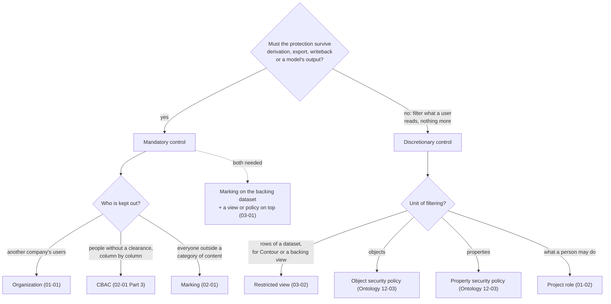
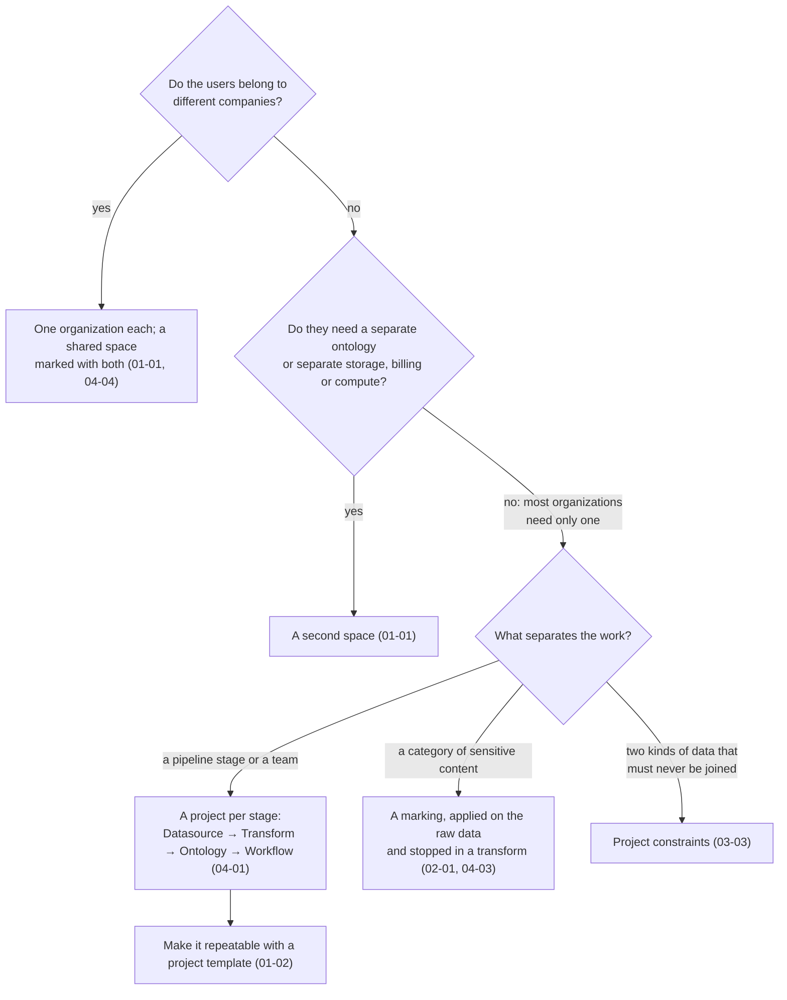
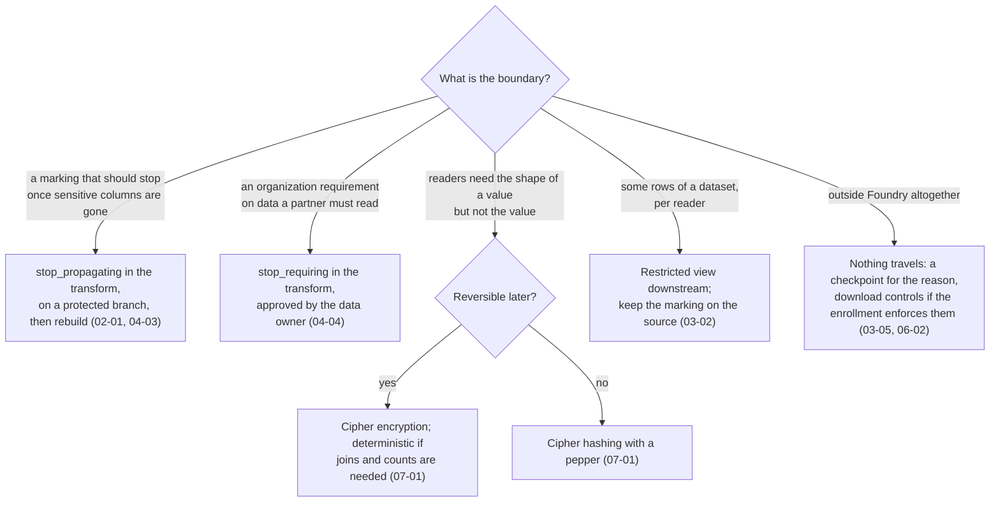
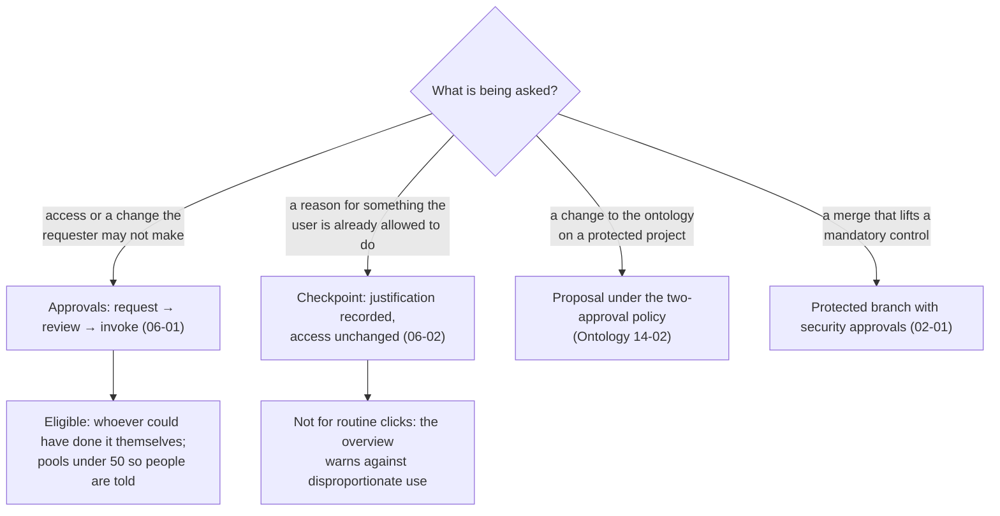
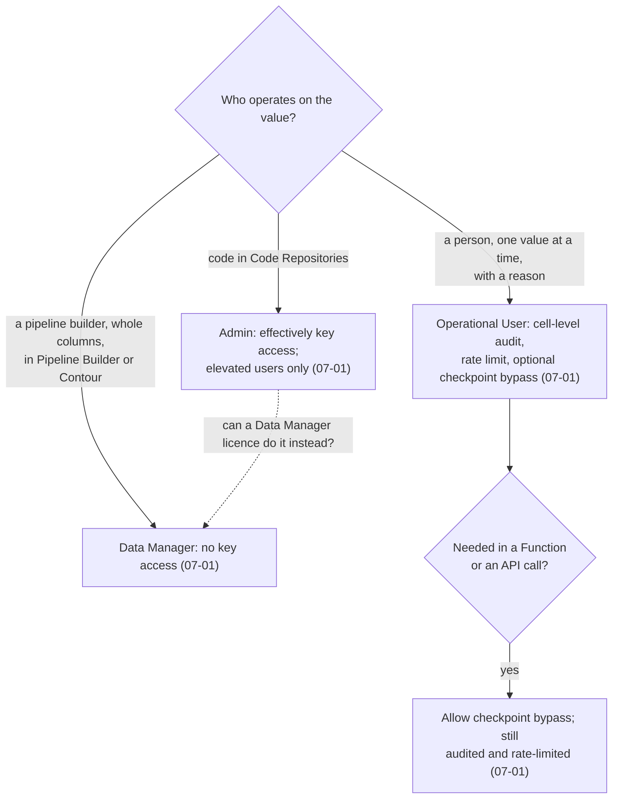
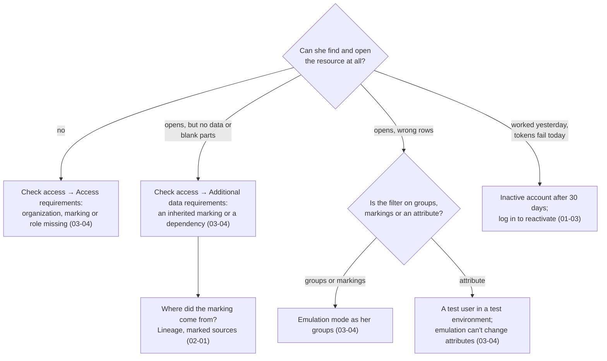

# Decision guide

*Sources: the notes each branch links to · compiled October 23, 2026 · Ready for Review. The flowcharts are ours; every leaf links to the note with the docs' wording.*

Six decisions that come up on almost every Foundry security question, as flowcharts. Each ends at the note to read next.

## 1. Mandatory or discretionary?

[01-01](../01-organizations-projects-users-and-groups/01-organizations-spaces-and-enrollments.md) · [02-01](../02-markings-and-mandatory-controls/01-markings-and-classification-based-access-controls.md) · [03-01](../03-discretionary-controls-propagation-and-diagnosis/01-access-control-propagation.md) · [03-02](../03-discretionary-controls-propagation-and-diagnosis/02-restricted-views.md) · [01-02](../01-organizations-projects-users-and-groups/02-projects-roles-and-project-templates.md) · [Ontology 12-03](../../Ontology/12-security-and-governance/03-object-and-property-security.md)

## 2. Which container?

[01-01](../01-organizations-projects-users-and-groups/01-organizations-spaces-and-enrollments.md) · [04-04](../04-securing-data-and-applications/04-cross-organization-collaboration.md) · [04-01](../04-securing-data-and-applications/01-securing-a-data-foundation.md) · [02-01](../02-markings-and-mandatory-controls/01-markings-and-classification-based-access-controls.md) · [04-03](../04-securing-data-and-applications/03-protecting-sensitive-data-and-requesting-justification.md) · [03-03](../03-discretionary-controls-propagation-and-diagnosis/03-project-constraints.md) · [01-02](../01-organizations-projects-users-and-groups/02-projects-roles-and-project-templates.md)

## 3. The data must cross a boundary. How?

[02-01](../02-markings-and-mandatory-controls/01-markings-and-classification-based-access-controls.md#removing-a-marking) · [04-03](../04-securing-data-and-applications/03-protecting-sensitive-data-and-requesting-justification.md) · [04-04](../04-securing-data-and-applications/04-cross-organization-collaboration.md) · [07-01](../07-cipher/01-cipher-concepts-and-getting-started.md) · [03-02](../03-discretionary-controls-propagation-and-diagnosis/02-restricted-views.md) · [03-05](../03-discretionary-controls-propagation-and-diagnosis/05-download-controls-and-the-two-deprecated-settings.md) · [06-02](../06-approvals-and-checkpoints/02-checkpoints.md)

## 4. Someone has to say yes, or say why. Which mechanism?

[06-01](../06-approvals-and-checkpoints/01-approvals.md) · [06-02](../06-approvals-and-checkpoints/02-checkpoints.md) · [Ontology 14-02](../../Ontology/14-lifecycle-and-operations/02-branching-and-proposals.md) · [02-01](../02-markings-and-mandatory-controls/01-markings-and-classification-based-access-controls.md#removing-a-marking)

## 5. Which Cipher licence?

[07-01](../07-cipher/01-cipher-concepts-and-getting-started.md#choosing-a-licence) · [07-02](../07-cipher/02-cipher-workflows.md)

## 6. *She can't see it.* Where do you look?

[03-04](../03-discretionary-controls-propagation-and-diagnosis/04-diagnosing-access.md) · [01-03](../01-organizations-projects-users-and-groups/03-users-groups-and-portfolios.md) · [02-01](../02-markings-and-mandatory-controls/01-markings-and-classification-based-access-controls.md#finding-where-a-marking-came-from)

---
[Module index](README.md) · [Security home](../README.md)
