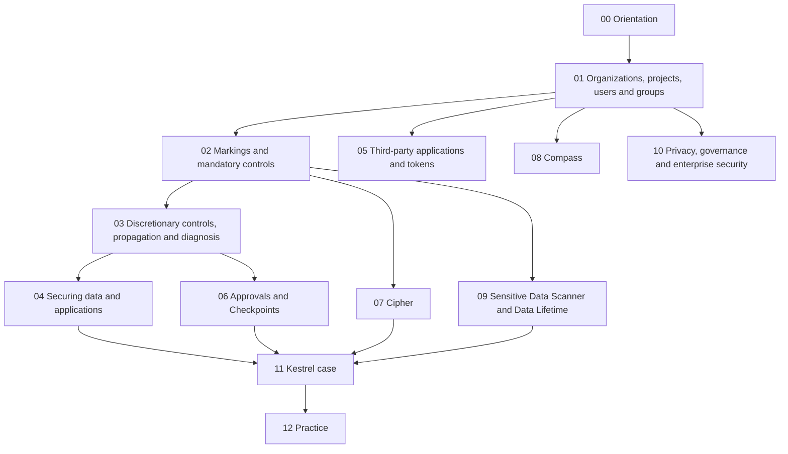

# Security & governance

A course and working reference for the **Security & governance** part of the Foundry docs: organizations, projects, roles, users and groups; markings and the other mandatory controls; restricted views, project constraints and access control propagation; third-party applications and tokens; Approvals and Checkpoints; Cipher; Compass; the Sensitive Data Scanner and Data Lifetime; privacy, audit logs, infrastructure security and code scanning. Every page in scope is assigned to a planned note; the [docs index](99-reference/docs-index.md) maps them.

| | |
|---|---|
| Structure | Created October 23, 2026 (Phase 2). Built from the official docs; the course notes listed in each module are linked, not reused as sources. |
| Notes written | **43 of 43**: [00 Orientation](00-orientation/README.md), [01 Organizations, projects, users and groups](01-organizations-projects-users-and-groups/README.md), [02 Markings and mandatory controls](02-markings-and-mandatory-controls/README.md), [03 Discretionary controls, propagation and diagnosis](03-discretionary-controls-propagation-and-diagnosis/README.md), [04 Securing data and applications](04-securing-data-and-applications/README.md), [05 Third-party applications and tokens](05-third-party-applications-and-tokens/README.md), [06 Approvals and Checkpoints](06-approvals-and-checkpoints/README.md), [07 Cipher](07-cipher/README.md), [08 Compass](08-compass/README.md), [09 Sensitive Data Scanner and Data Lifetime](09-sensitive-data-scanner-and-data-lifetime/README.md), [10 Privacy, governance and enterprise security](10-privacy-governance-and-enterprise-security/README.md), [11 Kestrel case](11-kestrel-case/README.md), [12 Practice](12-practice/README.md), [99 Reference](99-reference/README.md). Module READMEs list every note and the official pages it covers. |
| Scope | 104 pages: the docs' *Security & governance* sidebar, read from the fetched sidebar HTML on October 23, 2026 (`_tools/sec/raw.tsv`). The release-notes link is out of scope. No page is a reference table, so every page is read in full. |
| Sources | Official Palantir documentation first. Register, corrections and open questions: [SOURCES](SOURCES.md) |
| Quality | Reviewed October 23, 2026 (Phase 8): all 104 pages re-fetched and found unchanged, 295 doc quotes and every bold number re-matched, 27 limit rows re-verified, 15 diagrams parsed, links clean, cross-area consistency checked against Ontology 02-04 and 17-02 (2 fixes). Details and known limitations: [QUALITY-REVIEW](QUALITY-REVIEW.md) |
| Why it matters | The Application Developer Associate exam's domain 8 (application security, governance and operations) is almost entirely this sidebar: resource vs data access, identities, least privilege and operational diagnosis. Domain 5 takes the third-party application and token pages; domain 2 takes Checkpoints and justification |

## How this area relates to the others

The [Ontology area](../Ontology/README.md) covers the Ontology's own permission layer: [12-01](../Ontology/12-security-and-governance/01-two-layer-permission-model.md) to [12-05](../Ontology/12-security-and-governance/05-shared-ontologies-and-cross-org.md) (resource vs data permissions, object and property security policies, actions and functions, shared ontologies) and [02-04](../Ontology/02-foundry-data-foundations/04-projects-spaces-and-markings.md) (projects, spaces and markings as the Ontology sees them). This area explains the **platform controls underneath** in full and links those notes for the Ontology consequence and the Kestrel example instead of repeating them. The [AIP area](../AIP/README.md) covers how markings reach language models ([08-03](../AIP/08-security-governance-and-admin/03-llm-data-access-with-markings.md)). The [Apps area](../Apps/README.md) covers application-level permissions ([01-04](../Apps/01-workshop-foundations/04-permissions.md), [08-05](../Apps/08-automate/05-security-ownership-and-history.md), [09-03](../Apps/09-carbon-workspaces/03-configuration-and-permissions.md)). The [DevTools area](../DevTools/README.md) covers the developer side of applications and tokens ([02-01](../DevTools/02-developer-console-and-apis/01-applications-scopes-and-restrictions.md), [02-04](../DevTools/02-developer-console-and-apis/04-platform-apis.md)) and branch security ([06-01](../DevTools/06-branching-and-cross-app/01-global-branching.md)); module 05 here covers the Control Panel side.

## Learning path

## Modules

| # | Module | What you learn | Status |
|---|---|---|---|
| 00 | [Orientation](00-orientation/README.md) | The security map; Kestrel's posture | **Ready for Review** |
| 01 | [Organizations, projects, users and groups](01-organizations-projects-users-and-groups/README.md) | Organizations, spaces, projects, roles, users, groups, Portfolios | **Ready for Review** |
| 02 | [Markings and mandatory controls](02-markings-and-mandatory-controls/README.md) | Markings, CBAC, granular policies, what users see of them | **Ready for Review** |
| 03 | [Discretionary controls, propagation and diagnosis](03-discretionary-controls-propagation-and-diagnosis/README.md) | Propagation, restricted views, project constraints, diagnosis, download controls | **Ready for Review** |
| 04 | [Securing data and applications](04-securing-data-and-applications/README.md) | Securing a data foundation, an application, sensitive data; cross-org work | **Ready for Review** |
| 05 | [Third-party applications and tokens](05-third-party-applications-and-tokens/README.md) | Third-party applications, OAuth2 clients, tokens, API guidance | **Ready for Review** |
| 06 | [Approvals and Checkpoints](06-approvals-and-checkpoints/README.md) | Approvals; Checkpoints | **Ready for Review** |
| 07 | [Cipher](07-cipher/README.md) | Cipher concepts and workflows | **Ready for Review** |
| 08 | [Compass](08-compass/README.md) | Compass: projects, navigation, sharing, tags, Data Catalog | **Ready for Review** |
| 09 | [Sensitive Data Scanner and Data Lifetime](09-sensitive-data-scanner-and-data-lifetime/README.md) | Sensitive Data Scanner; Data Lifetime | **Ready for Review** |
| 10 | [Privacy, governance and enterprise security](10-privacy-governance-and-enterprise-security/README.md) | Privacy, audit logs, identity, infrastructure, code scanning | **Ready for Review** |
| 11 | [Kestrel case](11-kestrel-case/README.md) | Kestrel's access model, sensitive data and data lifecycle | **Ready for Review** |
| 12 | [Practice](12-practice/README.md) | Review questions tagged by exam domain | **Ready for Review** |
| 99 | [Reference](99-reference/README.md) | Limits, decision guide, roles matrix, docs index | **Ready for Review** |

## Conventions

Same as the Ontology, AIP, Apps and DevTools areas. Each note has a one-line *Sources · checked · status* header and footer navigation; otherwise its shape follows its topic. Labels: **[Docs]** (only real doc wording goes in quote marks), **[Concept]**, **[Explanation]**, **[Recommendation]**, **[Example]**, **[Analogy]**, **[Observed]**. Open questions are numbered RQ-NN in [SOURCES](SOURCES.md). Self-checks live only in [12 — Practice](12-practice/README.md). Examples use **Kestrel Commerce**, as defined in [Ontology 17-02](../Ontology/17-case-studies/02-kestrel-reference-model.md).

---
[Learn home](../../README.md) · [Topic map](MAP.md) · [Sources](SOURCES.md) · [Glossary](GLOSSARY.md)
