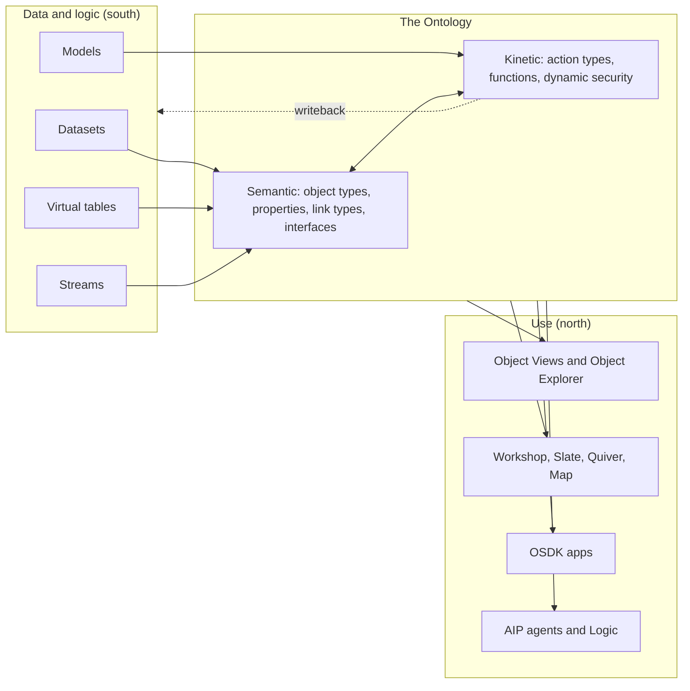

# 01 — What the Ontology is

*Sources: [Ontology building overview](https://www.palantir.com/docs/foundry/ontology/overview/) · [Core concepts](https://www.palantir.com/docs/foundry/ontology/core-concepts/) · [Object types overview](https://www.palantir.com/docs/foundry/object-link-types/object-types-overview/) · [Ontologies overview](https://www.palantir.com/docs/foundry/ontologies/ontologies-overview/) · checked October 2, 2026 · Ready for Review*

- **[Docs]** The Ontology is an **operational layer** that sits on top of the data and models in Foundry (datasets, virtual tables, models) and connects them to the real-world things they describe: plants, products, customer orders, financial transactions.
- It has two halves:
  - **Semantic elements**: what exists. Object types, properties, link types.
  - **Kinetic elements**: what can change, and how. Action types, functions, dynamic security.
- **[Docs]** Every concept comes as a **type** (the schema definition) and its **instances**:

  | Type | Instance | Collection |
  |---|---|---|
  | object type | object | object set |
  | property | property value | |
  | link type | link | |
  | action type | action (an applied action) | |

- **[Docs]** Interfaces add polymorphism: one shape that several object types can share.
- **[Explanation]** Think of it as the place where your organization's *vocabulary*, *data*, *permissions* and *permitted changes* are defined once, and every app, analysis and agent then reuses them.

## Why have one at all

**[Concept]** Data arrives in Foundry shaped by the systems that produced it: an ERP's purchase-order header and line tables, a web shop's `orders` table, a CSV export from a carrier. Each table is accurate about its own system. None of them says what a *customer* or a *late order* means for the business as a whole.

Without a shared model, every application has to rebuild that meaning on its own:

- which columns identify a customer;
- how to join orders to shipments;
- who is allowed to see payment data;
- what "approve a refund" should change.

The result is duplicated logic, answers that disagree, and decisions taken outside the system, so nothing records them.

**[Docs]** The Ontology addresses this by mapping datasources into objects, properties and links once. It adds rich metadata, granular security, and governed ways to make changes. The docs stress that this goes "far beyond" data cataloguing or schema design: the goal is a foundation for end-user workflows and decision-making.

## Four ideas to start with

Four ideas are enough to start. Each is defined here before later notes use it.

| Idea | Plain meaning | Kestrel example |
|---|---|---|
| **Entity** | A thing that exists and keeps its identity over time | a customer, a product, a warehouse |
| **Event** | Something that happened at a point in time | an order being placed, a payment, a tracking scan |
| **Relationship** | A meaningful connection between two things | a customer *places* an order; a shipment *is carried by* a carrier |
| **Change** | A governed decision that alters the state of things | approving a refund, putting an order on hold |

**[Docs]** Foundry's object types cover both entities and events: an object type is "the schema definition of a real-world entity or event".

**[Explanation]** The first three ideas describe the world. The fourth is what makes the Ontology *operational* rather than just descriptive.

## The pieces Foundry gives you

### The semantic elements

**[Docs]** These come from the Core concepts page.

- **Object type:** the schema of an entity or event. An **object** is one instance; an **object set** is a collection of objects. For example, an `Employee` type, the employee "Melissa Chang", and the set "all tenured employees".
- **Property:** the schema of one characteristic. A **property value** is that characteristic on a particular object.
- **Shared property:** a property defined once and used on several object types, giving consistent modelling and central management of its metadata.
- **Link type:** the schema of a relationship between two object types. A **link** is one instance of it, between two objects.

### The kinetic elements

**[Docs]**
- **Action type:** the schema of a set of edits to objects, property values and links that a user can make *at once*, plus the side effects that happen when the action is submitted. An action type "captures data from operators" and orchestrates decisions that connect to existing systems.
- **Function:** code that takes inputs and returns an output. Functions are native to the Ontology: they accept objects and object sets, read their properties, and can be used in action types and applications. They let you author business logic "of arbitrary complexity".
- **Dynamic security:** listed among the kinetic elements on the overview page. The detail is covered in [12 — Security and governance](../12-security-and-governance/README.md).

### Interfaces and Object Views

**[Docs]**
- **Interface:** an Ontology type that describes the shape of an object type and its capabilities. It lets you model, and interact with, object types that share a common shape consistently.
- **Object View:** the central hub for everything about one object: key information, linked objects, metrics, and related analyses, dashboards and apps.

### Where the definitions live

**[Docs]** An **ontology**, with a lowercase *o*, is also a *resource*: a container that stores object types, link types, action types, interfaces, shared properties and object type groups. Each ontology maps 1:1 to a **space**, which is explained in [02 — Projects, spaces and markings](../02-foundry-data-foundations/04-projects-spaces-and-markings.md).

**[Explanation]** "The Ontology" in these notes means the concept and the system. "An ontology" means one such container. Most organizations have one.

### Mapped to real data

**[Docs]** The Ontology is not an abstract data model. It maps each concept to actual data. Objects come into existence in one of two ways:

- **From a backing datasource:** for example, an employee directory backing the `Employee` type.
- **Through actions:** if every object will be created by actions, the object type can be created **without** a backing datasource.



The south/north framing comes from our [Intro course note 05](../../Courses/Introduction%20to%20Foundry%20%26%20AIP%20for%20Enterprise%20Organizations/05-high-level-architecture.md). The writeback arrow is explained in [02 — Why an Ontology](02-why-an-ontology.md).

## Where the dataset analogy breaks

**[Docs]** The Core concepts page offers a dataset analogy:

| Datasets | Ontology |
|---|---|
| Dataset | Object type |
| Row | Object |
| Column | Property |
| Field (cell) | Property value |
| Join | Link type |
| Filtered set of rows | Object set |

**[Analogy]** The analogy is a good first step, and it explains why a clean, one-row-per-thing dataset is the usual input. It breaks down in at least eight ways. Each one is a reason the Ontology exists:

| Where the analogy breaks | Why it matters | Covered in |
|---|---|---|
| **Identity survives rebuilds.** An object is identified by its primary key across every pipeline run. A row is just a row in this version of the file | User edits and links are attached to the key. An unstable key loses them | [01 — Keys and identity](../01-foundations/02-keys-and-identity.md) |
| **Objects can exist with no dataset row** | Action-created objects have no backing datasource | [04 — Object types](../04-object-types/README.md) |
| **User edits are merged with source data** | A dataset row reflects only the pipeline. An object reflects the pipeline plus governed human decisions | [13 — Edits and materializations](../13-backend-architecture/03-edits-and-materializations.md) |
| **Links are named, typed and traversable both ways** | A join is a query-time operation someone must remember to write correctly. A link type is a reusable, documented relationship with a name in each direction | [06 — Links](../06-links/README.md) |
| **Columns are not mapped 1:1** | Properties are curated, renamed, typed and described. Mapping every column is the Kitchen Sink anti-pattern | [Design 03](../11-design/03-anti-patterns.md#the-kitchen-sink) |
| **Behaviour is attached** | Action types and functions define how objects may change. A dataset has no notion of a permitted change | [08 — Actions](../08-actions/README.md) |
| **Security applies to schema and to data separately** | You can be allowed to see that `Payment` exists without seeing any payments | [12 — Security](../12-security-and-governance/README.md) |
| **It is indexed for operational reads** | Objects are served from object databases built for fast search, filtering and aggregation by apps, not scanned like files | [03 — Architecture at a glance](03-architecture-at-a-glance.md) |

**[Concept]** If you know domain-driven design: the Ontology plays the role of a shared domain model with a ubiquitous language, backed by live data and with governed operations attached. [01 — Semantic layers and domain models](../01-foundations/04-semantic-layers-and-domain-models.md) compares it with semantic layers, DDD and knowledge graphs.

## For AI systems

- **[Docs]** The overview frames the Ontology as the foundation that powers decision-making across Palantir's tools. The "Why" page (next note) adds that humans **and AI agents** operate on it under the same security.
- **[Explanation]** For an AI system, the useful part is that objects, links and actions come with names, descriptions and permissions. An agent gets entities and permitted operations, not raw tables, so it can be given context and tools without being given every table.
- The canonical AI material is in [16 — AI and agents](../16-ai-and-agents/README.md).

## Kestrel: one orders table, three questions

**[Example]** In the [running example](04-running-example.md), the storefront database has an `orders` table:

```text
order_id | customer_id | created_at | status  | ship_country | total_eur
O-10442  | C-2231      | 2026-09-30 | PAID    | GH           | 182.40
```

Mapped naively, `orders` becomes an `Order` object type, each row an `Order` object, and each column a property. That is a start, but already three questions show what the Ontology adds:

1. **Who is the customer?** `customer_id` is a foreign key. In the Ontology it becomes a **link** to a `Customer` object, so Ama can navigate from an order to everything else about that customer.
2. **What can people do to an order?** "Put on hold" should be an **action type** with its own rules and permissions, not someone editing a cell.
3. **Who may see `total_eur`?** That is a **security** decision attached to the model, not left to each app.

## Things to keep in mind
- **[Docs]** Start from the domain, not the data: this is the first principle in [Design 01](../11-design/01-best-practices.md#1-domain-driven-design-model-the-world-not-the-source-data).
- **[Explanation]** The Ontology is a shared asset. Its object types behave like a published API for every app, function, SDK client and agent built on it, so changes need care. That is the subject of [14 — Lifecycle](../14-lifecycle-and-operations/README.md).
- **[Explanation]** Not every dataset belongs in the Ontology. Intermediate, analytical-only or purely technical tables can stay as datasets.

## Easy mistakes
- Treating the Ontology as "datasets with nicer names", and mapping tables one-to-one without finding the real entities.
- Forgetting the kinetic half. A model with no actions is a read-only catalogue; edits then happen elsewhere, unrecorded.
- Confusing **the Ontology** (the system) with **an ontology** (the per-space resource).

## Caveats
- **[Docs] Inconsistency:** the Core concepts page still describes **roles** as "the central permissioning model in the Ontology". The newer [Ontology permissions](https://www.palantir.com/docs/foundry/object-permissioning/ontology-permissions/) page says project-based permissions replace Ontology roles and datasource-derived permissions for new ontologies. These notes treat project-based permissions as current. The [glossary](../GLOSSARY.md) entry has been corrected. See [02 — Projects, spaces and markings](../02-foundry-data-foundations/04-projects-spaces-and-markings.md).
- The overview lists "dynamic security" as kinetic without defining it there. **Open question** [RQ-02](../SOURCES.md#open-research-questions) tracks how the security layers combine.

## Where we've met this
- [Intro course 06 — What is the Ontology?](../../Courses/Introduction%20to%20Foundry%20%26%20AIP%20for%20Enterprise%20Organizations/06-what-is-the-ontology.md): "nouns and verbs of the business".
- [Ontology deep dive 14 — Create an object type](../../Application%20Developer/02-deep-dive-creating-your-first-ontology/14-create-object-type.md): row-to-object mapping in practice.
- [E2E speedrun 22 — Create your object](../../Speedrun/Your%20First%20End-to-End%20Workflow/22-create-your-object.md): our first `Order` object type.

---
[Module index](README.md) · Next: [02 — Why an Ontology](02-why-an-ontology.md)
