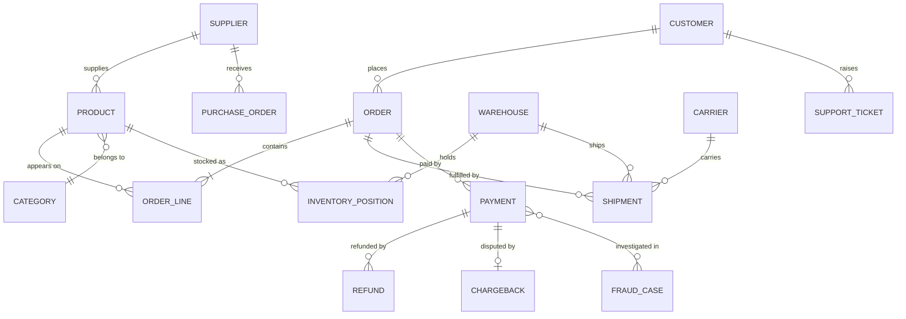

# 04 — The running example: Kestrel Commerce

*Sources: none (our own invented example) · written October 2, 2026; updated through October 3 · Ready for Review. Everything here is **[Example]**: Kestrel, its systems and its people are invented.*

- **Kestrel Commerce** is a fictional online retailer of home and outdoor goods, selling in several countries. Its in-house payments arm, **Kestrel Pay**, takes card payments, issues refunds and fights chargebacks.
- It is the one example domain used across all the Ontology notes. Each note adds a piece, so by the end you have seen one Ontology designed, built, secured and given to agents.
- It was chosen because it mixes **e-commerce** (customers, orders, products, shipments) with **finance** (payments, refunds, fraud). That combination exercises every Ontology construct: many-to-many links, events vs entities, sensitive data, human decisions and automation.
- The full assembled model will live in [Case study 02](../17-case-studies/README.md) once the modelling modules are written.

## The business

Kestrel sells about 40,000 products from 600 suppliers, ships from 5 warehouses through 4 carriers, and handles around 20,000 orders a day. A customer places an order on the web shop, pays by card through Kestrel Pay, and receives one or more shipments. Some orders are refunded; a small share of payments turn out to be fraudulent and come back as chargebacks.

The company has three recurring problems, which are the reason it is building an Ontology:

1. **Late deliveries.** Customer service learns about late shipments when customers complain. Nobody can see, in one place, which open orders are at risk and why: a stock-out at the warehouse, a late supplier delivery or a carrier delay.
2. **Refund leakage.** Refunds are approved in three different tools. Finance cannot tell which refunds broke policy, or which customers receive refunds unusually often.
3. **Fraud response.** Fraud analysts work from spreadsheet exports of the payments ledger. By the time they act, the goods have shipped.

## Source systems

Each system stores data in its own shape. That is the normal starting point for an Ontology project (see [01 — Foundations](../01-foundations/README.md)).

| System | What it holds | How it reaches Foundry (later notes) |
|---|---|---|
| **Storefront database** (PostgreSQL) | Customer accounts, carts, orders, order lines | Nightly batch sync, later change data capture |
| **Product catalogue** (PIM) | Products, categories, attributes | Daily file export |
| **ERP** | Suppliers, purchase orders, cost prices | Daily batch sync |
| **Warehouse system** (WMS) | Warehouses, stock levels, pick lists, shipments | Hourly batch sync |
| **Carrier tracking feed** | Tracking events ("picked up", "out for delivery", "delivered") | Stream |
| **Kestrel Pay ledger** | Payments, refunds, chargebacks, card fingerprints | Batch sync into a restricted project |
| **Support desk** | Customer tickets | API sync |
| **Finance warehouse** (Snowflake) | Revenue and margin reporting tables | Virtual tables (no copy) |
| **Fraud model** | A risk score per payment | A model in Foundry |

**Data quirks** that later notes deal with:

- The same customer can appear in the storefront, the support desk and the payments ledger under different IDs.
- Tracking numbers are unique per carrier, not across carriers.
- The storefront copies the product name and price onto each order line at checkout. Later changes to the product must not rewrite past orders.
- The payments ledger contains personal and card-related data. Only Kestrel Pay staff may see it, and card numbers never leave the ledger. Only the last four digits and a card fingerprint are synced.

## The people who will use it

| Person | Role | What they need to decide |
|---|---|---|
| **Ama** | Customer service lead | Which at-risk orders to contact customers about today |
| **Kofi** | Warehouse operations lead (Accra warehouse) | Which shipments to re-route, which stock to rebalance; sees only his region |
| **Lena** | Finance analyst, Kestrel Pay | Which refunds to approve; which customers to review |
| **Tomás** | Fraud analyst, Kestrel Pay | Which payments to block or escalate to a fraud case |
| **Priya** | Data engineer | Pipelines from the source systems into the Ontology |
| **Daniel** | Application developer | Workshop apps, functions and OSDK integrations |
| **Delivery Desk** | An AI agent (later notes) | Drafts customer updates and proposes re-routing for late orders, for a human to approve |

## The questions the Ontology must answer

These are the real business questions. [Design 04 — Validation](../11-design/04-validation.md) says to keep questions like these and test the model against them.

1. Which open orders will miss their promised delivery date, and what is the cause for each: stock, supplier or carrier?
2. Which high-value customers are affected by late deliveries this week?
3. Which suppliers' late purchase orders put which products at risk of a stock-out?
4. Which refunds over policy limits are waiting for approval, and who approved the last ones?
5. Which payments in the last hour have a high fraud score, and have their orders shipped yet?
6. What is net revenue after refunds and chargebacks by product category this month?

## Where the model is heading

This is the target shape, **not** the first design. Early notes start smaller and earn each piece. Names and relationships may change as later modules introduce interfaces, object-backed links and security.

Which modules introduce what:

| Module | What it adds to Kestrel |
|---|---|
| [01 — Foundations](../01-foundations/README.md) | Finding the entities, keys and relationships in the source systems |
| [02 — Foundry data foundations](../02-foundry-data-foundations/README.md) | The datasets, streams, virtual tables, projects and pipelines that feed the model |
| [04 — Object types](../04-object-types/README.md) | `Customer`, `Order`, `Product`, `Shipment` as object types |
| [05 — Properties](../05-properties/README.md) | Addresses as structs, money as value types, fraud score as a model output |
| [06 — Links](../06-links/README.md) | Order → Customer, Order ↔ Product through Order Line, foreign key vs join table vs object-backed links |
| [07 — Interfaces](../07-interfaces/README.md) | `Case` over Support Ticket, Chargeback and Fraud Case (extended by `MoneyCase`); `Location` over Warehouse and Pickup Point |
| [08 — Actions](../08-actions/README.md) | *Hold order*, *Re-route shipment*, *Approve refund*, *Issue refund*, *Cancel order* (function-backed) |
| [09 — Functions](../09-functions/README.md) | Delivery-risk calculation; refund policy check; live fraud score; drafted delay messages |
| [12 — Security](../12-security-and-governance/README.md) | Kestrel Pay data restricted; warehouse staff see only their region |
| [16 — AI and agents](../16-ai-and-agents/README.md) | The Delivery Desk agent and its tools |

### Types added in modules 06–16

The diagram shows the core. Later notes add these supporting types, each introduced where it is first needed:

| Type | What it is | Introduced in |
|---|---|---|
| `Promotion` | A discount campaign; many-to-many with Order | [09-02](../09-functions/02-query-functions-and-ontology-edits.md) |
| `Return Request` | A customer's request to return items; implements `MoneyCase` | [07-02](../07-interfaces/02-implementing-and-extending-interfaces.md) |
| `Pickup Point` | A parcel locker or partner shop; implements `Location` | [07-02](../07-interfaces/02-implementing-and-extending-interfaces.md) |
| `ShipmentEvent` | A timeline entry on a shipment (e.g. *rerouted*) | [08-02](../08-actions/02-rules-and-parameters.md) |
| `ChargebackQuery` | A question from customer service to Kestrel Pay; row-restricted | [08-06](../08-actions/06-action-permissions.md) |
| `RefundAudit` | A cautionary example of copying restricted data | [08-06](../08-actions/06-action-permissions.md) |
| `Agent`, `Assignment` | Support agents and their case assignments | [09-02](../09-functions/02-query-functions-and-ontology-edits.md) |
| `[Log] …` types | Generated action-log types | [08-07](../08-actions/07-consistency-reverts-and-logs.md) |
| `Message` | An outbound customer message drafted for a delay | [12-04](../12-security-and-governance/04-security-across-actions-functions-and-apis.md) |
| `DeliveryException`, `SharedShipment` | Joint types in the shared ontology with the carrier Northwind Freight | [12-05](../12-security-and-governance/05-shared-ontologies-and-cross-org.md) |
| `Shipment.exception` | Struct (reason code, reported at, location) written by *Record delivery exception* | [08-02](../08-actions/02-rules-and-parameters.md#writing-a-struct-property) |
| `Shipment.trackingUrl` | The carrier's tracking page; added on main while the `case-interface` branch was open | [14-02](../14-lifecycle-and-operations/02-branching-and-proposals.md#day-3--main-moves-on) |
| `Warehouse.code` | Warehouse code such as `WH_ACC_01`; set to the **not analyzed** analyzer so it's searched whole | [10-07](../10-applications/07-searching-the-ontology.md#the-lab) |
| `Vehicle` + temperature sensor | Refrigerated vans and their probe readings (time series) | [15-01](../15-advanced-patterns/01-events-history-and-time.md#q4--time-series) |
| `Shipment.delayRisk` | Struct (probability, band, model version, scored at) from the delay model | [15-03](../15-advanced-patterns/03-models-in-the-ontology.md) |
| `Planning Scenario` | A persisted what-if scenario with an approval status | [15-02](../15-advanced-patterns/02-scenarios.md) |
| `CustomerSourceRecord`, `MatchCandidate` | One customer's source records; borderline matches for review | [15-04](../15-advanced-patterns/04-entity-resolution-across-sources.md) |
| `PolicyDocument`, `PolicyChunk` | Returns and carrier policies, chunked and embedded | [16-02](../16-ai-and-agents/02-semantic-search-and-embeddings.md) |
| `RerouteProposal` | A re-route proposed by the Delivery Desk, for a lead to accept | [16-03](../16-ai-and-agents/03-ontology-tools-for-agents.md) |
| `Payment.riskTier` | Numeric risk tier (1–5) replacing `riskAssessment.band` | [14-03](../14-lifecycle-and-operations/03-schema-evolution-and-breaking-changes.md#part-2--a-deprecation-playbook-worked-once) |

**Environments (from module 14).** Kestrel later adds `kestrel-dev` and `kestrel-test` spaces alongside production `kestrel`, and ships the Delivery Desk between them as a Marketplace product ([14-04](../14-lifecycle-and-operations/04-marketplace-packaging.md#which-environment-changes-what)).

## Design considerations
- **[Example]** The domain is deliberately ordinary. It keeps attention on Ontology mechanics rather than on unfamiliar business rules.
- **[Example]** Finance gives the example real security stakes. Payment data is the natural place to show markings, restricted access, and why an action that moves data must not leak it.
- **[Example]** The course models we built (E2E orders, flight alerts, clinics, patients) stay in [Case study 01](../17-case-studies/01-course-ontologies-reviewed.md). Kestrel is used for new material so the two don't get mixed up.

---
[Module index](README.md) · Previous: [03 — Architecture at a glance](03-architecture-at-a-glance.md) · Next: [01 — Foundations](../01-foundations/README.md)
