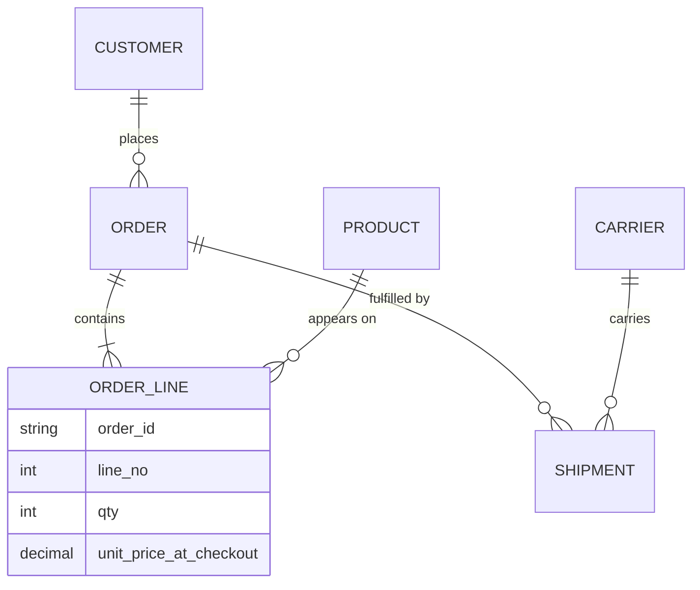

# 01 — Entities, attributes and relationships

*Sources: [Core concepts](https://www.palantir.com/docs/foundry/ontology/core-concepts/) · [Add an Ontology output (Pipeline Builder)](https://www.palantir.com/docs/foundry/pipeline-builder/outputs-add-ontology-output/) · [Data restrictions](https://www.palantir.com/docs/foundry/object-indexing/data-restrictions/) · Chen (1976), see *Additional references* · checked October 2, 2026 · Ready for Review*

- **[Concept]** Conceptual modelling has three building blocks:

  | Block | What it is | Example |
  |---|---|---|
  | **Entity** | A thing with its own identity | a customer |
  | **Attribute** | A fact about one entity | the customer's email |
  | **Relationship** | A meaningful connection between entities | a customer *places* orders |

- **[Concept]** Every relationship has a **cardinality**: one-to-one, one-to-many or many-to-many. It also has an **optionality**: must one side exist?
- **[Docs]** In Foundry, these map to **object types**, **properties** and **link types**. In Pipeline Builder, a many-to-many link needs a **join table**, and one-to-one link types aren't supported.
- **[Recommendation]** The key modelling test: *is this value something people want to find, follow, or reason about on its own?* If yes, it's probably an entity, not an attribute.

## Tables are not entities
**[Concept]** Source systems give you **tables**, not entities. One table can hold several entities (an export with customer, product and warehouse columns), and one entity can be spread across several tables (a customer in the web shop, the support desk and the payments ledger).

If you skip the conceptual step and model straight from tables, you inherit the source system's shape. [Design 01](../11-design/01-best-practices.md#1-domain-driven-design-model-the-world-not-the-source-data) lists the costs: unintuitive models, fragile coupling to source schemas, and relationships nobody can follow.

## The building blocks

### Three levels of model
**[Concept]**

| Level | Question | Audience | Kestrel example |
|---|---|---|---|
| **Conceptual** | What things exist, and how do they relate? | Business and engineers | "A customer places orders; an order contains products" |
| **Logical** | What attributes, keys and cardinalities do they have, independent of technology? | Engineers | `Order(order_id PK, customer_id FK, placed_at, status)` |
| **Physical** | How is it stored? | Data engineers | A Parquet dataset partitioned by date |

**[Explanation]** The Ontology sits closest to the **conceptual-plus-logical** level. Object types, properties and links are business concepts with keys and types. The physical level stays in datasets and pipelines.

### Entity vs attribute: a working test
**[Concept]** Ask four questions about a value:

1. Does it have **its own identity** that persists when other things change?
2. Do people **search for it**, or want to list it on its own?
3. Does it have **facts of its own**?
4. Is it **shared** by many other things?

**[Recommendation]** Two or more "yes" answers usually mean an entity.

**[Example]**

| Value on an order | Identity? | Searched for? | Own facts? | Shared? | Verdict |
|---|---|---|---|---|---|
| `customer_id`, `customer_name` | yes | yes | yes (email, tier, address) | yes | **Entity**: `Customer` |
| `ship_country` | weakly | sometimes | yes (region, VAT rate) | yes | Attribute for now. Could become an entity if country rules matter |
| `status` | no | used as a filter | no | — | **Attribute**, ideally with a fixed list of allowed values |
| `carrier_code` | yes | yes | yes (contract, SLA) | yes | **Entity**: `Carrier` |

### Events are entities too
**[Concept]** An event is something that happened: an order placed, a payment captured, a tracking scan. Events have identity (an event ID), a time, and the things they involve. Modelling events as their own types keeps **what happened** separate from **what exists**.

**[Docs]** Foundry treats events as object types: an object type defines "a real-world entity or event". [Design 01](../11-design/01-best-practices.md#1-domain-driven-design-model-the-world-not-the-source-data) calls this *separating identity from observation*.

### Relationships: cardinality and optionality
**[Concept]**

| Cardinality | Meaning | Kestrel example | Typical physical shape |
|---|---|---|---|
| One-to-one | Each A has at most one B, and vice versa | A payment has at most one chargeback | Foreign key with a uniqueness rule |
| One-to-many | One A has many B; each B has one A | A customer places many orders | Foreign key on the "many" side |
| Many-to-many | Many A to many B | Orders contain many products; products appear on many orders | A **join table** (associative entity) |

**[Concept]** Optionality adds "zero or more" vs "one or more". An order must have at least one order line, but a customer may have placed no orders yet.

**[Concept]** When a many-to-many relationship has **facts of its own** (quantity, price at checkout), the join table is really an entity: *Order Line*. This is the **associative entity** pattern.

## The Foundry mapping

**[Docs]** The Core concepts page:
- an **object type** defines an entity or event;
- a **property** defines its characteristics;
- a **link type** defines the relationship between two object types;
- an **action type** defines how an object type can be modified.

The relational side doesn't have this last idea at all.

**[Docs]** Link cardinality in Pipeline Builder's Ontology outputs:
- **one-to-many:** the foreign key property of one object type must refer to the primary key of the other;
- **many-to-many:** needs a **join table** containing every combination of the two object types' primary keys;
- **one-to-one:** link types are "currently not supported" in this workflow.
- Each side of a link has a display name, and the "many" side also has a plural display name. In the docs' example, a Flight has one "Assigned Aircraft" and an Aircraft has many "Scheduled Flights".

**[Docs]** A data restriction points the same way. OSv2 limits array properties to **100,000 elements** and recommends link types instead of very large arrays "to model relationships".

**[Explanation]** Whether one-to-one is available when you create link types in Ontology Manager rather than Pipeline Builder is checked in [06 — Links](../06-links/README.md). Don't assume one-to-one is unavailable everywhere.

| Conceptual | Foundry Ontology | Notes |
|---|---|---|
| Entity type / event type | Object type | Needs a primary key and a title key |
| Entity instance | Object | One per primary-key value |
| Attribute | Property | Typed; curated, not every column |
| Composite attribute (an address) | Struct property | [Design 02 §2](../11-design/02-structural-guidance.md#2-structs-group-fields-that-belong-together) |
| Relationship type | Link type | Named in both directions |
| Associative entity with its own facts | Object type plus links, or an object-backed link | [Design 02 §4](../11-design/02-structural-guidance.md#4-links-and-object-backed-link-types-relationships-with-meaning) |
| Allowed changes | Action type | No relational equivalent |

## ER diagrams and their limits
**[Analogy]** An entity-relationship (ER) diagram is the closest thing data engineers already draw to an Ontology. Draw one before opening Ontology Manager.

**[Analogy] Where it breaks:**
- ER diagrams usually describe one database. An Ontology unifies entities from **many** systems.
- ER relationships are unnamed foreign keys. Link types have human-readable names in both directions and are traversed by apps and agents.
- ER models say nothing about who may change what, or how. Action types do.

## Kestrel: what's hiding in one export
**[Example]** The storefront's `order_export` file, as Priya first receives it:

```text
order_id | line_no | placed_at  | customer_id | customer_email | sku    | product_name    | qty | unit_price | carrier | tracking_no
O-10442  | 1       | 2026-09-30 | C-2231      | e.k@mail.com   | TNT-02 | 2-person tent   | 1   | 149.00     | DHL     | 77812
O-10442  | 2       | 2026-09-30 | C-2231      | e.k@mail.com   | LMP-11 | Camping lantern | 2   | 16.70      | DHL     | 77812
```

The conceptual model hidden in it:



What the analysis found:

- **Five entities** in one export: Customer, Order, Order Line, Product, Shipment. Carrier is a sixth.
- **Order ↔ Product** is many-to-many with facts of its own (`qty`, price at checkout), so it becomes the associative entity **Order Line**.
- `product_name` on the line is a **copy at checkout time**. It is a fact about the order line ("what the customer saw"), not the product's current name. Keeping both is correct (see [03 — Normalization](03-normalization-and-denormalization.md)).
- `tracking_no` is a property of the shipment, but it is unique only **per carrier** (see [02 — Keys and identity](02-keys-and-identity.md)).

## Modelling advice
- **[Recommendation]** Find entities with the people who use them, before opening the schema. This is the first practice in [Design 01](../11-design/01-best-practices.md#1-domain-driven-design-model-the-world-not-the-source-data).
- **[Recommendation]** Promote an attribute to an entity only when it earns it. Over-modelling (every enum a type) clutters the Ontology as much as under-modelling hides relationships.
- **[Recommendation]** Name relationships as verbs in both directions ("places" / "placed by"). If you can't name a link, question whether it's a real relationship ([Design 02 §4](../11-design/02-structural-guidance.md#4-links-and-object-backed-link-types-relationships-with-meaning)).

## Classic mistakes
- Treating each source table as an entity: the System Silos and Kitchen Sink anti-patterns ([Design 03](../11-design/03-anti-patterns.md)).
- Storing a related entity as a text attribute (`customer_name` on orders), so it can't be linked or searched on its own.
- Modelling a many-to-many relationship with facts of its own as a plain link, and losing the quantity and price.

## Seen in our courses
- [AIP Workflow speedrun 22 — Define join table](../../Speedrun/Your%20First%20AIP%20Workflow/22-define-join-table.md): a many-to-many between chunks and entities.
- [Case study 01 — E2E Order model](../17-case-studies/01-course-ontologies-reviewed.md#1-speedrun-your-first-end-to-end-workflow--order): `customer_name` as an attribute rather than a link.
- [Design exercise A — Find the entities](../18-practice/01-design-exercises.md#a-find-the-entities-domain-driven-design).

## Additional references
- P. P. Chen, "The Entity-Relationship Model — Toward a Unified View of Data", *ACM TODS* 1(1), 1976 ([doi:10.1145/320434.320440](https://doi.org/10.1145/320434.320440)). The origin of ER modelling, the vocabulary used here.

---
[Module index](README.md) · Next: [02 — Keys and identity](02-keys-and-identity.md)
