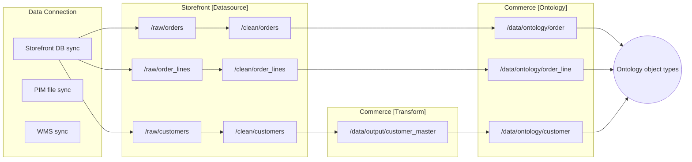

# 02 — Pipelines that feed the Ontology

*Sources: [What is a data pipeline?](https://www.palantir.com/docs/foundry/data-integration/data-pipeline/) · [Types of pipelines](https://www.palantir.com/docs/foundry/building-pipelines/pipeline-types/) · [Recommended project and team structure](https://www.palantir.com/docs/foundry/building-pipelines/recommended-project-structure/) · [Pipeline Builder overview](https://www.palantir.com/docs/foundry/pipeline-builder/overview/) · [Add an Ontology output](https://www.palantir.com/docs/foundry/pipeline-builder/outputs-add-ontology-output/) · checked October 2, 2026 · Ready for Review*

- **[Docs]** A data pipeline carries data from source systems through intermediate datasets to curated datasets that are "structured into the Ontology". A production pipeline has an **owner**, a **schedule**, **data quality checks**, **security**, and **documentation with support processes**.
- **[Docs]** Foundry recommends a chain of projects:

  | Stage | What it produces |
  |---|---|
  | Data Connection | Raw syncs from source systems |
  | **Datasource** project | One per source system; cleaned, 1:1 with source tables |
  | **Transform** project | Canonical, reusable datasets |
  | **Ontology** project | One canonical table per object type |
  | **Workflow** project | Use cases built on the Ontology |

  Design it **backwards from the Ontology**.
- **[Docs]** There are three pipeline types:
  - **batch:** recompute everything; simplest;
  - **incremental:** process only changes; minutes of latency; Python or Java only;
  - **streaming:** continuous; under a minute; complex and costly.

  Start with batch.
- **[Docs]** Pipeline Builder can output **object types and link types directly**, from batch or streaming datasets. In that workflow, link types are one-to-many or many-to-many (with a join table); one-to-one isn't supported.
- **[Recommendation]** The Ontology-facing dataset is an **API**. Give it one row per object, a deterministic key, clean types and stable column names.

## Why the pipeline decides Ontology quality
**[Concept]** An Ontology is only as good as the datasets behind it. Duplicate keys fail indexing, bad joins multiply rows, renamed columns break property mappings, and stale data misleads decisions.

Pipelines turn messy, source-shaped data into **object-shaped** data, and keep doing so reliably on a schedule, with checks and an owner.

## Stages with contracts
**[Concept]** Separate the stages by **purpose**, so each one has a clear contract:

```text
source-shaped  →  clean  →  canonical  →  object-shaped  →  use-case-shaped
(raw sync)       (typed)    (joined)      (1 row/object)     (apps, analysis)
```

Each arrow is a transformation owned by someone. Each stage's outputs are what the next stage may depend on.

## Foundry's recommended setup

### Project stages
**[Docs]** From *Recommended project and team structure*:

| Stage | Purpose | Recommended folders |
|---|---|---|
| **Data Connection** | Syncs land raw data. The key choice is `SNAPSHOT` vs `APPEND` | Agents live in a dedicated project for agent administrators |
| **Datasource project** | One per logical source. Outputs map 1:1 to source tables, with consistent names, correct types, handled malformed values, health checks, and PII removed. The outputs "should be thought of as an API" | `/raw`, `/processed`, `/clean`, `/analysis`, `/scratchpad`, `/documentation` |
| **Transform project** | Imports clean datasets; joins, normalizes or denormalizes into object-centric or time-centric datasets; standard metrics | `/data/transformed`, `/data/output` (the only datasets downstream should rely on), plus `/analysis`, `/scratchpad`, `/documentation` |
| **Ontology project** | "The final transformation necessary to produce datasets that conform to the definition of a single or related-group of objects". The Ontology layer "serves as an API for operational objects" | `/data/transformed`, `/data/ontology` (the only datasets downstream should rely on), plus `/analysis`, `/scratchpad`, `/documentation` |
| **Workflow project** | Use cases: apps, analysis, data science. They should reference **Ontology projects**, not earlier stages; if the Ontology isn't sufficient, enrich it | `/data`, `/analysis`, `/models`, `/applications`, … |

**[Docs]** The page also gives some sizing advice:
- **Projects map 1:1 to Code Repositories.**
- A good project is like a good microservice: a clear purpose, clear outputs, and a small owning team.
- Typing tip: import unreliable date and number fields as `STRING`, then parse them robustly.

It also lists roles: datasource developer, data pipeline developer (who builds the Ontology layer), release manager, data officer, and others.

### Pipeline types
**[Docs]** From *Types of pipelines*:

| Criterion | Batch | Incremental | Streaming |
|---|---|---|---|
| Latency | High | Low | Very low |
| Complexity | Low | Medium | High |
| Compute cost | Medium | Low | High |
| Resilience to growth in data | Low | High | High |

- **Batch:** fully recomputes every changed dataset. The docs advise starting here, and say it can be kept "indefinitely" at low scale ("less than tens of millions of rows").
- **Faster pipelines:** Pipeline Builder variants powered by DataFusion that speed up small and medium batch or incremental work. They don't support every expression.
- **Incremental:** processes only new or changed rows or files; latency in minutes. It requires understanding transactions and handling non-incremental updates. Only **Python and Java** APIs support it.
- **Streaming:** "closer to managing a microservice than managing a compute job". Use it only when data must arrive in under a minute.

### Authoring tools
**[Docs]**
- **Pipeline Builder** is "Foundry's primary application for data integration". It offers a point-and-click and form interface over Spark and Flink, type-safe functions, strict output checks, Git-style versioning, LLM and model transforms, streaming where enabled, and external pipelines that push compute to Databricks or Snowflake.
- **Code Repositories** provide Python, Java and SQL transforms. They are the route for incremental pipelines in code.

### Ontology outputs in Pipeline Builder
**[Docs]** From *Add an Ontology output*:
- **What you can create:** object type and link type outputs, from **batch and streaming** datasets. Edits and many-to-many links can't be configured for stream-backed objects in Pipeline Builder.
- **Ownership:** you can define new object types in Pipeline Builder but can't modify existing ones unless Pipeline Builder created them.
- **IDs:** after the first deploy, the object type ID can't change; the API name can. Links defined in Pipeline Builder can only use object types from the **same pipeline**.
- **Link cardinality:** one-to-many (foreign key → primary key) or many-to-many (a **join table** with every pair of primary keys). One-to-one isn't supported.
- **Other settings:** you can enable **edits** on batch-backed object types, and implement **interfaces** by mapping properties.
- **Validation errors:** conflicting changes in Pipeline Builder and Ontology Manager, changing a primary key referenced by an outside link, or breaking schema changes needing a **schema migration** (drop or migrate edits). These must be resolved before deploying.
- **Column names:** backing column names must **exactly match** the configured property backing columns, or data goes missing or indexing breaks.
- **Granular security:** restricted-view or object security policies can be set in Pipeline Builder. They are **read-time only**: pair them with markings to protect data downstream.
- **Deprecated:** "disowning" (handing types over to Ontology Manager).

## Medallion architecture, with a twist
**[Analogy]** This is the familiar **medallion / layered** architecture (bronze → silver → gold), with two additions:
- the gold layer is split into **object-shaped** datasets that back the Ontology;
- each layer is also a **security and ownership boundary**, because a project holds role grants.

**[Analogy] Where it breaks:** in a lakehouse, "gold" tables are usually the end product. In Foundry, the Ontology-project datasets are an **intermediate** product. The real interface for consumers is the Ontology, with its links, actions and permissions, not the tables.

## Kestrel: working backwards from the object types
**[Example]** Priya's project layout, working backwards from `Order`, `Order Line`, `Customer`, `Product` and `Shipment`:



**[Example]** Checks on `/data/ontology/order` before it backs `Order`:

| Check | Why | Source of the rule |
|---|---|---|
| `order_id` unique and non-null | Duplicates within a transaction fail indexing | [01 — Keys and identity](../01-foundations/02-keys-and-identity.md) |
| Row count equals the distinct orders in `/clean/orders` | Detects a fan-out join (one order × two addresses) | Our [Pipeline deep dive 17](../../Deep%20Dive/Building%20Your%20First%20Pipeline/17-identify-a-bad-join.md) |
| No empty strings, `NaN` or nested arrays | OSv2 data restrictions | [01 — Datasets](01-datasets-transactions-and-schemas.md) |
| Column names frozen | Property mappings depend on exact names | *Add an Ontology output* |
| Customer details as `customer_id` only, no name or email copies | Link to `Customer` instead | [01 — Normalization](../01-foundations/03-normalization-and-denormalization.md) |

**[Example]** Pipeline type per output:
- **`Product` and `Customer`:** batch, small and slowly changing.
- **`Order`:** incremental from the CDC changelog, because Ama needs minute-level status.
- **Tracking events:** streaming. See [03 — Virtual tables and streams](03-virtual-tables-and-streams.md).

## Decisions to make early
- **[Recommendation]** Choose **where each object type is defined**: in Pipeline Builder (pipeline-owned, versioned with the data logic) or in Ontology Manager on top of a dataset output. Pipeline-owned types can't use every Ontology Manager feature; the docs mention shared properties and runtime-derived properties.
- **[Recommendation]** Put uniqueness and null checks on every Ontology-project output. Fail the pipeline, not the Funnel indexing job.
- **[Explanation]** Changing an Ontology-project dataset is changing a public API. Coordinate column renames and type changes with the object type owners ([14 — Schema evolution and breaking changes](../14-lifecycle-and-operations/03-schema-evolution-and-breaking-changes.md)).

## Mistakes
- Workflow projects reading `/raw` or `/clean` datasets directly. That fragments the source of truth.
- Building incremental or streaming pipelines before batch is proven.
- Renaming a column in the pipeline and silently breaking a property mapping.
- Expecting Pipeline Builder links to reach object types defined elsewhere. They must be in the same pipeline; use Ontology Manager for those.

## In our courses
- [Deep Dive — Building Your First Pipeline](../../Deep%20Dive/Building%20Your%20First%20Pipeline/README.md), especially lessons [17 — bad join](../../Deep%20Dive/Building%20Your%20First%20Pipeline/17-identify-a-bad-join.md), [22 — segmenting and materializing outputs](../../Deep%20Dive/Building%20Your%20First%20Pipeline/22-segmenting-and-materializing-outputs.md) and [23 — maintainability](../../Deep%20Dive/Building%20Your%20First%20Pipeline/23-pipeline-maintainability.md).
- [E2E speedrun 17 — Union datasets](../../Speedrun/Your%20First%20End-to-End%20Workflow/17-union-datasets.md): two systems merged into one `Order` dataset (no System Silos).
- [AIP Workflow speedrun 21 — Output for entities](../../Speedrun/Your%20First%20AIP%20Workflow/21-add-output-for-entities.md) and [23 — Join table output](../../Speedrun/Your%20First%20AIP%20Workflow/23-add-output-for-join-table.md)

---
[Module index](README.md) · Previous: [01 — Datasets, transactions and schemas](01-datasets-transactions-and-schemas.md) · Next: [03 — Virtual tables and streams](03-virtual-tables-and-streams.md)
