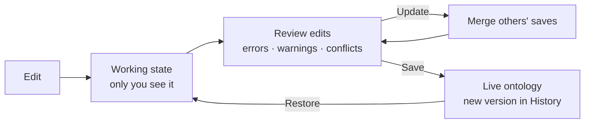

# 02 — Ontology Manager: a guided tour

*Sources: [Ontology Manager overview](https://www.palantir.com/docs/foundry/ontology-manager/overview/) · [Navigation](https://www.palantir.com/docs/foundry/ontology-manager/navigation/) · [Viewing usage](https://www.palantir.com/docs/foundry/ontology-manager/view-usage/) · [Save changes](https://www.palantir.com/docs/foundry/ontology-manager/save-changes/) · [Review and restore changes](https://www.palantir.com/docs/foundry/ontology-manager/restore-changes/) · checked October 2, 2026 · Ready for Review*

Ontology Manager (sometimes called the Ontology Management Application, OMA) is where object types, link types, action types, interfaces and shared properties are defined and maintained. This note walks through it in the order you'd meet it, then covers the save cycle, which is where most surprises happen.

## Getting in

**[Docs]** There are three ways in:

- the Ontology Manager icon in the workspace sidebar;
- right-clicking an object type in Data Lineage and choosing **Configure object type**;
- adding `/workspace/ontology` to your Foundry URL.

## The screens

**Top bar and sidebar.** The top bar searches resources (Cmd/Ctrl + K), creates new ones, and switches or creates **branches**. Search covers object types, properties, link types, action types, shared properties, interfaces and functions, and highlights which field matched.

**Discover.** The landing page. It shows favourite and recently viewed object types and favourite groups by default, and you can add a section for any group. New users also see recently modified and prominent object types.

**Resource lists.** Pages for object types, link types, action types, shared properties, interfaces and functions. Filter by visibility, status and indexing issues.

**Object type view.** The page you'll use most. Its Overview has seven sections:

1. metadata
2. properties
3. action types
4. a link type graph
5. dependents
6. data
7. usage

The sidebar leads to further pages, such as Properties, Datasources and Capabilities.

**Property editor.** Opens when you select a property. Mapping columns, base types, keys, formatting and render hints all live here (see [05 — Properties](../05-properties/README.md)).

**Link type, action type and function views.**

- **Link types** have Overview and Datasources pages.
- **Action types** have Overview, Logic and Observability. Observability shows the last 30 days of usage and monitoring rules.
- **Functions** are read-only here: you change them in their Code Repository. Their view shows usage history by version, so you can find apps still on an old version.

## Usage: who depends on this?

**[Docs]** When Ontology metrics are switched on (an Ontology administrator does this in Control Panel; changes can take up to 60 minutes), each object type and link type shows:

- **reads:** load requests, not objects. A table that loads 500 objects is one read;
- **writes:** edit requests from actions, functions, forms, Object Explorer edits or the API;
- **interactions** and **active users** over the last 30 days.

The **Usage** tab lists who used a type, when, and in which application.

**[Explanation]** Check this before any breaking change. It is the closest thing to a dependency report for an object type.

## The save cycle

**[Docs]** Ontology Manager edits are a **local work-in-progress** until you save. Nothing changes for anyone else until then.

1. Make your changes. They are staged, not live.
2. Select **Save**, which opens **Review edits**. Every changed resource has its own entry.
3. Fix **errors**; they block saving. **Warnings** don't, but read them.
4. If someone else saved in the meantime, select **Update** to merge their changes. Resolve conflicts by keeping theirs or overriding with yours.
5. For destructive changes, confirm by typing the resource's name.
6. Save. Failures show a toast whose error name starts with `OntologyMetadata:` or `Phonograph2:`. Search the docs for that name.

You can discard a single resource's changes (trash icon in Review edits) or all of them.

**[Docs]** The **History** tab shows saved changes per resource and across the ontology, with who saved and when. You can **restore an object type** to an earlier version. The restore lands in your working state and still has to be saved.

## Where to look when…

| Situation | Look here |
|---|---|
| Objects aren't showing up or are stale | Object type → **Datasources** (pipeline, index status, edits) |
| Save button is grey | Review edits → **Errors** tab, or someone saved first → **Update** |
| "Who uses this type?" | Overview usage graph → **Usage** tab |
| "Who changed this, and when?" | Resource → **History** |
| A function needs changing | Function view → **Open in Code Repository** |
| An action's failure rate | Action type → **Observability** |

## In our courses

**[Observed]** [Ontology deep dive lesson 13](../../Application%20Developer/02-deep-dive-creating-your-first-ontology/13-ontology-manager.md) was the first time we used Ontology Manager. Lessons 14–16 built an object type, a link type and an action type there.

**[Explanation]** Branching from the top bar, and proposals for reviewing changes before they reach the main ontology, are covered in [14 — Branching and proposals](../14-lifecycle-and-operations/02-branching-and-proposals.md).

---
[Module index](README.md) · Previous: [01 — Ontologies as resources](01-ontologies-as-resources.md) · Next: [03 — Objects and object sets](03-objects-and-object-sets.md)
