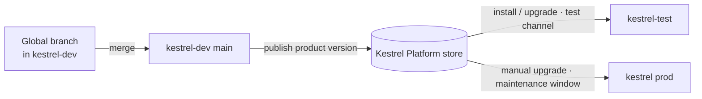

# 04 — Packaging with Marketplace

*Sources: [Product delivery overview](https://www.palantir.com/docs/foundry/devops/overview/) · [DevOps core concepts](https://www.palantir.com/docs/foundry/devops/core-concepts/) · [Create a product](https://www.palantir.com/docs/foundry/foundry-devops/create-products/) · [Ontology types in Marketplace](https://www.palantir.com/docs/foundry/object-link-types/marketplace-ontology-types/) · [Action types in Marketplace](https://www.palantir.com/docs/foundry/action-types/marketplace-action-types/) · [Ontology permissions](https://www.palantir.com/docs/foundry/object-permissioning/ontology-permissions/) · checked October 3, 2026 · Ready for Review*

Written as a **product spec**: the document Kestrel's platform team wrote before packaging the Delivery Desk workflow. The "Notes" column of each section explains which doc rule shaped the decision.

## Why package at all

**[Docs]** **Foundry DevOps** packages "any combination of Foundry resources as a product", with versioning, dependency management, **release channels** and fleets of **installations**. **Marketplace** is the storefront for installing products, with optional **automatic upgrades** in **maintenance windows**.

The docs give four uses:

- distribution;
- ecosystems (one installation per customer, subsidiary or department);
- **release management** (dev, test, prod installations);
- bootstrapping.

**[Docs]** A *product* is installed into an *installation*. Installers map the product's **inputs**, and the product creates its **outputs**. One product can be installed many times. The docs' example is a pre-production space and ontology and a production one, each with its own input data, release channel and upgrade window.

**Kestrel's reason:** **release management**. Kestrel has a `kestrel-dev` space with its own ontology, where branches merge ([02](02-branching-and-proposals.md#which-branching)), and a production `kestrel` space. The Delivery Desk is promoted from dev to prod as a product version.

**[Explanation]** This revises the "one space, one ontology" setup in [03-01](../03-ontology-fundamentals/01-ontologies-as-resources.md#kestrels-setup). The rule there was not to create extra ontologies for **teams**. Separate **environments** are a different case, and it's the case the docs' own installation example uses.

## Spec: *Kestrel Delivery Desk* v1.0

### Outputs (created by every installation)

| Resource | Notes |
|---|---|
| Workshop app *Delivery Desk queue* | **[Docs]** Add the **furthest-downstream** resource first; DevOps finds the dependencies |
| Action types *Hold order*, *Re-route shipment*, *Send delay update* | **[Docs]** Submission criteria **must not reference a specific user**; use groups. *Hold order* already checks the *CS agents* group ([08-01](../08-actions/01-action-types.md#the-anatomy)) |
| Functions `deliveryRisk`, `draftDelayMessage` | Model **aliases** travel but **can't be remapped** at install ([09-04](../09-functions/04-functions-on-models-and-llms.md#pattern-2--call-a-language-model)) |
| `Case` interface, with its action type constraints | **[Docs]** Interfaces and their action constraints are packageable ([07-03](../07-interfaces/03-interface-links-and-action-constraints.md)). *Untested:* the **implementations** live on Support Ticket, Chargeback and Fraud Case, which aren't in the product. The docs don't say whether an install carries them, or each environment re-implements `Case` on its own types. → RQ-28 |
| `Message` object type (no backing datasource) | **[Docs]** Types **without** backing datasources are supported |

### Inputs (the installer maps them)

| Input | Why it isn't an output |
|---|---|
| `Order`, `Shipment`, `Customer` object types | Each environment has its own core types and data |
| Groups (*CS agents*, *fraud*) | **[Docs]** Inputs such as **groups** and parameters can't be promoted to outputs |
| Allowed markings for mandatory-control properties | **[Docs]** Packaging declares these as installation inputs ([05-06](../05-properties/06-edit-only-required-and-mandatory-control.md)) |

**[Docs] Inputs or outputs?** "If you want installers to provide their own version of a resource… list that requirement as an input." To have the product provide it, **promote** the input to an output. If you promote every input, the installer maps nothing.

### Not packageable, so out of scope

**[Docs]**

| Item | Rule | Kestrel consequence |
|---|---|---|
| **Objects and user edits** | "Objects themselves cannot be packaged" | Production holds and re-routes stay in production. Packages carry definitions, not decisions |
| **Stream-backed object types** | Not supported | The carrier tracking-event type stays outside the product, as an input mapped in each environment |
| Cipher, geo-time and **vector** properties | Not supported | No change: Delivery Desk has no vectors. Module 16's semantic search may add some, so check this again then |

### Settings

| Setting | Choice | Doc rule |
|---|---|---|
| **Installation mode** | **Production** | **[Docs]** "Recommended when you want to manage all installations centrally and use features such as automatic upgrades." Installers can **lock down** the project for safe upgrades. *Singleton* allows one installation per space and ontology. *Bootstrap* is for starting points that will be customised |
| **Automatic upgrades** | **Off** in prod, on in test | **[Docs]** Off by default in Production mode |
| **Build settings** | Build on install | **[Docs]** Hydrates datasets and models during the installation job |
| **Folder structure** | On | **[Docs]** Recreates folders up to the lowest common ancestor |
| **Store** | `Kestrel Platform` store, in a project restricted to the platform team | **[Docs]** Anyone who can **edit** the store's project can create and edit products. Anyone who can **view** it can install |

### Size and permissions

- **[Docs]** A product can have **15,000** inputs and outputs combined, counting nested items such as dataset columns and **object type properties**. A warning appears at 75%. **[Explanation]** A wide `Order` type counts once for each property, so keep core types as **inputs**.
- **[Docs]** A product **installs with the permission model it was packaged with**. Before migration to project permissions, Ontology resources land in the **Ontology service project** (every user has Viewer). After migration, they land **in the target project** ([12-02](../12-security-and-governance/02-ontology-resource-permissions.md#migration-runbook)).
- **[Docs]** In **CBAC** environments, installed files take the **target project's classification**. Installing below the store's classification needs declassify permission.
- **[Docs]** Packaging a dataset **with static data** needs the **download** operation on it. On restricted enrollments that may need an extra role, such as *Exporter*.

## Which environment changes what

**[Explanation]** Kestrel's rule, which 01–03 follow:

| Resource | Where it's changed | How it reaches prod |
|---|---|---|
| **Product outputs** (Delivery Desk app, its actions and functions, `Case`, `Message`) | Only in `kestrel-dev`, on global branches | A new **product version**, installed in test and then prod |
| **Core types that are inputs** (`Order`, `Shipment`, `Customer`, `Payment`) | In **each** environment, under the [01](01-saving-reviewing-and-restoring.md) change policy | The same change is made twice: dev first, then prod, on a branch each time |

The cost of the second row is duplicated work on core types. The alternative, packaging core types too, would put every property of a wide type into the 15,000 limit and make production data types depend on a product upgrade.

## Release flow

**[Explanation]** Branches handle **change within** an environment. Product versions handle **movement between** environments. Keep the two separate, and never edit an installed resource in production by hand. The next upgrade would conflict with your edit, and the installation's lockdown is there to prevent exactly that.

---
[Module index](README.md) · Previous: [03 — Schema evolution and breaking changes](03-schema-evolution-and-breaking-changes.md) · Next: [05 — Migration and export/import](05-migration-and-export-import.md)
