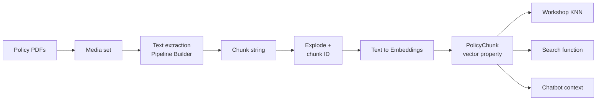

# 02 — Semantic search and embeddings

*Sources: [Semantic search](https://www.palantir.com/docs/foundry/ontology/overview-semantic-search/) · [Document processing](https://www.palantir.com/docs/foundry/ontology/document-processing/) · [Multimodal and embedding models](https://www.palantir.com/docs/foundry/ontology/aip-multimodal-and-embedding-models/) · [Ontology-augmented generation](https://www.palantir.com/docs/foundry/ontology/ontology-augmented-generation/) · [Workflow with Palantir-provided models](https://www.palantir.com/docs/foundry/ontology/using-palantir-provided-models-to-create-a-semantic-search-workflow/) · [Workflow with custom models](https://www.palantir.com/docs/foundry/ontology/using-custom-models-to-create-a-semantic-search-workflow/) · [Chatbot Studio: retrieval context](https://www.palantir.com/docs/foundry/chatbot-studio/retrieval-context/) · checked October 3, 2026 · Ready for Review*

[10-07](../10-applications/07-searching-the-ontology.md) covered **keyword** search: matching tokens. This note covers **semantic** search: matching meaning. It's laid out as a **build recipe**, the one Priya followed to make Kestrel's returns and carrier policies searchable by the Delivery Desk, with the doc rule behind each step.

## The idea in one paragraph

**[Docs]** An embedding model turns text into a vector of N numbers. If the model is good, texts with similar meaning land near each other: "face mask" lands closer to "face covering" than to "respirator". Store the vector on an object, and "find related objects" becomes "find the nearest vectors".

**[Explanation]** Keyword search finds `damaged parcel`. Semantic search also finds "the box arrived crushed". Neither is better; they fail differently, which is why the advanced step at the end combines them.

## The recipe

### 1. Get the text out

**[Docs]** Upload PDFs as a **media set**, add it to Pipeline Builder, then use **Get Media References** and **Text Extraction**. Keep the media reference: users will want to see the source page beside the answer.

### 2. Chunk it

**[Docs]** Chunking splits long text into smaller pieces, each embedded separately. Two reasons: embedding models have a maximum input length, and smaller pieces are "more semantically distinct". The **Chunk string** board takes:

- *chunk size* (approximate characters);
- *chunk overlap* (characters shared with the previous chunk, to keep context across the boundary);
- an ordered list of *separators*: it splits on the highest-priority one first, and moves down the list only while a chunk is still too big.

**[Docs]** Then **Explode Array with Position**, and build a chunk ID from the parent ID plus the position (`abc_0`, `abc_1`…). The chunk ID is the new primary key; the parent ID becomes the link.

**[Example]** Priya uses ~1,000 characters with 150 overlap, separators `\n\n`, `\n`, `. `. Chunk IDs are `POL-RETURNS-2026_0`, `_1`… Stable as long as the document and chunk settings don't change; changing either re-keys every chunk, which is fine because nobody edits chunks.

### 3. Embed it

**[Docs]** **Text to Embeddings** in Pipeline Builder converts a string into a vector using a Palantir-provided model (the tutorial uses `text-embedding-ada-002`). The result becomes a **vector property**.

**[Docs] Choosing a model:**

- Queries and passages aren't the same kind of text. Models trained for search (the docs mention MS MARCO models) put a **query** near its **answer**; a general model like Ada is a better fit when you start from a chunk and look for similar chunks.
- Most non-Ada embedding models accept only about **512 tokens**; size the chunks to match.
- Bringing your own embedding model is "no longer a recommended workflow". If you do, the vector property needs a **dimension** and a **similarity function**, and queries must be embedded with the **same model** as the documents.

### 4. Model it

| Object type | Key | Properties | Links |
|---|---|---|---|
| `PolicyDocument` | `documentId` | title, owner, effective date, media reference | has many `PolicyChunk` |
| `PolicyChunk` | `chunkId` | text, position, **embedding (vector)** | belongs to one `PolicyDocument` |

**[Docs]** The OAG page's basic recipe: chunk, create chunk objects **with a media reference property**, search them, and show the result with the **PDF Viewer** widget.

**[Explanation]** Keep chunks a **separate type**, never vectors on `PolicyDocument`: one document has many chunks, and the search should land on the paragraph, not the 40-page file.

### 5. Retrieve

Four ways, from no-code to full control. **[Docs]**

| Route | How | Limits |
|---|---|---|
| **Workshop KNN object set** | An object set variable filtered on the vector property; set K and a query string variable | K from 1 to 100. Results **can't be sorted by relevance** |
| **Search function** | TSv1: embed the query with the same model, then `nearestNeighbors(...).orderByRelevance()`. TSv2: pass the **text** directly; ordering via `$orderBy: "relevance"`. Python: `nearest_neighbors` (beta), results carry `_score` | TSv1 K ≤ 100; TSv2 1–500. TSv1 repositories need `"enableVectorProperties": true` in `functions.json` |
| **Chatbot Ontology context** | Semantic mode: the K objects nearest each message | Needs a vector property on the type ([01](01-ontology-as-ai-context.md)) |
| **Chatbot document context** | *Relevant chunks* mode searches attached documents directly | Beta |

- **[Docs]** The old **Ontology semantic search tool** in Chatbot Studio is **legacy**: no citations, and it doesn't return the object set to the model. Use Ontology context instead.
- **[Docs]** A published search function can also be a **tool in AIP Logic**.

## When basic retrieval isn't enough

**[Docs]** "First investigate whether the relevant context was retrieved": when an agent answers badly, it's usually the retrieval that failed, not the LLM. The OAG page lists four improvements and recommends starting simple and adding them "as it becomes necessary":

| Technique | What it does | When |
|---|---|---|
| **HyDE** | Ask an LLM to write a *hypothetical* answer chunk, then embed that instead of the question | Questions look nothing like the passages that answer them |
| **Ranked keyword search** | `matchAnyToken(query)` plus `orderByRelevance()`: the index's own relevance scoring | Domain jargon a generic embedding model doesn't separate well |
| **Query augmentation** | An LLM rewrites the query: strip filler, add synonyms ("deer collision" → animal, wildlife, collision…) for keyword search; or extract the core ask for semantic search | Users ask in long, chatty sentences |
| **Hybrid search (RRF)** | Run keyword and semantic search, then merge by **reciprocal rank fusion**: score = Σ 1/(k + rank), with k = 60 in the example | Both kinds of failure happen |

**[Explanation]** The docs' examples use TSv1 APIs (`Objects.search()`, `GPT_4o`). The logic carries over; the calls don't.

**[Example]** Kestrel's first version was plain KNN. Agents asked "what if a customer won't sign for it?" and missed the *refused delivery* section, which uses the words "decline acceptance". Priya added query augmentation in front of a hybrid search; the right chunk moved from 9th to 1st. That function feeds the Delivery Desk through function-backed context ([03](03-ontology-tools-for-agents.md)).

## Beyond text

**[Docs]** For diagrams and tables, text-only LLMs don't help. The docs suggest extracting text **just to have something to search**, then running a **multimodal** model on the original page image. They mention GPT-4o and GPT-4o mini, and open-source options such as Pix2Struct and Microsoft UDOP.

**[Docs]** Two language notes from the page: for English, MS MARCO search models; for German corpora, the page reports GPT as the only LLM that "performs decently" and suggests trying Ada. **[Explanation]** This page reads as older advice; check the current model list in the [AIP reference](../../AIP/applications/12-aip-model-catalog.md) before choosing.

---
[Module index](README.md) · Previous: [01 — The Ontology as AI context](01-ontology-as-ai-context.md) · Next: [03 — Ontology tools for agents](03-ontology-tools-for-agents.md)
