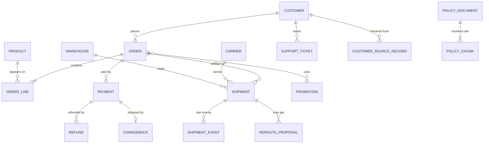

# 02 — Kestrel Commerce reference model

*Sources: the notes linked in each row (no new doc pages) · assembled October 3, 2026 · Ready for Review*

The running example was built up across 16 modules, one decision at a time. This page puts it in one place: **every type, link, interface, action, function, automation, security rule and environment**, with the note where it was decided. Use it to check consistency when writing new material, or to revise the whole design in one sitting. Everything here is **[Example]**: a fictional company, designed with the docs' rules.

## 1. The model on one page

**[Explanation]** The diagram shows the operational core and the types added later. It leaves out `[Log]` types, `Planning Scenario`, `MatchCandidate`, the shared-ontology types and the time series sensor, which are listed below.

## 2. Object types

| Type | Key (title) | Lives in | Notable properties | Defined in |
|---|---|---|---|---|
| `Customer` | `customerId`, master ID from the crosswalk (`fullName`) | `Commerce [Ontology]` | `email`, `phone`, `addresses` (array of structs); PII under a property policy | [04-03](../04-object-types/03-primary-keys-and-titles.md#kestrel-decisions), [12-03](../12-security-and-governance/03-object-and-property-security.md), [15-04](../15-advanced-patterns/04-entity-resolution-across-sources.md) |
| `Order` | `orderId`, e.g. `O-10442` (`orderId`) | `Commerce [Ontology]` | `status` (`OrderStatus` enum), `promisedDeliveryDate`, `deliveryAddress` (struct, PII), `refundState`, `holdReason`, `currency` | [04-03](../04-object-types/03-primary-keys-and-titles.md#kestrel-decisions), [05-02](../05-properties/02-value-types.md), [08-01](../08-actions/01-action-types.md) |
| `OrderLine` | `orderLineId` (`productNameAtCheckout`) | `Commerce [Ontology]` | quantity, price, `line_status` | [06-02](../06-links/02-many-to-many-and-object-backed-links.md#what-kestrel-chose) |
| `Product` | — | `Commerce [Ontology]` | `name` | [04-01](../04-object-types/01-object-types.md) |
| `Shipment` | `shipmentId`, e.g. `DHL|77812` (`trackingNumber`) | `Commerce [Ontology]` | `eta` (UTC), `isLate`, `region` (regional policy), `exception` (struct), `delayRisk` (struct with model version), `trackingUrl` | [04-04](../04-object-types/04-creating-and-editing-object-types.md), [08-02](../08-actions/02-rules-and-parameters.md#writing-a-struct-property), [15-03](../15-advanced-patterns/03-models-in-the-ontology.md) |
| `ShipmentEvent` | `eventId` | `Commerce [Ontology]` | `eventType`, `occurredAt`, `location` | [08-02](../08-actions/02-rules-and-parameters.md), [15-01](../15-advanced-patterns/01-events-history-and-time.md#q2--event-objects) |
| `Carrier` | `carrierCode`, e.g. `DHL` (`carrierName`) | `Commerce [Ontology]` | — | [04-03](../04-object-types/03-primary-keys-and-titles.md#kestrel-decisions) |
| `Warehouse` | `warehouseId` | `Commerce [Ontology]` | `code` (not analyzed), `region`, `location`; implements `Location` | [07-02](../07-interfaces/02-implementing-and-extending-interfaces.md), [10-07](../10-applications/07-searching-the-ontology.md#the-lab) |
| `Pickup Point` | — | — | implements `Location` | [07-02](../07-interfaces/02-implementing-and-extending-interfaces.md) |
| `Vehicle` + temperature sensor | — | — | time series via a sensor object | [15-01](../15-advanced-patterns/01-events-history-and-time.md#q4--time-series) |
| `Payment` | — | `Payments [Ontology]` | `riskAssessment` (struct; `band` being replaced by `riskTier`) | [05-03](../05-properties/03-structs.md), [14-03](../14-lifecycle-and-operations/03-schema-evolution-and-breaking-changes.md#part-2--a-deprecation-playbook-worked-once) |
| `Refund`, `Chargeback`, `Fraud Case` | — | `Payments [Ontology]` | Chargeback and Fraud Case implement `Case` / `MoneyCase` | [02-04](../02-foundry-data-foundations/04-projects-spaces-and-markings.md), [07-02](../07-interfaces/02-implementing-and-extending-interfaces.md) |
| `Customer Risk Profile` | — | `Payments [Ontology]` | Linked to `Customer`, not an MDO | [04-02](../04-object-types/02-backing-datasources-and-mapping.md#step-3--several-datasources-for-one-type-mdos) |
| `Support Ticket` | — | — | implements `Case` | [07-02](../07-interfaces/02-implementing-and-extending-interfaces.md) |
| `Return Request` | — | — | implements `MoneyCase` | [07-02](../07-interfaces/02-implementing-and-extending-interfaces.md) |
| `Promotion` | — | — | many-to-many with Order | [09-02](../09-functions/02-query-functions-and-ontology-edits.md) |
| `ChargebackQuery` | — | — | action-only; object security policy | [08-06](../08-actions/06-action-permissions.md), [12-03](../12-security-and-governance/03-object-and-property-security.md) |
| `Agent`, `Assignment` | — | — | support agents and case assignments | [09-02](../09-functions/02-query-functions-and-ontology-edits.md) |
| `Message` | — | — | no backing datasource; product output | [12-04](../12-security-and-governance/04-security-across-actions-functions-and-apis.md), [14-04](../14-lifecycle-and-operations/04-marketplace-packaging.md) |
| `RerouteProposal` | — | — | written by the agent; accepted by a lead | [16-03](../16-ai-and-agents/03-ontology-tools-for-agents.md) |
| `Planning Scenario` | scenario reference | — | implements *Ontology Scenario*; Draft → In review → Approved/Rejected | [15-02](../15-advanced-patterns/02-scenarios.md) |
| `CustomerSourceRecord`, `MatchCandidate` | — | — | entity-resolution provenance and review | [15-04](../15-advanced-patterns/04-entity-resolution-across-sources.md#6-what-the-ontology-gets) |
| `PolicyDocument`, `PolicyChunk` | `documentId`, `chunkId` | — | chunk text, vector embedding | [16-02](../16-ai-and-agents/02-semantic-search-and-embeddings.md#4-model-it) |
| `DeliveryException`, `SharedShipment` | — | Shared ontology with Northwind Freight | the narrow types the partner sees | [12-05](../12-security-and-governance/05-shared-ontologies-and-cross-org.md) |
| `[Log] …` | generated | — | action-log types | [08-07](../08-actions/07-consistency-reverts-and-logs.md) |

"—" means the notes never needed to decide it. **[Recommendation]** Decide it before adding examples that depend on it.

## 3. Links

| Link | Cardinality | Stored as | Defined in |
|---|---|---|---|
| Order → Customer | many-to-one | FK `Order.customerId` | [06-01](../06-links/01-link-types-and-cardinality.md) |
| Shipment → Order | many-to-one | FK `Shipment.orderId` | [06-01](../06-links/01-link-types-and-cardinality.md) |
| Shipment → Carrier | many-to-one | FK `Shipment.carrierCode` | [06-01](../06-links/01-link-types-and-cardinality.md) |
| Shipment → Warehouse | many-to-one | FK `Shipment.warehouseId` | [06-01](../06-links/01-link-types-and-cardinality.md) |
| Payment ↔ Chargeback | one-to-one (intent) | FK `Chargeback.paymentId` | [06-01](../06-links/01-link-types-and-cardinality.md) |
| Order ↔ Product | many-to-many | through `OrderLine` objects | [06-02](../06-links/02-many-to-many-and-object-backed-links.md#what-kestrel-chose) |
| Order ↔ Promotion | many-to-many | join table | [09-02](../09-functions/02-query-functions-and-ontology-edits.md) |
| Shipment → ShipmentEvent | one-to-many | FK on the event | [15-01](../15-advanced-patterns/01-events-history-and-time.md#q2--event-objects) |
| Customer → source records, orders, tickets | one-to-many | built through the crosswalk; never on email or name | [15-04](../15-advanced-patterns/04-entity-resolution-across-sources.md) |

**Rejected:** Order ↔ Warehouse (derivable through Shipment) and Customer ↔ Carrier (no real relationship), [06-01](../06-links/01-link-types-and-cardinality.md).

## 4. Interfaces

| Interface | Implemented by | Constraints | Defined in |
|---|---|---|---|
| `Case` | Support Ticket, Fraud Case (and, via `MoneyCase`, Chargeback, Return Request) | *Escalate case* action constraint | [07-02](../07-interfaces/02-implementing-and-extending-interfaces.md), [07-03](../07-interfaces/03-interface-links-and-action-constraints.md) |
| `MoneyCase` | Chargeback, Return Request | extends `Case`; adds `amountAtRisk`, `currency` | [07-02 Part C](../07-interfaces/02-implementing-and-extending-interfaces.md#part-c--extend-moneycase) |
| `Location` | Warehouse, Pickup Point | — | [07-02 Part E](../07-interfaces/02-implementing-and-extending-interfaces.md#part-e--location-quickly) |

## 5. Actions

| Action | On | Notes | Defined in |
|---|---|---|---|
| *Hold order* | Order | CS agents; not after SHIPPED/DELIVERED; sets `ON_HOLD`, `holdReason`; notifies the warehouse lead | [08-01](../08-actions/01-action-types.md) |
| *Hold order for payment* | Order | Automation-only; *Kestrel Pay automation* group or fraud group | [10-06](../10-applications/06-automate-and-ontology-events.md) |
| *Re-route shipment* | Shipment | filtered warehouse dropdown; creates a `ShipmentEvent`; own-region only on main | [08-02](../08-actions/02-rules-and-parameters.md), [15-02](../15-advanced-patterns/02-scenarios.md#step-3--govern-it) |
| *Cancel order* | Order | function-backed; about 6 objects edited | [08-04](../08-actions/04-function-backed-actions.md) |
| *Approve refund*, *Issue refund* | Refund, Order | approval with a logged decision; *Issue refund* also sets `Order.refundState` so concurrent refunds conflict | [08-03](../08-actions/03-submission-criteria.md), [08-07](../08-actions/07-consistency-reverts-and-logs.md) |
| *Send delay update* | Order, Message | writes the `Message` body and notifies the customer; agent tool on confirm-first | [08-05](../08-actions/05-side-effects.md), [16-03](../16-ai-and-agents/03-ontology-tools-for-agents.md) |
| *Record delivery exception* | Shipment | writes the `exception` struct | [08-02](../08-actions/02-rules-and-parameters.md#writing-a-struct-property) |
| *Record fraud score* | Payment | stores a live score with its model version | [09-04](../09-functions/04-functions-on-models-and-llms.md) |
| *Escalate case* | via `Case` | interface action constraint | [07-03](../07-interfaces/03-interface-links-and-action-constraints.md) |
| *Propose re-route* | Shipment | writes `RerouteProposal`; agent tool, automatic | [16-03](../16-ai-and-agents/03-ontology-tools-for-agents.md) |
| *Submit for review*, *Approve scenario*, *Reject scenario* | Planning Scenario | approval flow; approve also merges | [15-02](../15-advanced-patterns/02-scenarios.md#step-3--govern-it) |
| *Confirm match*, *Reject match* | MatchCandidate | data stewards | [15-04](../15-advanced-patterns/04-entity-resolution-across-sources.md) |
| *Mark delay as excused* | Shipment | reason as a property, used to exclude training labels | [15-03](../15-advanced-patterns/03-models-in-the-ontology.md) |

## 6. Functions, automations and the agent

| Item | Kind | Defined in |
|---|---|---|
| `deliveryRisk(shipment)` | Live function wrapping the delay model | [09-01](../09-functions/01-functions-on-objects.md), [15-03](../15-advanced-patterns/03-models-in-the-ontology.md) |
| `refundPolicyCheck(refund)` | Function used by *Approve refund* and the agent | [09-01](../09-functions/01-functions-on-objects.md) |
| `lateOrdersForRegion(region)` | Query function for the support portal (API gateway) | [09-02](../09-functions/02-query-functions-and-ontology-edits.md) |
| `assignCase` | Staged-write function | [09-02](../09-functions/02-query-functions-and-ontology-edits.md#staged-writes-beta) |
| `liveFraudScore` | Model function wrapper | [09-04](../09-functions/04-functions-on-models-and-llms.md#pattern-1--wrap-a-predictive-model) |
| `draftDelayMessage` | LLM function; agent tool T4 (pinned) | [09-04](../09-functions/04-functions-on-models-and-llms.md), [16-03](../16-ai-and-agents/03-ontology-tools-for-agents.md) |
| *High-risk payment hold* | Automation, owned by a service user | [10-06](../10-applications/06-automate-and-ontology-events.md) |
| Delivery Desk | AIP Chatbot; tools T1–T7; prompted tool calling | [16-03](../16-ai-and-agents/03-ontology-tools-for-agents.md) |

## 7. Security, environments and governance

- **Projects:** `Commerce [Ontology]`, `Payments [Ontology]` (datasets marked `Kestrel Pay – Financial`), `Delivery Desk [Workflow]` ([02-04](../02-foundry-data-foundations/04-projects-spaces-and-markings.md)).
- **Row and column security:** object and property security policies by default; Shipment regional; Customer PII property policy ([12-03](../12-security-and-governance/03-object-and-property-security.md)).
- **Permissions model:** project-based ([12-02](../12-security-and-governance/02-ontology-resource-permissions.md)).
- **Shared ontology:** with Northwind Freight, narrow types only ([12-05](../12-security-and-governance/05-shared-ontologies-and-cross-org.md)).
- **Environments:** `kestrel-dev`, `kestrel-test`, `kestrel`; product outputs ship as versions, core types change per environment ([14-04](../14-lifecycle-and-operations/04-marketplace-packaging.md#which-environment-changes-what)).
- **Change policy:** tiers A/B/C; protected ontology projects with a two-approval policy ([14-01](../14-lifecycle-and-operations/01-saving-reviewing-and-restoring.md)).
- **Agent controls:** the control ladder ([16-04](../16-ai-and-agents/04-human-in-the-loop-and-staged-writes.md#where-kestrel-puts-each-operation)).

## 8. Known gaps in the example

- Keys and projects for several supporting types are undecided ("—" above).
- `Product`, `Supplier`, `Category`, `Purchase Order` and `Inventory Position` appear in the original target model ([00-04](../00-orientation/04-running-example.md#where-the-model-is-heading)) but no note needed them; question 3 there (supplier risk) is still unanswered.
- *Hold shipment*, mentioned in [16-05](../16-ai-and-agents/05-designing-the-ontology-for-agents.md), isn't designed anywhere.

---
[Module index](README.md) · Previous: [01 — Applied to our courses](01-course-ontologies-reviewed.md) · Next module: [18 — Practice](../18-practice/README.md)
