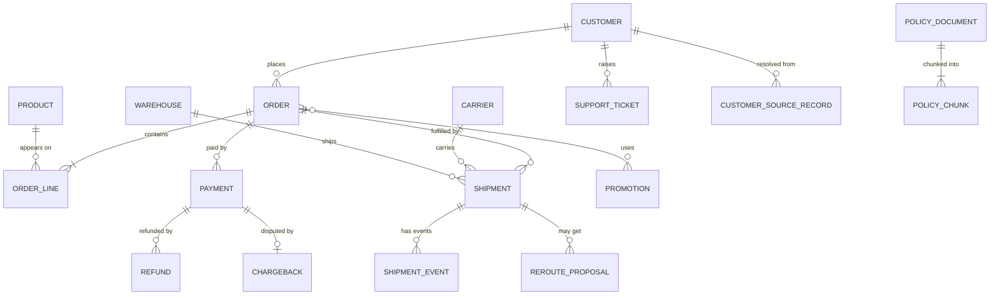

# 02 — Kestrel Commerce reference model

*Sources: the notes linked in each row (no new doc pages) · assembled October 3, 2026; carrier-invoice types added October 8 from the AIP area; applications added October 21 from the [Apps area](../../Apps/README.md); developer resources added October 22 from the [DevTools area](../../DevTools/README.md) · Ready for Review*

The running example was built up across 16 modules (and, for carrier invoices, the [AIP area](../../AIP/README.md)), one decision at a time. This page puts it in one place: **every type, link, interface, action, function, automation, application, security rule and environment**, with the note where it was decided. Use it to check consistency when writing new material, or to revise the whole design in one sitting. Everything here is **[Example]**: a fictional company, designed with the docs' rules.

## 1. The model on one page

**[Explanation]** The diagram shows the operational core and the types added later. It leaves out `[Log]` types, `Planning Scenario`, `MatchCandidate`, the shared-ontology types and the time series sensor, which are listed below.

## 2. Object types

| Type | Key (title) | Lives in | Notable properties | Defined in |
|---|---|---|---|---|
| `Customer` | `customerId`, master ID from the crosswalk (`fullName`) | `Commerce [Ontology]` | `email`, `phone`, `addresses` (array of structs); PII under a property policy | [04-03](../04-object-types/03-primary-keys-and-titles.md#kestrel-decisions), [12-03](../12-security-and-governance/03-object-and-property-security.md), [15-04](../15-advanced-patterns/04-entity-resolution-across-sources.md) |
| `Order` | `orderId`, e.g. `O-10442` (`orderId`) | `Commerce [Ontology]` | `status` (`OrderStatus` enum), `promisedDeliveryDate`, `deliveryAddress` (struct, PII), `refundState`, `holdReason`, `currency` | [04-03](../04-object-types/03-primary-keys-and-titles.md#kestrel-decisions), [05-02](../05-properties/02-value-types.md), [08-01](../08-actions/01-action-types.md) |
| `OrderLine` | `orderLineId` (`productNameAtCheckout`) | `Commerce [Ontology]` | quantity, price, `line_status` | [06-02](../06-links/02-many-to-many-and-object-backed-links.md#what-kestrel-chose) |
| `Product` | — | `Commerce [Ontology]` | `name` | [04-01](../04-object-types/01-object-types.md) |
| `Shipment` | `shipmentId`, e.g. `DHL|77812` (`trackingNumber`) | `Commerce [Ontology]` | `eta` (UTC), `isLate`, `region` (regional policy), `exception` (struct), `delayRisk` (struct with model version), `trackingUrl` | [04-04](../04-object-types/04-creating-and-editing-object-types.md), [08-02](../08-actions/02-rules-and-parameters.md#writing-a-struct-property), [15-03](../15-advanced-patterns/03-models-in-the-ontology.md) |
| `ShipmentEvent` | `eventId` | `Commerce [Ontology]` | `eventType`, `occurredAt`, `location` | [08-02](../08-actions/02-rules-and-parameters.md), [15-01](../15-advanced-patterns/01-events-history-and-time.md#q2--event-objects) |
| `Carrier` | `carrierCode`, e.g. `DHL` (`carrierName`) | `Commerce [Ontology]` | — | [04-03](../04-object-types/03-primary-keys-and-titles.md#kestrel-decisions) |
| `Warehouse` | `warehouseId` | `Commerce [Ontology]` | `code` (not analyzed), `region`, `location`; implements `Location` | [07-02](../07-interfaces/02-implementing-and-extending-interfaces.md), [10-07](../10-applications/07-searching-the-ontology.md#the-lab) |
| `Pickup Point` | — | — | implements `Location` | [07-02](../07-interfaces/02-implementing-and-extending-interfaces.md) |
| `Vehicle` + temperature sensor | — | — | time series via a sensor object | [15-01](../15-advanced-patterns/01-events-history-and-time.md#q4--time-series) |
| `Payment` | — | `Payments [Ontology]` | `riskAssessment` (struct; `band` being replaced by `riskTier`) | [05-03](../05-properties/03-structs.md), [14-03](../14-lifecycle-and-operations/03-schema-evolution-and-breaking-changes.md#part-2--a-deprecation-playbook-worked-once) |
| `Refund`, `Chargeback`, `Fraud Case` | — | `Payments [Ontology]` | Chargeback and Fraud Case implement `Case` / `MoneyCase` | [02-04](../02-foundry-data-foundations/04-projects-spaces-and-markings.md), [07-02](../07-interfaces/02-implementing-and-extending-interfaces.md) |
| `Customer Risk Profile` | — | `Payments [Ontology]` | Linked to `Customer`, not an MDO | [04-02](../04-object-types/02-backing-datasources-and-mapping.md#step-3--several-datasources-for-one-type-mdos) |
| `Support Ticket` | — | — | implements `Case` | [07-02](../07-interfaces/02-implementing-and-extending-interfaces.md) |
| `Return Request` | — | — | implements `MoneyCase` | [07-02](../07-interfaces/02-implementing-and-extending-interfaces.md) |
| `Promotion` | — | — | many-to-many with Order | [09-02](../09-functions/02-query-functions-and-ontology-edits.md) |
| `ChargebackQuery` | — | — | action-only; object security policy | [08-06](../08-actions/06-action-permissions.md), [12-03](../12-security-and-governance/03-object-and-property-security.md) |
| `Agent`, `Assignment` | — | — | support agents and case assignments | [09-02](../09-functions/02-query-functions-and-ontology-edits.md) |
| `Message` | — | — | no backing datasource; product output | [12-04](../12-security-and-governance/04-security-across-actions-functions-and-apis.md), [14-04](../14-lifecycle-and-operations/04-marketplace-packaging.md) |
| `RerouteProposal` | — | — | written by the agent; accepted by a lead | [16-03](../16-ai-and-agents/03-ontology-tools-for-agents.md) |
| `Planning Scenario` | scenario reference | — | implements *Ontology Scenario*; Draft → In review → Approved/Rejected | [15-02](../15-advanced-patterns/02-scenarios.md) |
| `CustomerSourceRecord`, `MatchCandidate` | — | — | entity-resolution provenance and review | [15-04](../15-advanced-patterns/04-entity-resolution-across-sources.md#6-what-the-ontology-gets) |
| `PolicyDocument`, `PolicyChunk` | `documentId`, `chunkId` | — | chunk text, vector embedding | [16-02](../16-ai-and-agents/02-semantic-search-and-embeddings.md#4-model-it) |
| `CarrierInvoice` | `invoiceId`, e.g. `DHL-INV-2026-09` | — | `invoiceDate`, `totalAmount`, `currency`, `sourceDocument` (media reference); extracted with AIP Document Intelligence | [AIP 06-01](../../AIP/06-document-intelligence/01-extraction-strategies.md#where-the-data-goes) |
| `CarrierInvoiceLine` | `invoiceLineId` | — | `trackingNumber` as printed, `chargeType`, `amount`, `matchStatus` | [AIP 06-01](../../AIP/06-document-intelligence/01-extraction-strategies.md#where-the-data-goes) |
| `DeliveryException`, `SharedShipment` | — | Shared ontology with Northwind Freight | the narrow types the partner sees | [12-05](../12-security-and-governance/05-shared-ontologies-and-cross-org.md) |
| `[Log] …` | generated | — | action-log types | [08-07](../08-actions/07-consistency-reverts-and-logs.md) |
| `TemperatureExcursion` (planned, added October 22) | — | — | one event per period a refrigerated van's probe stayed above 8 °C for 10 minutes, linked to `Vehicle`; found with FoundryTS `time_series_search`; where the job runs is undecided | [DevTools 07-01](../../DevTools/07-foundryts/01-foundryts.md#for-kestrel), [15-01](../15-advanced-patterns/01-events-history-and-time.md#q4--time-series) |

"—" means the notes never needed to decide it. **[Recommendation]** Decide it before adding examples that depend on it.

## 3. Links

| Link | Cardinality | Stored as | Defined in |
|---|---|---|---|
| Order → Customer | many-to-one | FK `Order.customerId` | [06-01](../06-links/01-link-types-and-cardinality.md) |
| Shipment → Order | many-to-one | FK `Shipment.orderId` | [06-01](../06-links/01-link-types-and-cardinality.md) |
| Shipment → Carrier | many-to-one | FK `Shipment.carrierCode` | [06-01](../06-links/01-link-types-and-cardinality.md) |
| Shipment → Warehouse | many-to-one | FK `Shipment.warehouseId` | [06-01](../06-links/01-link-types-and-cardinality.md) |
| Payment ↔ Chargeback | one-to-one (intent) | FK `Chargeback.paymentId` | [06-01](../06-links/01-link-types-and-cardinality.md) |
| Order ↔ Product | many-to-many | through `OrderLine` objects | [06-02](../06-links/02-many-to-many-and-object-backed-links.md#what-kestrel-chose) |
| Order ↔ Promotion | many-to-many | join table | [09-02](../09-functions/02-query-functions-and-ontology-edits.md) |
| Shipment → ShipmentEvent | one-to-many | FK on the event | [15-01](../15-advanced-patterns/01-events-history-and-time.md#q2--event-objects) |
| CarrierInvoice → Carrier | many-to-one | FK `CarrierInvoice.carrierCode` | [AIP 06-01](../../AIP/06-document-intelligence/01-extraction-strategies.md#where-the-data-goes) |
| CarrierInvoiceLine → CarrierInvoice | many-to-one | FK on the line | [AIP 06-01](../../AIP/06-document-intelligence/01-extraction-strategies.md#where-the-data-goes) |
| CarrierInvoiceLine → Shipment | many-to-one, set only when matched | FK `CarrierInvoiceLine.shipmentId` (empty until matched) | [AIP 06-01](../../AIP/06-document-intelligence/01-extraction-strategies.md#where-the-data-goes) |
| Customer → source records, orders, tickets | one-to-many | built through the crosswalk; never on email or name | [15-04](../15-advanced-patterns/04-entity-resolution-across-sources.md) |

**Rejected:** Order ↔ Warehouse (derivable through Shipment) and Customer ↔ Carrier (no real relationship), [06-01](../06-links/01-link-types-and-cardinality.md).

## 4. Interfaces

| Interface | Implemented by | Constraints | Defined in |
|---|---|---|---|
| `Case` | Support Ticket, Fraud Case (and, via `MoneyCase`, Chargeback, Return Request) | *Escalate case* action constraint | [07-02](../07-interfaces/02-implementing-and-extending-interfaces.md), [07-03](../07-interfaces/03-interface-links-and-action-constraints.md) |
| `MoneyCase` | Chargeback, Return Request | extends `Case`; adds `amountAtRisk`, `currency` | [07-02 Part C](../07-interfaces/02-implementing-and-extending-interfaces.md#part-c--extend-moneycase) |
| `Location` | Warehouse, Pickup Point | — | [07-02 Part E](../07-interfaces/02-implementing-and-extending-interfaces.md#part-e--location-quickly) |

## 5. Actions

| Action | On | Notes | Defined in |
|---|---|---|---|
| *Hold order* | Order | CS agents; not after SHIPPED/DELIVERED; sets `ON_HOLD`, `holdReason`; notifies the warehouse lead | [08-01](../08-actions/01-action-types.md) |
| *Hold order for payment* | Order | Automation-only; *Kestrel Pay automation* group or fraud group | [10-06](../10-applications/06-automate-and-ontology-events.md) |
| *Re-route shipment* | Shipment | filtered warehouse dropdown; creates a `ShipmentEvent`; own-region only on main | [08-02](../08-actions/02-rules-and-parameters.md), [15-02](../15-advanced-patterns/02-scenarios.md#step-3--govern-it) |
| *Cancel order* | Order | function-backed; about 6 objects edited | [08-04](../08-actions/04-function-backed-actions.md) |
| *Approve refund*, *Issue refund* | Refund, Order | approval with a logged decision; *Issue refund* also sets `Order.refundState` so concurrent refunds conflict | [08-03](../08-actions/03-submission-criteria.md), [08-07](../08-actions/07-consistency-reverts-and-logs.md) |
| *Send delay update* | Order, Message | writes the `Message` body and notifies the customer; agent tool on confirm-first | [08-05](../08-actions/05-side-effects.md), [16-03](../16-ai-and-agents/03-ontology-tools-for-agents.md) |
| *Record delivery exception* | Shipment | writes the `exception` struct | [08-02](../08-actions/02-rules-and-parameters.md#writing-a-struct-property) |
| *Record fraud score* | Payment | stores a live score with its model version | [09-04](../09-functions/04-functions-on-models-and-llms.md) |
| *Escalate case* | via `Case` | interface action constraint | [07-03](../07-interfaces/03-interface-links-and-action-constraints.md) |
| *Propose re-route* | Shipment | writes `RerouteProposal`; agent tool, automatic | [16-03](../16-ai-and-agents/03-ontology-tools-for-agents.md) |
| *Submit for review*, *Approve scenario*, *Reject scenario* | Planning Scenario | approval flow; approve also merges | [15-02](../15-advanced-patterns/02-scenarios.md#step-3--govern-it) |
| *Confirm match*, *Reject match* | MatchCandidate | data stewards | [15-04](../15-advanced-patterns/04-entity-resolution-across-sources.md) |
| *Mark delay as excused* | Shipment | reason as a property, used to exclude training labels | [15-03](../15-advanced-patterns/03-models-in-the-ontology.md) |

## 6. Functions, automations and the agent

| Item | Kind | Defined in |
|---|---|---|
| `deliveryRisk(shipment)` | Live function wrapping the delay model | [09-01](../09-functions/01-functions-on-objects.md), [15-03](../15-advanced-patterns/03-models-in-the-ontology.md) |
| `refundPolicyCheck(refund)` | Function used by *Approve refund* and the agent | [09-01](../09-functions/01-functions-on-objects.md) |
| `lateOrdersForRegion(region)` | Query function for the support portal (API gateway) | [09-02](../09-functions/02-query-functions-and-ontology-edits.md) |
| `assignCase` | Staged-write function | [09-02](../09-functions/02-query-functions-and-ontology-edits.md#staged-writes-beta) |
| `liveFraudScore` | Model function wrapper | [09-04](../09-functions/04-functions-on-models-and-llms.md#pattern-1--wrap-a-predictive-model) |
| `draftDelayMessage` | LLM function; agent tool T4 (pinned) | [09-04](../09-functions/04-functions-on-models-and-llms.md), [16-03](../16-ai-and-agents/03-ontology-tools-for-agents.md) |
| *High-risk payment hold* | Automation, owned by the Kestrel Pay service user; **project-scoped**, action effect *Hold order for payment* plus fallback (revised October 21). Project scope needs every resource it uses imported into `Payments [Ontology]`, including `Order` and *Hold order for payment* from `Commerce [Ontology]`; whether a fallback that notifies through an action side effect works in project scope is open (Apps RQ-12) | [10-06](../10-applications/06-automate-and-ontology-events.md), [Apps 08-05](../../Apps/08-automate/05-security-ownership-and-history.md#who-can-see-what-happened) |
| *High-risk payment alert* | Automation on the same condition, notification to `kestrel-pay-fraud`; user-scoped because project scope can't hold notification effects (added October 21) | [Apps 08-05](../../Apps/08-automate/05-security-ownership-and-history.md#who-can-see-what-happened) |
| Delivery Desk | AIP Chatbot; tools T1–T7; prompted tool calling | [16-03](../16-ai-and-agents/03-ontology-tools-for-agents.md) |

### Added in the AIP area

| Item | Kind | Defined in |
|---|---|---|
| `shipmentFacts(order)` | TSv2 helper: shipment, local ETA date, plain-text delay reason | [AIP 03-02](../../AIP/03-aip-logic/02-building-a-logic-function.md) |
| *Draft delay message (Logic)* | Logic function in `Delivery Desk [Workflow]`; wording sandbox, not the shipped tool T4 | [AIP 03-02](../../AIP/03-aip-logic/02-building-a-logic-function.md#logic-version-vs-typescript-version) |
| `lateDeliveryChargebacksByCarrier(quarter)` | Function called by AIP Analyst through a skill | [AIP 07-04](../../AIP/07-end-user-apps/04-aip-analyst.md#what-it-costs) |
| *Delivery Desk drafts — suite* | AIP Evals suite (49 cases, 3 iterations); results dataset `delivery-desk-eval-runs` | [AIP 04-01](../../AIP/04-aip-evals/01-evals-concepts-and-suites.md), [04-04](../../AIP/04-aip-evals/04-reading-results.md) |
| `delivery-desk-session-logs` | Exported chatbot session logs; restricted; 30-day retention | [AIP 05-04](../../AIP/05-chatbot-studio/04-session-logging.md) |
| Kofi's reviewer chatbot | AIP Chatbot with map commands (view only) next to the re-route review page | [AIP 05-02](../../AIP/05-chatbot-studio/02-commands-as-tools.md#kestrel-a-map-command-for-kofi) |
| *Invoice disputes* | Source-backed AIP Chatbot in AIP Assist | [AIP 07-03](../../AIP/07-end-user-apps/03-assist-custom-content-sources.md#kestrels-choice) |
| *Peak season readiness* | Boardroom; Commerce context only; marked `Customer PII` | [AIP 07-06](../../AIP/07-end-user-apps/06-boardroom.md) |
| Invoice extraction | Document Intelligence transform (VLM + preprocessing, incremental) and a per-document function for disputes | [AIP 06-02](../../AIP/06-document-intelligence/02-deploying-extraction.md) |
| Kestrel Pay model | Self-hosted registered model in compute module `kestrel-pay-llm`; fallback design `kestrel-pay-redacting-proxy` | [AIP 02-01](../../AIP/02-bring-your-own-model/01-choosing-a-byom-path.md#kestrel-pays-decision), [02-03](../../AIP/02-bring-your-own-model/03-self-hosting-and-proxy-layers.md) |

### Added in the DevTools area

Added October 22, 2026, from the [DevTools area](../../DevTools/README.md); the build records are in [DevTools 09](../../DevTools/09-kestrel-case/README.md).

| Item | Kind | Defined in |
|---|---|---|
| Customer portal backend | Back-end TypeScript (Next.js) on Kestrel's infrastructure; requests `api:use-ontologies-read` explicitly; one `Shipment` page per request, no snapshot; one `Shipment` subscription per open order (filter, not pivot); retry helper with backoff and jitter; `ApiUsageDenied` pages the team | [DevTools 09-01](../../DevTools/09-kestrel-case/01-customer-portal-built-out.md) |
| Nightly delivery-performance export | A **separate** backend-service application with its own secret and scope; snapshot paging | [DevTools 02-04](../../DevTools/02-developer-console-and-apis/04-platform-apis.md#for-kestrel) |
| `kestrel-pay-llm` settings | A readiness probe and one scheduled daytime override, on top of AIP 02-02's minimum replica | [DevTools 03-02](../../DevTools/03-compute-modules-and-custom-endpoints/02-configuration-and-sdks.md#for-kestrel) |

## 7. Security, environments and governance

- **Projects:** `Commerce [Ontology]`, `Payments [Ontology]` (datasets marked `Kestrel Pay – Financial`), `Delivery Desk [Workflow]` ([02-04](../02-foundry-data-foundations/04-projects-spaces-and-markings.md)).
- **Row and column security:** object and property security policies by default; Shipment regional; Customer PII property policy ([12-03](../12-security-and-governance/03-object-and-property-security.md)).
- **Permissions model:** project-based ([12-02](../12-security-and-governance/02-ontology-resource-permissions.md)).
- **Shared ontology:** with Northwind Freight, narrow types only ([12-05](../12-security-and-governance/05-shared-ontologies-and-cross-org.md)).
- **Environments:** `kestrel-dev`, `kestrel-test`, `kestrel`; product outputs ship as versions, core types change per environment ([14-04](../14-lifecycle-and-operations/04-marketplace-packaging.md#which-environment-changes-what)).
- **Change policy:** tiers A/B/C; protected ontology projects with a two-approval policy ([14-01](../14-lifecycle-and-operations/01-saving-reviewing-and-restoring.md)).
- **Agent controls:** the control ladder ([16-04](../16-ai-and-agents/04-human-in-the-loop-and-staged-writes.md#where-kestrel-puts-each-operation)).
- **LLM data access (AIP):** enrollment allowlist `Customer PII`; the Kestrel Pay model's own policy allows `Customer PII` and `Kestrel Pay – Financial`; users with the Kestrel Pay marking use scoped sessions for other models ([AIP 08-03](../../AIP/08-security-governance-and-admin/03-llm-data-access-with-markings.md)).
- **LLM capacity (AIP):** project limits Production 100%, Batch 40%, Sandbox 15% with a model allowlist; reserved capacity for `Delivery Desk [Workflow]`; AIP Analyst action execution limited to operations leads ([AIP 08-04](../../AIP/08-security-governance-and-admin/04-capacity-and-rate-limits.md#kestrels-design), [07-04](../../AIP/07-end-user-apps/04-aip-analyst.md#admin-switches)).

- **Developer environments (DevTools):** functions, Kestrel Pay work and Python transforms in **VS Code workspaces** (Java transforms, if any, stay in Code Repositories); **local transforms preview off**; Code Repositories for pull request review; local Palantir MCP only for Daniel's group, commerce work, and only once the IDE provider agreement is recorded ([DevTools 09-02](../../DevTools/09-kestrel-case/02-daniels-developer-setup.md)).
- **Branch protection (DevTools):** *automatically protect new files* on in `Commerce [Ontology]`, so new types and actions go through the two-approval policy ([DevTools 06-01](../../DevTools/06-branching-and-cross-app/01-global-branching.md#for-kestrel)).
- **Product delivery (DevTools):** `Kestrel Platform` store requires approval for new versions; Delivery Desk v1.1 adds the Apps-area modules, widget set and Carbon workspace; core-type inputs use Source presets with custom values off; `PolicyDocument` and `PolicyChunk` are inputs (vector property); functions are packaged without their repositories; installation suffixes `TEST` and `PROD`, prod locked, environments configured in DevOps ([DevTools 09-03](../../DevTools/09-kestrel-case/03-delivery-desk-product-release.md)).

## 8. Applications

Added from the [Apps area](../../Apps/README.md), October 21, 2026. Before then the apps were scattered across notes.

| Application | Kind | Users | Where it lives | Defined in |
|---|---|---|---|---|
| **Delivery Desk queue** | Workshop module: at-risk orders, *Hold order* and *Re-route shipment*, Delivery Desk chatbot drawer, saved queues | Ama's CS agents; Kofi (sees his region only) | `Delivery Desk [Workflow]` | [10-03](../10-applications/03-workshop-and-slate.md), [Apps 11-01](../../Apps/11-kestrel-case/01-delivery-desk-queue-built-out.md) |
| **Order panel** | Workshop child module (interface variable `order`), embedded in the queue and the re-route review page | — | `Delivery Desk [Workflow]` | [Apps 02-04](../../Apps/02-workshop-data-and-logic/04-embedding-modules.md) |
| **Re-route review page** | Workshop module listing `RerouteProposal`s, with the reviewer chatbot (map commands) | Kofi, operations leads | `Delivery Desk [Workflow]` | [AIP 05-02](../../AIP/05-chatbot-studio/02-commands-as-tools.md) |
| **Warehouse floor** | Mobile Workshop module: barcode scan on `trackingNumber`, shipment detail, *Re-route shipment*, today's shipments at Accra | Kofi's warehouse staff | `Delivery Desk [Workflow]` | [Apps 04-05](../../Apps/04-workshop-in-production/05-mobile.md), [Apps 11-02](../../Apps/11-kestrel-case/02-warehouse-floor-mobile.md) |
| **`delivery-widgets`** | Custom widget set; one widget, *shipment timeline* (parameters `events`, `selectedEventId`; event `selectEvent`), in the Order panel | — | `Delivery Desk [Workflow]` | [Apps 06-03](../../Apps/06-osdk-react-and-custom-widgets/03-custom-widget-sets.md), [06-04](../../Apps/06-osdk-react-and-custom-widgets/04-custom-widgets-in-workshop.md#kestrel-the-shipment-timeline) |
| **Delivery Desk workspace** | Carbon workspace: the queue anchored, search on Order, Shipment, Customer; default for CS agents; navigation out disabled | CS agents | `Delivery Desk [Workflow]` | [Apps 09-01](../../Apps/09-carbon-workspaces/01-carbon-workspaces.md#kestrel-a-delivery-desk-workspace), [Apps 11-03](../../Apps/11-kestrel-case/03-delivery-desk-workspace.md) |
| **Invoice review** | Workshop module: unmatched `CarrierInvoiceLine`s with the invoice PDF beside them, jumping to the printed line; disputed lines exported | Lena's team | Not yet decided | [AIP 10-02](../../AIP/10-kestrel-case/02-carrier-invoices.md), [Apps 03-03](../../Apps/03-workshop-widgets/03-media-documents-and-history.md) |
| **Configured Object Views** | Order, Shipment, Payment; auto-publish off | Everyone, by permissions | Ontology | [10-02](../10-applications/02-object-views-and-object-explorer.md), [14-01](../14-lifecycle-and-operations/01-saving-reviewing-and-restoring.md) |
| **Customer delivery-status portal** | Backend outside Foundry with Kestrel's own customer login; backend-service app, client credentials, service user | Kestrel's customers (not Foundry users) | Developer Console | [10-04](../10-applications/04-osdk-and-apis.md), [DevTools 09-01](../../DevTools/09-kestrel-case/01-customer-portal-built-out.md) |
| **Support portal** | External app calling `lateOrdersForRegion` through the API gateway | Support staff | Outside Foundry | [09-02](../09-functions/02-query-functions-and-ontology-edits.md) |

**Considered, not adopted** (October 21): a public Slate delivery-feedback form ([Apps 05-01](../../Apps/05-slate/01-slate-apps.md#integrated-and-public-apps)); an OSDK React app for internal users ([Apps 06-01](../../Apps/06-osdk-react-and-custom-widgets/01-osdk-react-apps.md)); Lena's Pilot-built invoice line matcher and a *Match line to shipment* action ([Apps 07-01](../../Apps/07-pilot/01-what-pilot-is.md#steering-it)); an invoice-lines-ready dataset automation ([Apps 08-02](../../Apps/08-automate/02-conditions.md#dataset-conditions)); Autopilot order-lifecycle boards ([Apps 10-02](../../Apps/10-workflow-tools/02-autopilot.md#kestrel-the-order-lifecycle)); a Solution Designer diagram of the invoice flow ([Apps 10-03](../../Apps/10-workflow-tools/03-solution-designer-and-workflow-builder.md#solution-designer)).

**Considered, not adopted** (DevTools, October 22): an offline dock checklist on the embedded Ontology ([DevTools 02-02](../../DevTools/02-developer-console-and-apis/02-bootstrapping-and-hosting.md#for-kestrel)); a custom endpoint for the support portal ([03-04](../../DevTools/03-compute-modules-and-custom-endpoints/04-custom-endpoints.md)); a Copilot Studio agent over Ontology MCP ([04-01](../../DevTools/04-mcp-and-pro-code-agents/01-ontology-mcp.md)); a build-fixing pro-code agent ([04-03](../../DevTools/04-mcp-and-pro-code-agents/03-pro-code-agents.md#for-kestrel)); delay-risk modelling in JupyterLab ([05-01](../../DevTools/05-development-environments/01-code-workspaces.md#for-kestrel)); the Delivery Desk as a SuperRepo ([05-04](../../DevTools/05-development-environments/04-superrepo-and-foundry-cli.md#for-kestrel)); App Pairing on Kofi's re-route page ([06-02](../../DevTools/06-branching-and-cross-app/02-cross-application-interactivity.md#for-kestrel)); folder tracking of `Delivery Desk [Workflow]` and a separate core Ontology product ([09-03](../../DevTools/09-kestrel-case/03-delivery-desk-product-release.md#considered-not-adopted)).

## 9. Known gaps in the example

- Keys and projects for several supporting types are undecided ("—" above).
- `Product`, `Supplier`, `Category`, `Purchase Order` and `Inventory Position` appear in the original target model ([00-04](../00-orientation/04-running-example.md#where-the-model-is-heading)) but no note needed them; question 3 there (supplier risk) is still unanswered.
- Whether Kestrel's three projects should be grouped in a **Portfolio** (the replacement for Use Cases, [Apps 10-04](../../Apps/10-workflow-tools/04-use-cases-sunset.md)) hasn't been decided.
- *Hold shipment*, mentioned in [16-05](../16-ai-and-agents/05-designing-the-ontology-for-agents.md), isn't designed anywhere.
- From the DevTools area: whether `RerouteProposal` has a backing datasource (and so whether it ships in the Delivery Desk product); the language of Priya's transforms; Kestrel's agreement with Daniel's IDE model provider; the key and the pipeline host for `TemperatureExcursion` ([DevTools 09](../../DevTools/09-kestrel-case/README.md)).

---
[Module index](README.md) · Previous: [01 — Applied to our courses](01-course-ontologies-reviewed.md) · Next module: [18 — Practice](../18-practice/README.md)
