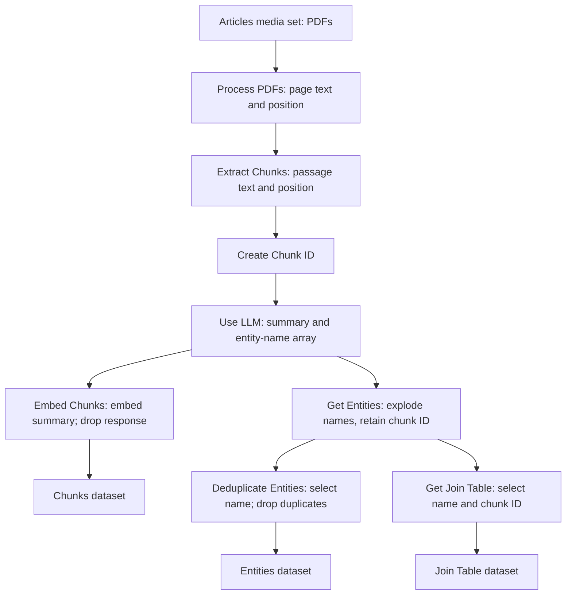

# Speedrun: Your First AIP Workflow

[Official course](https://learn.palantir.com/speedrun-your-e2e-aip-workflow) · first half inspected September 9; second half September 10, 2026.

**All 49 required lessons plus optional import lesson 08a now have detailed notes.** Lessons 26–49 are ready for review after your authorization to continue. Start with the [second-half review guide](SECOND-HALF-REVIEW.md), or revisit the [first-half guide](FIRST-HALF-REVIEW.md).

Learn moved from 0/49 to 25/49 during first-half viewing, then to **49/49 (100%)** during second-half viewing. The course overview exposes a [course certificate](https://verify.skilljar.com/c/rcsa9i6bjpb7). This is course completion, not a certification exam pass or independent mastery. No live Foundry exercises, model calls, installations, builds or assessments were performed. [Practice](PRACTICE.md) remains **Not Started**.

## The dataflow you are learning

This graph describes the course design, not a deployed pipeline. The three datasets later support Chunk/Entity objects and their relationship. Shared entity mentions provide a route to inspect passages; they do not by themselves establish causation or other typed factual relations.

## First-half lesson index

The numbered prefix counts required lessons. `08a` is the optional import alternative, preserving the 01–49 numbering. Repeated Introduction/Summary titles include module context for readability.

| # | Module | Lesson | Notes | Practice |
|---|---|---|---|---|
| 01 | Overview | [Course Introduction](01-course-introduction.md) | Ready for Review | Not Started |
| 02 | Overview | [Permissions & Help](02-permissions-and-help.md) | Ready for Review | Not Started |
| 03 | Overview | [The Use Case](03-the-use-case.md) | Ready for Review | Not Started |
| 04 | Project setup | [Introduction — Project Setup](04-project-setup-introduction.md) | Ready for Review | Not Started |
| 05 | Project setup | [Create a Foundry Learning Project](05-create-a-foundry-learning-project.md) | Ready for Review | Not Started |
| 06 | Project setup | [Create a Course-Specific Training Folder](06-create-a-course-specific-training-folder.md) | Ready for Review | Not Started |
| 07 | Uploading data | [Introduction — Uploading the Data](07-uploading-data-introduction.md) | Ready for Review | Not Started |
| 08 | Uploading data | [Upload Data](08-upload-data.md) | Ready for Review | Not Started |
| 08a | Uploading data | [[Optional] Deploy Datasets via Marketplace](08a-optional-deploy-datasets-via-marketplace.md) | Ready for Review | Not Started |
| 09 | Uploading data | [Summary — Uploading the Data](09-upload-summary.md) | Ready for Review | Not Started |
| 10 | Transforming data | [Introduction — Transforming the Data](10-transformation-introduction.md) | Ready for Review | Not Started |
| 11 | Transforming data | [Create a New Pipeline](11-create-a-new-pipeline.md) | Ready for Review | Not Started |
| 12 | Transforming data | [Add Data](12-add-data.md) | Ready for Review | Not Started |
| 13 | Transforming data | [Process PDFs](13-process-pdfs.md) | Ready for Review | Not Started |
| 14 | Transforming data | [Extract Chunks](14-extract-chunks.md) | Ready for Review | Not Started |
| 15 | Transforming data | [Create Chunk ID](15-create-chunk-id.md) | Ready for Review | Not Started |
| 16 | Transforming data | [Use LLM](16-use-llm.md) | Ready for Review | Not Started |
| 17 | Transforming data | [Embedding](17-embedding.md) | Ready for Review | Not Started |
| 18 | Transforming data | [Add Output for Chunks](18-add-output-for-chunks.md) | Ready for Review | Not Started |
| 19 | Transforming data | [Get Entities](19-get-entities.md) | Ready for Review | Not Started |
| 20 | Transforming data | [Resolve Entities](20-resolve-entities.md) | Ready for Review | Not Started |
| 21 | Transforming data | [Add Output for Entities](21-add-output-for-entities.md) | Ready for Review | Not Started |
| 22 | Transforming data | [Define Join Table](22-define-join-table.md) | Ready for Review | Not Started |
| 23 | Transforming data | [Add Output for the Join Table](23-add-output-for-join-table.md) | Ready for Review | Not Started |
| 24 | Transforming data | [Deploy Pipeline](24-deploy-pipeline.md) | Ready for Review | Not Started |
| 25 | Transforming data | [Summary — Transforming the Data](25-transformation-summary.md) | Ready for Review | Not Started |

## Second-half lesson index

| # | Module | Lesson | Notes | Practice |
|---|---|---|---|---|
| 26 | Configuring the Ontology | [Introduction — Configuring the Ontology](26-ontology-introduction.md) | Ready for Review | Not Started |
| 27 | Configuring the Ontology | [Create the Chunk Object Type](27-create-chunk-object-type.md) | Ready for Review | Not Started |
| 28 | Configuring the Ontology | [Create the Entity Object Type](28-create-entity-object-type.md) | Ready for Review | Not Started |
| 29 | Configuring the Ontology | [Configure the Object Relation](29-configure-object-relation.md) | Ready for Review | Not Started |
| 30 | Configuring the Ontology | [Summary — Configuring the Ontology](30-ontology-summary.md) | Ready for Review | Not Started |
| 31 | Exploring Object Relations | [Introduction — Exploring Object Relations](31-vertex-introduction.md) | Ready for Review | Not Started |
| 32 | Exploring Object Relations | [Create a Vertex Graph](32-create-vertex-graph.md) | Ready for Review | Not Started |
| 33 | Exploring Object Relations | [Visualize Object Relations](33-visualize-object-relations.md) | Ready for Review | Not Started |
| 34 | Exploring Object Relations | [Configure a Vertex Template](34-configure-vertex-template.md) | Ready for Review | Not Started |
| 35 | Exploring Object Relations | [Summary — Exploring Object Relations](35-vertex-summary.md) | Ready for Review | Not Started |
| 36 | Creating an AIP Logic Function | [Introduction — Creating an AIP Logic Function](36-logic-introduction.md) | Ready for Review | Not Started |
| 37 | Creating an AIP Logic Function | [Create a Logic Function](37-create-logic-function.md) | Ready for Review | Not Started |
| 38 | Creating an AIP Logic Function | [Compose Your Function](38-compose-your-function.md) | Ready for Review | Not Started |
| 39 | Creating an AIP Logic Function | [Test Your Function](39-test-your-function.md) | Ready for Review | Not Started |
| 40 | Creating an AIP Logic Function | [Publish Your Function](40-publish-your-function.md) | Ready for Review | Not Started |
| 41 | Creating an AIP Logic Function | [Summary — Creating an AIP Logic Function](41-logic-summary.md) | Ready for Review | Not Started |
| 42 | Building an App | [Introduction — Building an App](42-app-introduction.md) | Ready for Review | Not Started |
| 43 | Building an App | [Create a Workshop App](43-create-workshop-app.md) | Ready for Review | Not Started |
| 44 | Building an App | [Organize the Layout](44-organize-layout.md) | Ready for Review | Not Started |
| 45 | Building an App | [Get User Input](45-get-user-input.md) | Ready for Review | Not Started |
| 46 | Building an App | [Display Objects](46-display-objects.md) | Ready for Review | Not Started |
| 47 | Building an App | [Display Object Relations](47-display-object-relations.md) | Ready for Review | Not Started |
| 48 | Building an App | [Display AIP Response](48-display-aip-response.md) | Ready for Review | Not Started |
| 49 | Conclusion | [Conclusion](49-conclusion.md) | Ready for Review | Not Started |

Optional course feedback is separate and was not submitted.

[Sources and interpretation checks](SOURCES-AND-CORRECTIONS.md) · [Practice plan](PRACTICE.md) · [Central progress](../../PROGRESS.md) · [Study plan](../../STUDY-PLAN.md)

The [second-half dataflow diagram](SECOND-HALF-REVIEW.md#the-two-paths-matter) distinguishes Workshop retrieval from Logic retrieval. Prior files are preserved in the [September 10 archive](../../study-backups/2026-09-10/aip-second-half-depth/notes-before.tar.gz).

**Go deeper in the Ontology area:** [16 — AI and agents](../../Ontology/16-ai-and-agents/README.md)
