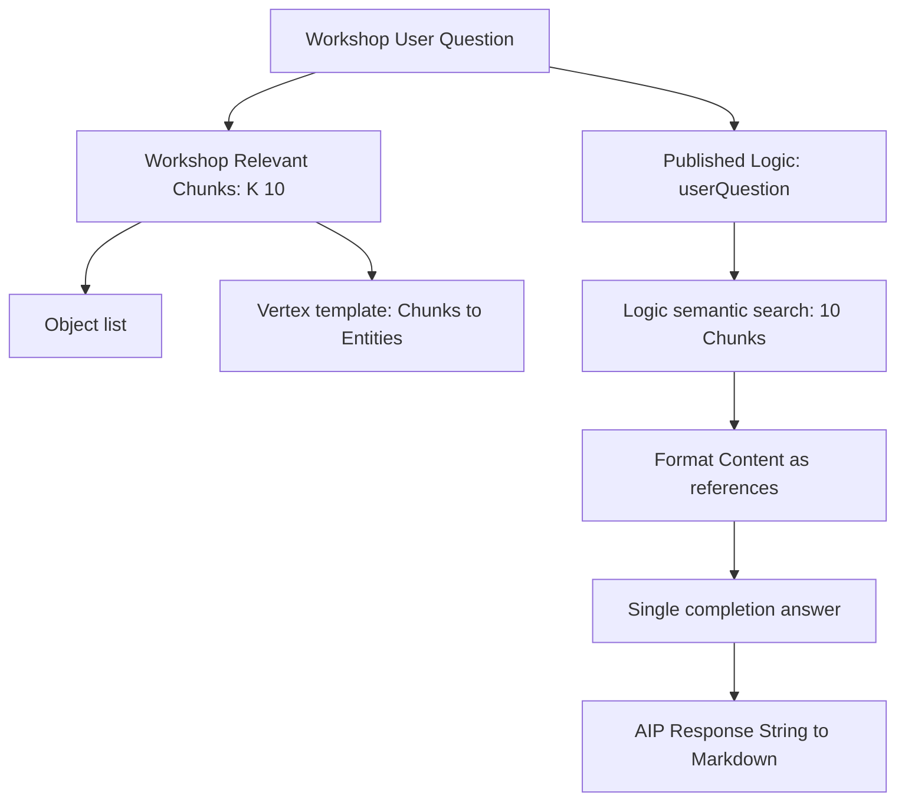

# Second-half review: from datasets to a question-answering app

**Lessons 26–49 are ready for review.** All 49 required lessons plus optional import lesson 08a now have detailed notes. Continuation after the first half was authorized; independent understanding and practical mastery remain separate.

## Where to focus

| Topic | Lessons | What you should be able to explain |
|---|---|---|
| Ontology | [26](26-ontology-introduction.md)–[30](30-ontology-summary.md) | Dataset versus type versus object; identity, title, media reference and join-table mapping |
| Vertex | [31](31-vertex-introduction.md)–[35](35-vertex-summary.md) | A selected graph versus a parameterized template; Search Around and edge meaning |
| Logic | [36](36-logic-introduction.md)–[41](41-logic-summary.md) | Question input, bounded semantic retrieval, Content formatting, single completion and publication |
| Workshop | [42](42-app-introduction.md)–[48](48-display-aip-response.md) | Variable bindings, the two retrieval paths, graph input and function-backed String output |
| Whole workflow | [49](49-conclusion.md) | What course completion establishes and what still needs practical evidence |

The most detailed integration notes are [27](27-create-chunk-object-type.md), [38](38-compose-your-function.md), [46](46-display-objects.md) and [48](48-display-aip-response.md).

## The two paths matter

This is the course's configured dataflow. Relevant Chunks is not passed to the Logic function; only the question is passed. Matching query text and result counts do not make two searches the same stored result.

## A synthetic evidence-alignment example

Suppose Workshop displays C1, C2 and C3, while a Logic preview uses C1, C2 and C4. This is an invented diagnostic example, not an observed mismatch. It shows why equal result counts are insufficient: one reference differs.

If C3 mentions Entity X, the graph can show X even though C3 was not in the generation references. If C4 supports a sentence in the answer, that support may be absent from the displayed list. The app can appear coherent while its evidence display is incomplete for that particular answer.

During practice, compare actual identities under a controlled question, configuration and data state. A future design can share retrieval or return reference IDs with the answer. That would require a deliberate contract change; it is not already implemented by this tutorial.

## Questions to try before reading the guidance

1. Why is Chunk Id the primary key while Summary is the title?
2. What does configuring Media Reference add beyond storing a string-like reference?
3. Why can a saved object type still have no usable objects in a consumer?
4. Why is Entity Name being both key and title a limited identity policy?
5. How do entityName and chunkId map the join table to the relationship endpoints?
6. What does Search Around do, and what does Radial layout do?
7. What is the input contract of the Vertex template?
8. Which text was embedded, and which text is passed to the answering LLM?
9. Does ten retrieved chunks mean all relevant evidence was found?
10. Is the configured Logic function an autonomous tool-using agent?
11. What should an unsupported-question test establish?
12. What distinguishes a saved Logic resource, published function and published Workshop app?
13. Why is AIP Response a String rather than an object set?
14. Why can a static template selection produce a changing graph?
15. Why is the graph not automatically a trace of the exact answer references?
16. What can Learn 49/49 establish without any Foundry practice?

## Answer guidance

1. Identity needs the designed unique key; a generated summary is a readable label that can change or resemble another label.
2. The property is configured as media-aware and associated with the correct Articles media set. This supports interpretation of the source reference; actual document access and page correctness still need testing.
3. Check backing data, indexing, Ontology branch/proposal context and access. Saving schema and serving indexed objects are separate stages.
4. The first-half pipeline only deduplicated names. Aliases and ambiguity remain; the object type does not add semantic disambiguation.
5. Each pair's entityName identifies an Entity and chunkId identifies a Chunk. Both endpoints must exist and match the intended keys.
6. Search Around traverses a configured link. Radial arranges the displayed objects. Neither proves a causal relationship or improves source extraction.
7. It accepts the intended Chunk object set and follows the configured relationship to Entities. It is a reusable view procedure rather than the original fixed sample.
8. The pipeline embedded generated summaries. Logic formats retrieved Content into the task prompt. Retrieval representation and answer evidence are different.
9. No. Ten is a bounded nearest-results setting, not an exhaustive search or confidence guarantee. Similar passages may still be unhelpful.
10. The shown implementation uses semantic search followed by Single completion. Broader agent/tool modes are discussed but not configured; no Entity-edit tool is added to this answer path.
11. The answer should acknowledge insufficient references rather than invent support. Compare the actual retrieved content and output; one successful test is limited evidence.
12. Saving records authoring state, publishing exposes the function contract, and publishing Workshop exposes the app configuration. Each needs its own verification.
13. The steps create a function-backed String for Markdown. The lesson's isolated reference to an object-set variable conflicts with that explicit setup and is not the intended type.
14. The backing template resource is fixed while Relevant Chunks changes. Renderer definition and input data are separate.
15. The graph consumes Workshop retrieval; Logic retrieves independently. Compare IDs or change the contract before claiming exact correspondence.
16. The portal recorded all required lesson views. It does not prove practical execution, independent comprehension or a certification exam pass.

## Before practical work

Review the unresolved checks in [sources and corrections](SOURCES-AND-CORRECTIONS.md) and the expanded [practice plan](PRACTICE.md). Important checks include branch/indexing access, media and embedding property configuration, actual retrieval IDs, unsupported-question behavior and current published bindings.

Please review whether the explanations now let you describe why each component exists and how to diagnose an incorrect result. Point out any passage that still assumes too much Foundry knowledge.

Learn was confirmed at **49/49 (100%) on September 10, 2026**. No Foundry objects, models, pipelines, functions or apps were created or executed in this notes phase. Practice remains **Not Started**.
