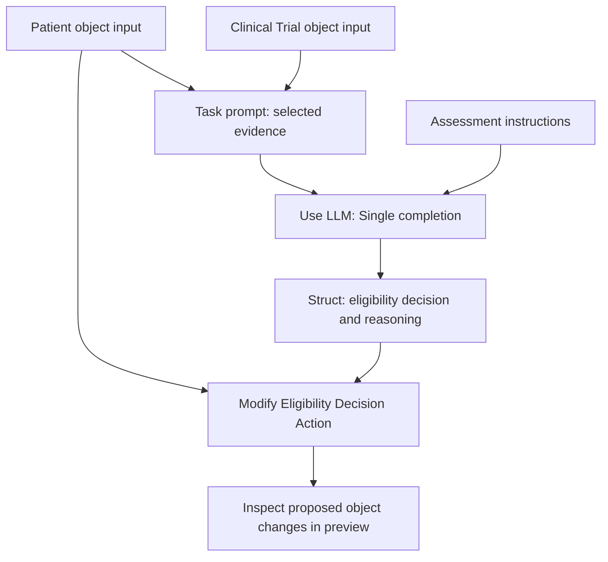

# Speedrun: Your First Agentic AIP Workflow

[Official course](https://learn.palantir.com/speedrun-your-first-agentic-aip-workflow) · inspected September 12, 2026 · published duration 1–2 hours.

**All 38 lesson notes are prepared.** Lessons 19–38 are Ready for Review after authorization to continue. Start with the [second-half review guide](SECOND-HALF-REVIEW.md); the [first-half guide](FIRST-HALF-REVIEW.md) remains available.

Learn changed from **0/38 → 18/38 → 38/38 (100%)** through lesson viewing on September 12, 2026. The overview provides a [course certificate](https://verify.skilljar.com/c/m5jt8wrr4avw). No Foundry installation, model call, preview, Ontology update, evaluation, publication or automation was executed. [Practice](PRACTICE.md) remains **Not Started**. Course completion is separate from certification exams and independent mastery.

## The design you are learning

The builder fixes this sequence. Generic course discussion of dynamic tool selection is broader than the configured exercise. An uncertainty label does not itself create a staffed review queue, and an eligibility update is not proof of enrollment. See [source corrections](SOURCES-AND-CORRECTIONS.md).

## First-half lesson index

Repeated Introduction/Summary titles retain their official wording; the module column distinguishes them. All rows below are Ready for Review, with practice Not Started. Review sessions A–C are proposed in the review guide, not logged study time.

| # | Module | Lesson | Planned review |
|---|---|---|---|
| 01 | Overview | [Course Introduction](01-course-introduction.md) | A |
| 02 | Overview | [Requirements](02-requirements.md) | A |
| 03 | Overview | [Permissions & Help](03-permissions-and-help.md) | A |
| 04 | Overview | [The Use Case](04-the-use-case.md) | A |
| 05 | Setting Up Your Project & Folder | [Introduction](05-project-setup-introduction.md) | A |
| 06 | Setting Up Your Project & Folder | [Create a Foundry Learning Project](06-create-a-foundry-learning-project.md) | A |
| 07 | Setting Up Your Project & Folder | [Create a Course-Specific Training Folder](07-create-course-specific-training-folder.md) | A |
| 08 | Install Foundational Ontology & Understand Agentic Workflow | [Introduction](08-foundational-ontology-introduction.md) | B |
| 09 | Install Foundational Ontology & Understand Agentic Workflow | [Install the Marketplace Product](09-install-marketplace-product.md) | B |
| 10 | Install Foundational Ontology & Understand Agentic Workflow | [Explore the Application](10-explore-application.md) | B |
| 11 | Install Foundational Ontology & Understand Agentic Workflow | [Understand Human-AI Teaming in the Agentic Workflow](11-human-ai-teaming.md) | B |
| 12 | Create an Agent | [Introduction](12-create-agent-introduction.md) | B |
| 13 | Create an Agent | [Create an AIP Logic](13-create-aip-logic.md) | B |
| 14 | Create an Agent | [Configure Inputs](14-configure-inputs.md) | C |
| 15 | Create an Agent | [Compose the LLM Part of your Logic](15-compose-llm-logic.md) | C |
| 16 | Create an Agent | [Instruct Agent to Edit your Ontology](16-instruct-agent-edit-ontology.md) | C |
| 17 | Create an Agent | [Preview Results of your Agent](17-preview-agent-results.md) | C |
| 18 | Create an Agent | [Summary](18-create-agent-summary.md) | C |

## Second-half lesson index

All rows below are Ready for Review; practice remains Not Started. Suggested review session: the next two-hour orientation block in the second-half guide, with follow-up blocks for unresolved topics.

| # | Module | Lesson | Status |
|---|---|---|---|
| 19 | Evaluate your Agent | [Introduction](19-evaluation-introduction.md) | Ready for Review |
| 20 | Evaluate your Agent | [Expose LLM Output to Evaluation](20-expose-llm-output.md) | Ready for Review |
| 21 | Evaluate your Agent | [Create an Evaluation Suite](21-create-evaluation-suite.md) | Ready for Review |
| 22 | Evaluate your Agent | [Configure an Evaluator](22-configure-evaluator.md) | Ready for Review |
| 23 | Evaluate your Agent | [Configure Test Cases](23-configure-test-cases.md) | Ready for Review |
| 24 | Evaluate your Agent | [Run the Evaluation Suite](24-run-evaluation-suite.md) | Ready for Review |
| 25 | Evaluate your Agent | [Inspect the Results](25-inspect-evaluation-results.md) | Ready for Review |
| 26 | Evaluate your Agent | [Compare Results to Another LLM](26-compare-another-llm.md) | Ready for Review |
| 27 | Evaluate your Agent | [Summary](27-evaluation-summary.md) | Ready for Review |
| 28 | Automate your Agent | [Introduction](28-automation-introduction.md) | Ready for Review |
| 29 | Automate your Agent | [Publish your Agent](29-publish-agent.md) | Ready for Review |
| 30 | Automate your Agent | [Create Automation](30-create-automation.md) | Ready for Review |
| 31 | Automate your Agent | [Execute your Automation](31-execute-automation.md) | Ready for Review |
| 32 | Automate your Agent | [Observe the Automation Effects](32-observe-automation-effects.md) | Ready for Review |
| 33 | Automate your Agent | [Add a New Patient](33-add-new-patient.md) | Ready for Review |
| 34 | Automate your Agent | [Observe Automatic Processing by your AIP Agent](34-observe-automatic-processing.md) | Ready for Review |
| 35 | Automate your Agent | [Summary](35-automation-summary.md) | Ready for Review |
| 36 | Conclusion | [Next Steps: Further Automation and Human-AI Teaming](36-further-automation-human-teaming.md) | Ready for Review |
| 37 | Conclusion | [Next Steps: Interactive AIP Agents](37-interactive-aip-agents.md) | Ready for Review |
| 38 | Conclusion | [Conclusion](38-conclusion.md) | Ready for Review |

## Important open checks

- Validate the prompt correction against the installed output schema and Action parameters.
- Inspect accepted Action values, including Manual review required.
- Verify which model is used by the installed pipeline and by the authored LLM block.
- Inspect actual Logic execution and write settings before interpreting a future run.
- Identify how a human will receive and resolve uncertain cases; a label alone does not establish this.
- Inspect evaluator options, expected-case evidence and the selected published function version.
- Verify automatic triggering separately from manual execution and confirm write-mode/effect compatibility.

[Practice plan](PRACTICE.md) · [Source and correction register](SOURCES-AND-CORRECTIONS.md) · [Central progress](../../PROGRESS.md) · [Study plan](../../STUDY-PLAN.md)

**Go deeper in the Ontology area:** [16 — AI and agents](../../Ontology/16-ai-and-agents/README.md)
