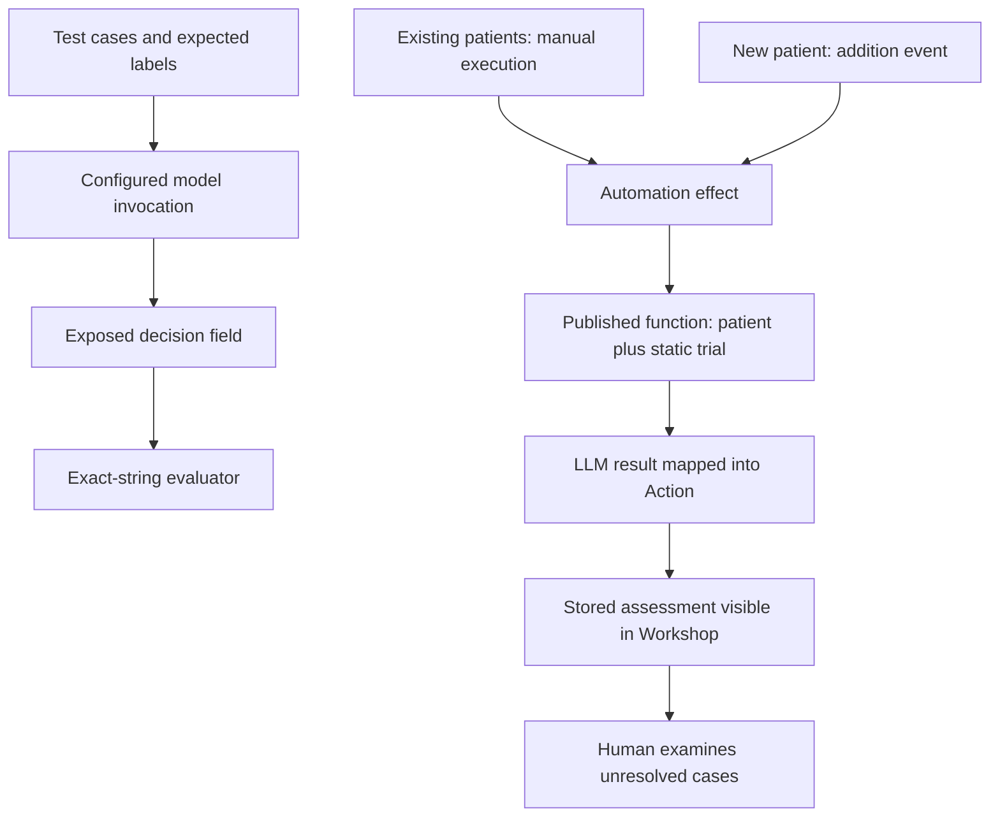

# Second-half review — Your First Agentic AIP Workflow

**Lessons 19–38 are Ready for Review. All 38 lesson notes are now prepared.** Continuation was authorized; learner comprehension is not inferred from that authorization. Learn shows 38/38 after page viewing on September 12, 2026. Practical work remains Not Started.

## The most important connections

Read [the evaluator](22-configure-evaluator.md) and [test cases](23-configure-test-cases.md) together: the course compares one decision string against a supplied expected label for each of three fictional patients. It does not score every part of the workflow or cover all possible inputs.

Then connect [model comparison](26-compare-another-llm.md) with [publication](29-publish-agent.md): publish the configuration you deliberately selected, and record the version actually consumed by the automation.

Finally, compare [manual execution](31-execute-automation.md) with [automatic processing](34-observe-automatic-processing.md). They can produce similar visible results through different invocation paths. Evidence of one is not evidence of the other.

## Two paths through the system

This is a learning diagram, not a deployed system. The evaluation branch measures a decision field; it does not prove the operational branch. The shown course effect automatically runs edits. Actual write-mode compatibility must be inspected before later execution.

## Worked example: why the score can mislead

This is a supplemental equipment-loan example, with the same three-label vocabulary. Assume the expected labels were independently established from a fictional policy.

| Case | Expected | Model A | Model B |
|---|---|---|---|
| Confirmed compliance | Suitable | Suitable | Suitable |
| Known failure | Not suitable | Suitable | Not suitable |
| Relevant evidence missing | Manual review required | Manual review required | Manual review required |

Under a simple one-comparison-per-case calculation, A matches 2/3 (about 66.7%) and B matches 3/3 (100%). These are illustrative values, not results from Foundry.

B did better on these observed labels. However, suppose B invents a reason in the missing-evidence case. The exact-label score still passes. Suppose the Action is bound to the wrong applicant: the score still passes. Suppose no new-object event ever invokes the function: the score still passes. These failures lie outside the configured comparison.

Before choosing B, verify that both runs used the same prompt, evaluator and evidence, inspect case details and collect broader evidence where needed. Never turn three examples into a claim of universal accuracy.

## Worked trace: manual versus automatic

A manual run processes the existing population. You see updated fields in Workshop. That verifies the manual path only to the extent supported by the run and object evidence.

Now create one fictional new object during later practice. Correlate its identity with the addition event, confirm the effect receives that object and the intended static trial, inspect the effect status, then find the stored result in the application. This verifies the automatic path for that case.

If the object vanishes from a Pending-only view, remove that filter and locate its identity. The assessment may have completed; disappearance from a filtered table is not evidence of deletion. If it remains Pending, inspect the event and effect stages before rerunning anything.

## Questions for active recall

1. Why expose Use LLM output rather than only inspect the final function result?
2. Which exact field is scored in the course?
3. What do the three official cases cover, and what do they leave out?
4. Why can a correct label still be a poor assessment?
5. How can mutable object data confound a model comparison?
6. What should remain fixed when comparing two models?
7. How does a run error differ from a failed label comparison?
8. What is the difference between saving, publishing and invoking?
9. Where does the automation get `patient`, and where does it get `clinicalTrial`?
10. Why is the static trial a limitation when extending the design?
11. What does manual execution verify that an evaluation score does not?
12. What does manual execution fail to verify about new patients?
13. How do internal staged writes differ from staging an Action for approval?
14. What does the course's Automatically run edits setting imply?
15. What evidence links a newly created patient to automatic processing?
16. Why might the Pending filter no longer show the new patient?
17. What remains necessary for a reliable manual-review handoff?
18. What is the current documentation name for the course's AIP Agent Studio?

## Answer guidance

1. It creates a measurement point for the model's intermediate result. The scoring target is distinct from assumptions about execution isolation.
2. `Use LLM (block).eligibility_decision`, compared with the case's Expected value.
3. Three outcome categories. They do not cover every evidence combination, boundary, error, explanation or edit behavior.
4. The reason may be unsupported or the operational target/mapping may be wrong.
5. The same object reference may supply different properties at different times; record the evidence/version used.
6. Prompt, schema, evaluator options, expected labels and input evidence, so the model is the intended changed variable.
7. An error prevents or disrupts execution; a mismatch is an observed output that fails the comparison. Report both.
8. Saving retains edits; publishing exposes an identifiable callable configuration; invocation executes a configured version.
9. The triggering Patient object supplies `patient`; the course binds one Static object for `clinicalTrial`.
10. It does not select the appropriate trial dynamically or assess all patient/trial pairs.
11. It exercises the effect path for selected existing objects and can provide persisted-result evidence.
12. Detection and processing of a new-object event must be verified separately.
13. Internal staged writes concern function edit semantics. Approval staging concerns a human approval step before effects are applied; the concepts are distinct.
14. The shown course effect applies its edits automatically. The Manual review required label is not itself an approval-staging control.
15. Matching object identity, addition event, effect inputs/version, completed status and stored fields.
16. Asynchronous processing may have changed its decision; inspect identity across states before resubmitting.
17. Visibility, ownership, useful evidence and a way to resolve the case. A stored label alone is insufficient.
18. AIP Chatbot Studio; the official linked overview documents the rename.

## Proposed next two-hour review

Spend 50 minutes on evaluation lessons 19–27, 45 minutes on automation lessons 28–35, and 25 minutes on the examples and conclusion questions. This is an orientation block, not a requirement to rush every detail into two hours. Carry unresolved topics into another block if needed. No learner hours are logged automatically, and the original deadline shortfall remains an unresolved planning issue.

**ACTION REQUIRED FROM ME**

Review the second-half notes, especially lessons 22–23 and 30–34. Tell me which explanations or questions need more detail. After understanding gaps are resolved, use the separately planned Foundry practice phase; no live build or assessment is claimed here.

[Course index](README.md) · [Practice plan](PRACTICE.md) · [Source corrections](SOURCES-AND-CORRECTIONS.md)
